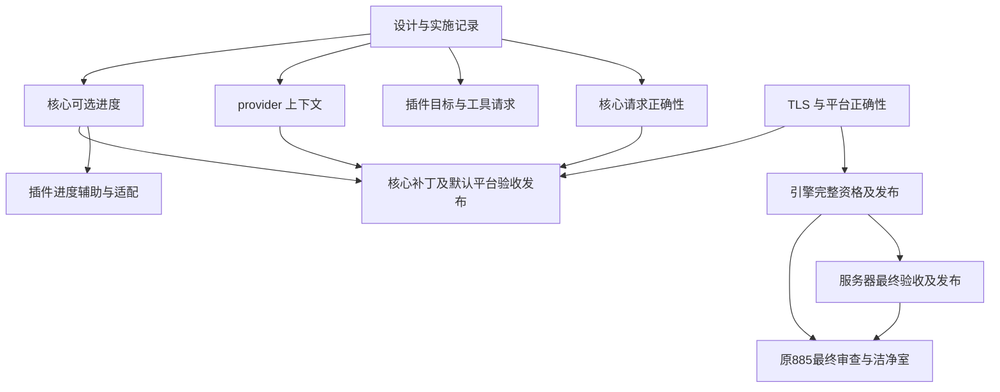

# 生态 885 与异构构建补充方案的实现依赖

**读者：** 推进 mcpp、插件、平台及语言服务发布的维护者。

**本文回答的问题：** 已确认的设计分别如何实现、验证和发布，哪些工作确实互为前置。

**范围之外：** 把局部实验等同完整验收，以及未经验证的全部 HPC 覆盖承诺。

日期：2026-11-05。相关规范：[构建插件](../../docs/specs/build-plugins.md)、
[平台](../../docs/specs/platforms.md)、[目标侧](../../docs/specs/target-side.md)。
依据：[补充方案](2026-11-05-heterogeneous-build-semantics-and-plugin-boundaries-supplement.md)、
[第二轮实验](2026-11-05-heterogeneous-build-research-and-experiments.md)、
[mcpp#885](https://github.com/mcpp-community/mcpp/issues/885)、
[mcpp#887](https://github.com/mcpp-community/mcpp/issues/887)。

状态：用户已要求继续实现 #885 与补充子方案。按工作主题分别提交 PR，不以其中
一个主题通过代表其他主题完成。以下为启动时状态；后续按具名检查点追加实证。

## 1. 当前交付与剩余范围

mcpp 2026.11.3.1 已发布，内置平台 0.23.3；公开平台已到 0.23.5，消费者可以显式
选择。IDE 0.2.0 已交付。原 #885 的引擎、服务器及最终验收仍需闭环，不能只凭新
方案实现完成就关闭原交付。

复核到引擎候选 `39f8589` 的完整 CI `41901404153` 已终止失败；两个 Linux 映像
均因原生 TLS 段和 TLS 重定位被 seal 拒绝，没有 bundle。旧观察器已停止，未从
失败构建触发诊断发布或资格提升。服务器对应候选也不能据此获准发布。

## 2. 实现批次

| 编号 | 改动主题 | 真正前置 | 验证与退出条件 |
|---|---|---|---|
| I0 | 保存设计、实验及依赖记录 | 已有用户实现指令 | 独立文档 PR，引用可定位、状态不夸大 |
| I1 | 核心完整请求验证、重复实现政策与集合规范化 | 无其他实现前置 | 新二进制的非法输入、次序及有效输入 E2E；比较单测；旧合法元数据保持兼容 |
| I2 | 插件 L2 统一读取；SYCL 归属目标及按需工具；相邻规则复核 | 通用语义已定；可与 I1 同时实现 | 单实现、混合目标、负向请求、工具可见性及多阶段实际产物 |
| I3 | requirement 消费上下文与 exclusive 链接闭包 | 无 I1/I2 前置 | 独立程序、应用供给、同程序冲突、共享库及身份控制 |
| I4 | 核心可选 action 进度 | 现有 action/执行模型 | 各角色、并发、关闭、失败、取消、普通及机器输出；真实产物不作为 stamp |
| I5 | 插件进度写入辅助与外部构建适配 | I4 的协议和运行通道 | 新核心集成，旧核心有明确可选降级；未知总量与限频 |
| I6 | 平台默认版本跟进与核心补丁发布 | 对应平台公开可安装，核心改动通过各自门槛 | 默认/显式/锁、std BMI、宿主与目标图、launcher 自举及完整发布资产 |
| L1 | 引擎 ThinLTO 的 TLS 正确性 | 小型双架构控制定位 | 平台约定覆盖最终 LTO codegen；seal 与执行控制，不移除检查 |
| L2 | 原 #885 引擎资格与发布 | L1，平台及依赖已公开 | 完整 CI、原始工作负载和性能门槛、台账、双源产物校验 |
| L3 | 原 #885 服务器资格与发布 | L2 的合格引擎 | 更新候选/lock，最终 CI 与已发布引擎一致，再发布 |
| L4 | 原 #885 最终审查、洁净室及清理 | L2、L3 及其余原门槛 | 最终数字与真实公开安装，证据保存，相关项目仅保留最近构建 |

I1、I2、I3、I4 可分别推进；发布时只声明实际完成范围。I2 的普通修复不等待新核心
进度接口，也不等待完整多节点测试。I4 的核心与 I5 的辅助保持版本边界。
多目标归档的独立 SDK 失败继续在工具链/插件流程中定位，不作为新增核心模式的
理由。安装目录污染按不可变发行包契约处理，不把全量哈希所有包放到每次构建中。

## 3. 依赖图

图中的文档前置是交付记录，不要求等待文档 CI 才开始本地实现。没有画出 I2 到
L2 的边，因为语言服务引擎不依赖 SYCL 目标修复。I6 的合并与发布次序按最终
实际兼容性安排，不从图推出可绕过某项 required check。

## 4. 启动控制：ThinLTO 丢失最终 TLS codegen 约定

LLVM 23.1.3 上将 `__thread` 变量用 `-femulated-tls -flto=thin -fPIC` 编译为 bitcode，
再以 ld.lld 链接。x86_64 默认 LTO 输出含 TLS 段及 DTPMOD/DTPOFF 重定位，
aarch64 含 TLS 段及 TLSDESC。最终链接增加 `-mllvm -emulated-tls` 后，两者均无
TLS 段，转为 `__emutls_get_address` 与 emulated storage。

该双架构小型复现与真实 CI 拒绝一致，证据位于
`/tmp/mcpp-885-thinlto-tls-fix/results.json`。它不等于 clangd 完整资格通过。
该约定属于映像平台的链接/codegen 契约，优先在平台数据中补齐，使其他 LTO
消费者同样受益；不在通用 mcpp 核心增加 openkal TLS 分支。

## 5. 实现检查点（2026-11-05）：请求、消费上下文及平台

I1 已在同一核心 PR #888 提交。新二进制通过 23 项 accelerator 单测和 E2E 1011。
I3 第一批实现将 provider/requirement/exclusive 的身份改为包索引，按所选消费包的
普通依赖闭包验证；宿主构建边不进入目标上下文。库 requirement 在最终消费者内
绑定，应用可以通过兄弟依赖供给。工作空间根 pin、成员 pin、CLI pin 依次覆盖，
短名只有唯一匹配时可用，同短名跨 namespace 可以使用完整 `namespace:name`。
绑定仍只验证，普通依赖继续决定编译和链接输入，没有借 pin 删除其他实现。

新二进制的 E2E 1012 通过独立 exclusive、应用供给、缺失供给、同程序互斥、成员
与 CLI pin、跨 namespace 同短名和完整身份控制。原 E2E 81、601 同样通过。
共享库、测试与宿主工具的进一步控制以及完整核心 CI 仍待完成，不据此宣布 I3
全部验收。I4/I5 的可选进度尚未实现。

插件实际实现复用 #52（提交 `8d4b150`），保留原 CMake cross contract。46 项
plugin-logic、真实 musl CMake cross build/run、真实 SYCL 旧写法、独占 NVIDIA、
双 NVIDIA 与 SPIR-V/NVIDIA 混合构建通过。规则设备链接命令的中间产物已核验
双 NVIDIA fatbin 与混合 SPIR-V/NVIDIA 镜像。当前驱动返回 CUDA 803，GPU 执行
未获资格。多目标静态归档的 SDK 流程仍待定位。

平台修复 PR #19 的四种宿主完整 CI `41922140543` 全部通过，已发布 0.23.6。
GitHub/GitCode 源码一致，SHA256 为
`51903d50b436e81047b74b460ea1e7e23be25704ab601438b160b9370a7017c2`。
索引 PR #709 的候选与消费者检查通过并合入，发布任务已触发。引擎 PR #16 的
平台选择已更新到该版本，须待公开索引可安装后重跑完整资格。原性能、seal 和
补丁台账门槛保留。服务器 PR #75 第三次尝试的独立 macOS job 已通过，目前失败
只剩严格引擎候选门槛，服务器最终发布仍等待合格引擎。

## 6. 发布执行约束（2026-11-05，用户补充）

核心 PR #888 同时携带构建版本 `2026.11.5.1`；bootstrap 保持公开的
`2026.11.3.1`，不提前安装未发布版本。中英文使用文档、协议及插件文档与最终
实现同轮更新。

最终提交的核心 CI 通过后，再独立完成一次生态视角 PR review。审查涵盖插件新旧
接口、宿主/目标图、平台默认及显式覆盖、交叉构建、打包与发布资产、语言服务和
增量行为；将发现、证据及限制记录在本方案中。未经该审查不得合入或创建发布 tag。
如审查需要改代码或文档，则修正后以新提交重新完成适用检查。

确认无问题后合入 #888；先取消该合入触发的 main CI，再创建新版本 tag，优先
执行 Release CI。Release 的完整平台资产、镜像和索引可安装性验收完成后，再从
main 显式触发常规 CI。记录合入 SHA、被取消的 run、Release run、公开安装证据
和重新触发的 main run，避免用旧提交或上一轮 CI 代替本轮验收。

I4 当前本地集成控制已通过五种 action 角色、真实对象链接运行、关闭开关、JSON
输出及内部计数完成后的失败退出。新增进程组取消控制检出中断退出未清理通道，
现已接入现有 `mcpp::run::add_cleanup`；仍待新版本二进制重建后复验，不将修改
意图计为通过。

## 7. 新版本本地检查点（2026-11-05）

候选二进制实际报告 `mcpp 2026.11.5.1`，SHA256 为
`26bee63a21372057d01c95dc3a18e832b3ae67fc7b4251b2e2b90488464ddd50`。
该二进制通过 E2E 01、1011、扩展 1012、1013。1012 追加共享 provider、测试链接
单元与 host-only 不能供给 target requirement 控制；1013 的进程组取消清理复验
通过。此前进度解析单测 3 项通过；新版本完整 directives 单测仍在执行。

默认平台已在现有隔离 GLOBAL 洁净室的新中性项目验证：没有 `platform` 覆盖，
实际从公开索引解析 0.23.6；ThinLTO 的 x86_64 映像封装并运行输出 TLS 值 7，
aarch64 映像交叉构建和封装通过。该项使用本地候选编译器和公开平台依赖，不能
等同最终发布资产安装验收。证据为
`/tmp/mcpp-885-core11351-default-platform-verified.json`。

插件进度辅助已追加至 #52（`d215e0d`），逻辑测试 49/49 通过。通用 enable/快照
类型放在标准库辅助，原子文件 writer 为独立可选 feature，复用 os.fs；普通 CMake
消费方不因启用阶段报告引入该运行库。CMake adapter 在新核心下真实构建并运行，
独立实跑验证快照有效、正常阶段报告和不可写通道不影响构建。它只报告自己拥有的
configure/build-install 阶段，不估计未掌握的编译任务总数。旧核心下退化保持可用。

中英文核心使用文档、SPEC-007 及其目录、平台默认示例已同步。结构与风格检查
通过，修改的文档已用 pandoc 渲染并进行第二遍阅读。以上是 CI 前的本地检查；
用户要求的最终生态 review 仍待最终提交 CI 通过后执行。
