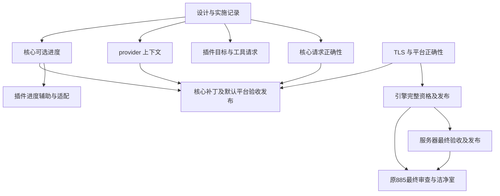

# 生态 885 与异构构建补充方案的实现依赖

**读者：** 推进 mcpp、插件、平台及语言服务发布的维护者。

**本文回答的问题：** 已确认的设计分别如何实现、验证和发布，哪些工作确实互为前置。

**范围之外：** 把局部实验等同完整验收，以及未经验证的全部 HPC 覆盖承诺。

日期：2026-11-05。相关规范：[构建插件](../../docs/specs/build-plugins.md)、
[平台](../../docs/specs/platforms.md)、[目标侧](../../docs/specs/target-side.md)。
依据：[补充方案](2026-11-05-heterogeneous-build-semantics-and-plugin-boundaries-supplement.md)、
[第二轮实验](2026-11-05-heterogeneous-build-research-and-experiments.md)、
[mcpp#885](https://github.com/mcpp-community/mcpp/issues/885)、
[mcpp#887](https://github.com/mcpp-community/mcpp/issues/887)。

状态：用户已要求继续实现 #885 与补充子方案。按工作主题分别提交 PR，不以其中
一个主题通过代表其他主题完成。以下为启动时状态；后续按具名检查点追加实证。

## 1. 当前交付与剩余范围

mcpp 2026.11.3.1 已发布，内置平台 0.23.3；公开平台已到 0.23.5，消费者可以显式
选择。IDE 0.2.0 已交付。原 #885 的引擎、服务器及最终验收仍需闭环，不能只凭新
方案实现完成就关闭原交付。

复核到引擎候选 `39f8589` 的完整 CI `41901404153` 已终止失败；两个 Linux 映像
均因原生 TLS 段和 TLS 重定位被 seal 拒绝，没有 bundle。旧观察器已停止，未从
失败构建触发诊断发布或资格提升。服务器对应候选也不能据此获准发布。

## 2. 实现批次

| 编号 | 改动主题 | 真正前置 | 验证与退出条件 |
|---|---|---|---|
| I0 | 保存设计、实验及依赖记录 | 已有用户实现指令 | 独立文档 PR，引用可定位、状态不夸大 |
| I1 | 核心完整请求验证、重复实现政策与集合规范化 | 无其他实现前置 | 新二进制的非法输入、次序及有效输入 E2E；比较单测；旧合法元数据保持兼容 |
| I2 | 插件 L2 统一读取；SYCL 归属目标及按需工具；相邻规则复核 | 通用语义已定；可与 I1 同时实现 | 单实现、混合目标、负向请求、工具可见性及多阶段实际产物 |
| I3 | requirement 消费上下文与 exclusive 链接闭包 | 无 I1/I2 前置 | 独立程序、应用供给、同程序冲突、共享库及身份控制 |
| I4 | 核心可选 action 进度 | 现有 action/执行模型 | 各角色、并发、关闭、失败、取消、普通及机器输出；真实产物不作为 stamp |
| I5 | 插件进度写入辅助与外部构建适配 | I4 的协议和运行通道 | 新核心集成，旧核心有明确可选降级；未知总量与限频 |
| I6 | 平台默认版本跟进与核心补丁发布 | 对应平台公开可安装，核心改动通过各自门槛 | 默认/显式/锁、std BMI、宿主与目标图、launcher 自举及完整发布资产 |
| L1 | 引擎 ThinLTO 的 TLS 正确性 | 小型双架构控制定位 | 平台约定覆盖最终 LTO codegen；seal 与执行控制，不移除检查 |
| L2 | 原 #885 引擎资格与发布 | L1，平台及依赖已公开 | 完整 CI、原始工作负载和性能门槛、台账、双源产物校验 |
| L3 | 原 #885 服务器资格与发布 | L2 的合格引擎 | 更新候选/lock，最终 CI 与已发布引擎一致，再发布 |
| L4 | 原 #885 最终审查、洁净室及清理 | L2、L3 及其余原门槛 | 最终数字与真实公开安装，证据保存，相关项目仅保留最近构建 |

I1、I2、I3、I4 可分别推进；发布时只声明实际完成范围。I2 的普通修复不等待新核心
进度接口，也不等待完整多节点测试。I4 的核心与 I5 的辅助保持版本边界。
多目标归档的独立 SDK 失败继续在工具链/插件流程中定位，不作为新增核心模式的
理由。安装目录污染按不可变发行包契约处理，不把全量哈希所有包放到每次构建中。

## 3. 依赖图

图中的文档前置是交付记录，不要求等待文档 CI 才开始本地实现。没有画出 I2 到
L2 的边，因为语言服务引擎不依赖 SYCL 目标修复。I6 的合并与发布次序按最终
实际兼容性安排，不从图推出可绕过某项 required check。

## 4. 启动控制：ThinLTO 丢失最终 TLS codegen 约定

LLVM 23.1.3 上将 `__thread` 变量用 `-femulated-tls -flto=thin -fPIC` 编译为 bitcode，
再以 ld.lld 链接。x86_64 默认 LTO 输出含 TLS 段及 DTPMOD/DTPOFF 重定位，
aarch64 含 TLS 段及 TLSDESC。最终链接增加 `-mllvm -emulated-tls` 后，两者均无
TLS 段，转为 `__emutls_get_address` 与 emulated storage。

该双架构小型复现与真实 CI 拒绝一致，证据位于
`/tmp/mcpp-885-thinlto-tls-fix/results.json`。它不等于 clangd 完整资格通过。
该约定属于映像平台的链接/codegen 契约，优先在平台数据中补齐，使其他 LTO
消费者同样受益；不在通用 mcpp 核心增加 openkal TLS 分支。
