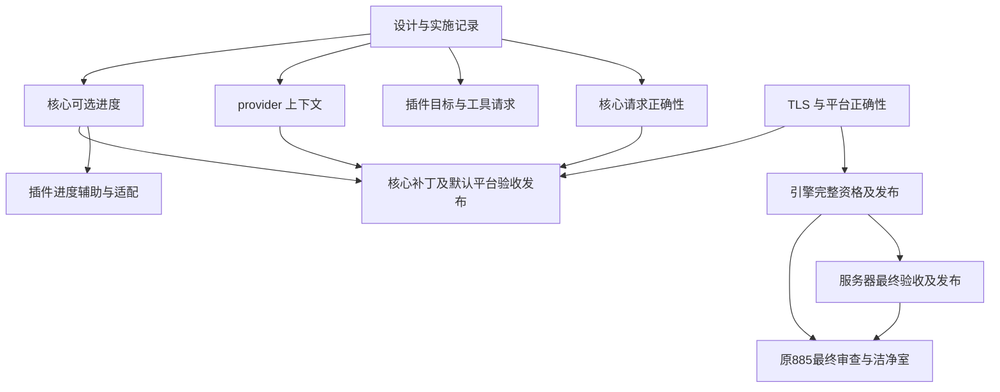

# 生态 885 与异构构建补充方案的实现依赖

**读者：** 推进 mcpp、插件、平台及语言服务发布的维护者。

**本文回答的问题：** 已确认的设计分别如何实现、验证和发布，哪些工作确实互为前置。

**范围之外：** 把局部实验等同完整验收，以及未经验证的全部 HPC 覆盖承诺。

日期：2026-11-05。相关规范：[构建插件](../../docs/specs/build-plugins.md)、
[平台](../../docs/specs/platforms.md)、[目标侧](../../docs/specs/target-side.md)。
依据：[补充方案](2026-11-05-heterogeneous-build-semantics-and-plugin-boundaries-supplement.md)、
[第二轮实验](2026-11-05-heterogeneous-build-research-and-experiments.md)、
[mcpp#885](https://github.com/mcpp-community/mcpp/issues/885)、
[mcpp#887](https://github.com/mcpp-community/mcpp/issues/887)。

状态：用户已要求继续实现 #885 与补充子方案。按工作主题分别提交 PR，不以其中
一个主题通过代表其他主题完成。以下为启动时状态；后续按具名检查点追加实证。

## 1. 当前交付与剩余范围

mcpp 2026.11.3.1 已发布，内置平台 0.23.3；公开平台已到 0.23.5，消费者可以显式
选择。IDE 0.2.0 已交付。原 #885 的引擎、服务器及最终验收仍需闭环，不能只凭新
方案实现完成就关闭原交付。

复核到引擎候选 `39f8589` 的完整 CI `41901404153` 已终止失败；两个 Linux 映像
均因原生 TLS 段和 TLS 重定位被 seal 拒绝，没有 bundle。旧观察器已停止，未从
失败构建触发诊断发布或资格提升。服务器对应候选也不能据此获准发布。

## 2. 实现批次

| 编号 | 改动主题 | 真正前置 | 验证与退出条件 |
|---|---|---|---|
| I0 | 保存设计、实验及依赖记录 | 已有用户实现指令 | 独立文档 PR，引用可定位、状态不夸大 |
| I1 | 核心完整请求验证、重复实现政策与集合规范化 | 无其他实现前置 | 新二进制的非法输入、次序及有效输入 E2E；比较单测；旧合法元数据保持兼容 |
| I2 | 插件 L2 统一读取；SYCL 归属目标及按需工具；相邻规则复核 | 通用语义已定；可与 I1 同时实现 | 单实现、混合目标、负向请求、工具可见性及多阶段实际产物 |
| I3 | requirement 消费上下文与 exclusive 链接闭包 | 无 I1/I2 前置 | 独立程序、应用供给、同程序冲突、共享库及身份控制 |
| I4 | 核心可选 action 进度 | 现有 action/执行模型 | 各角色、并发、关闭、失败、取消、普通及机器输出；真实产物不作为 stamp |
| I5 | 插件进度写入辅助与外部构建适配 | I4 的协议和运行通道 | 新核心集成，旧核心有明确可选降级；未知总量与限频 |
| I6 | 平台默认版本跟进与核心补丁发布 | 对应平台公开可安装，核心改动通过各自门槛 | 默认/显式/锁、std BMI、宿主与目标图、launcher 自举及完整发布资产 |
| L1 | 引擎 ThinLTO 的 TLS 正确性 | 小型双架构控制定位 | 平台约定覆盖最终 LTO codegen；seal 与执行控制，不移除检查 |
| L2 | 原 #885 引擎资格与发布 | L1，平台及依赖已公开 | 完整 CI、原始工作负载和性能门槛、台账、双源产物校验 |
| L3 | 原 #885 服务器资格与发布 | L2 的合格引擎 | 更新候选/lock，最终 CI 与已发布引擎一致，再发布 |
| L4 | 原 #885 最终审查、洁净室及清理 | L2、L3 及其余原门槛 | 最终数字与真实公开安装，证据保存，相关项目仅保留最近构建 |

I1、I2、I3、I4 可分别推进；发布时只声明实际完成范围。I2 的普通修复不等待新核心
进度接口，也不等待完整多节点测试。I4 的核心与 I5 的辅助保持版本边界。
多目标归档的独立 SDK 失败继续在工具链/插件流程中定位，不作为新增核心模式的
理由。安装目录污染按不可变发行包契约处理，不把全量哈希所有包放到每次构建中。

## 3. 依赖图

图中的文档前置是交付记录，不要求等待文档 CI 才开始本地实现。没有画出 I2 到
L2 的边，因为语言服务引擎不依赖 SYCL 目标修复。I6 的合并与发布次序按最终
实际兼容性安排，不从图推出可绕过某项 required check。

## 4. 启动控制：ThinLTO 丢失最终 TLS codegen 约定

LLVM 23.1.3 上将 `__thread` 变量用 `-femulated-tls -flto=thin -fPIC` 编译为 bitcode，
再以 ld.lld 链接。x86_64 默认 LTO 输出含 TLS 段及 DTPMOD/DTPOFF 重定位，
aarch64 含 TLS 段及 TLSDESC。最终链接增加 `-mllvm -emulated-tls` 后，两者均无
TLS 段，转为 `__emutls_get_address` 与 emulated storage。

该双架构小型复现与真实 CI 拒绝一致，证据位于
`/tmp/mcpp-885-thinlto-tls-fix/results.json`。它不等于 clangd 完整资格通过。
该约定属于映像平台的链接/codegen 契约，优先在平台数据中补齐，使其他 LTO
消费者同样受益；不在通用 mcpp 核心增加 openkal TLS 分支。

## 5. 实现检查点（2026-11-05）：请求、消费上下文及平台

I1 已在同一核心 PR #888 提交。新二进制通过 23 项 accelerator 单测和 E2E 1011。
I3 第一批实现将 provider/requirement/exclusive 的身份改为包索引，按所选消费包的
普通依赖闭包验证；宿主构建边不进入目标上下文。库 requirement 在最终消费者内
绑定，应用可以通过兄弟依赖供给。工作空间根 pin、成员 pin、CLI pin 依次覆盖，
短名只有唯一匹配时可用，同短名跨 namespace 可以使用完整 `namespace:name`。
绑定仍只验证，普通依赖继续决定编译和链接输入，没有借 pin 删除其他实现。

新二进制的 E2E 1012 通过独立 exclusive、应用供给、缺失供给、同程序互斥、成员
与 CLI pin、跨 namespace 同短名和完整身份控制。原 E2E 81、601 同样通过。
共享库、测试与宿主工具的进一步控制以及完整核心 CI 仍待完成，不据此宣布 I3
全部验收。I4/I5 的可选进度尚未实现。

插件实际实现复用 #52（提交 `8d4b150`），保留原 CMake cross contract。46 项
plugin-logic、真实 musl CMake cross build/run、真实 SYCL 旧写法、独占 NVIDIA、
双 NVIDIA 与 SPIR-V/NVIDIA 混合构建通过。规则设备链接命令的中间产物已核验
双 NVIDIA fatbin 与混合 SPIR-V/NVIDIA 镜像。当前驱动返回 CUDA 803，GPU 执行
未获资格。多目标静态归档的 SDK 流程仍待定位。

平台修复 PR #19 的四种宿主完整 CI `41922140543` 全部通过，已发布 0.23.6。
GitHub/GitCode 源码一致，SHA256 为
`51903d50b436e81047b74b460ea1e7e23be25704ab601438b160b9370a7017c2`。
索引 PR #709 的候选与消费者检查通过并合入，发布任务已触发。引擎 PR #16 的
平台选择已更新到该版本，须待公开索引可安装后重跑完整资格。原性能、seal 和
补丁台账门槛保留。服务器 PR #75 第三次尝试的独立 macOS job 已通过，目前失败
只剩严格引擎候选门槛，服务器最终发布仍等待合格引擎。

## 6. 发布执行约束（2026-11-05，用户补充）

核心 PR #888 同时携带构建版本 `2026.11.5.1`；bootstrap 保持公开的
`2026.11.3.1`，不提前安装未发布版本。中英文使用文档、协议及插件文档与最终
实现同轮更新。

最终提交的核心 CI 通过后，再独立完成一次生态视角 PR review。审查涵盖插件新旧
接口、宿主/目标图、平台默认及显式覆盖、交叉构建、打包与发布资产、语言服务和
增量行为；将发现、证据及限制记录在本方案中。未经该审查不得合入或创建发布 tag。
如审查需要改代码或文档，则修正后以新提交重新完成适用检查。

确认无问题后合入 #888；先取消该合入触发的 main CI，再创建新版本 tag，优先
执行 Release CI。Release 的完整平台资产、镜像和索引可安装性验收完成后，再从
main 显式触发常规 CI。记录合入 SHA、被取消的 run、Release run、公开安装证据
和重新触发的 main run，避免用旧提交或上一轮 CI 代替本轮验收。

I4 当前本地集成控制已通过五种 action 角色、真实对象链接运行、关闭开关、JSON
输出及内部计数完成后的失败退出。新增进程组取消控制检出中断退出未清理通道，
现已接入现有 `mcpp::run::add_cleanup`；仍待新版本二进制重建后复验，不将修改
意图计为通过。

## 7. 新版本本地检查点（2026-11-05）

候选二进制实际报告 `mcpp 2026.11.5.1`，SHA256 为
`26bee63a21372057d01c95dc3a18e832b3ae67fc7b4251b2e2b90488464ddd50`。
该二进制通过 E2E 01、1011、扩展 1012、1013。1012 追加共享 provider、测试链接
单元与 host-only 不能供给 target requirement 控制；1013 的进程组取消清理复验
通过。此前进度解析单测 3 项通过；新版本完整 directives 单测仍在执行。

默认平台已在现有隔离 GLOBAL 洁净室的新中性项目验证：没有 `platform` 覆盖，
实际从公开索引解析 0.23.6；ThinLTO 的 x86_64 映像封装并运行输出 TLS 值 7，
aarch64 映像交叉构建和封装通过。该项使用本地候选编译器和公开平台依赖，不能
等同最终发布资产安装验收。证据为
`/tmp/mcpp-885-core11351-default-platform-verified.json`。

插件进度辅助已追加至 #52（`d215e0d`），逻辑测试 49/49 通过。通用 enable/快照
类型放在标准库辅助，原子文件 writer 为独立可选 feature，复用 os.fs；普通 CMake
消费方不因启用阶段报告引入该运行库。CMake adapter 在新核心下真实构建并运行，
独立实跑验证快照有效、正常阶段报告和不可写通道不影响构建。它只报告自己拥有的
configure/build-install 阶段，不估计未掌握的编译任务总数。旧核心下退化保持可用。

中英文核心使用文档、SPEC-007 及其目录、平台默认示例已同步。结构与风格检查
通过，修改的文档已用 pandoc 渲染并进行第二遍阅读。以上是 CI 前的本地检查；
用户要求的最终生态 review 仍待最终提交 CI 通过后执行。

## 8. 集成边界检查点（2026-11-05）

新版本 directives 单测 74/74 通过。进度 E2E 另行通过 verbose 与未修改 action
不重新执行的控制。

插件 writer 的集成定位到一个既有核心缺陷：build-only 库声明的 target-side
provider 仍参与最终产物的层选择。最小包只在 build.mcpp 中使用
`provides=["mcpp:kernel-abi=openkal"]` 的库，目标源码却收到 `__OPENKAL__`，
复现见 `/tmp/mcpp-885-host-layer-probe/before.json`。核心现按 `buildTimeOnly`
过滤 target-side provider、requirement、条件 requirement、kernel interface
需求及 hosted 标准库资格；宿主子构建中的实际 target instance 仍照常选择层。

E2E 1014 的直接、传递与同包双角色控制通过。修正后二进制 SHA256 为
`b440228697715797c80f9e297070ef4ea33f625a5e50f29be827861d298b54cd`。
其进度正常/verbose/关闭/JSON/失败/取消/增量控制通过；默认公开平台的中性
ThinLTO native run 和 aarch64 seal 复验通过，证据为
`/tmp/mcpp-885-core11351-hostfix-default-platform-verified.json`。

插件 #52 的 CI 又检出 object storage 的既有增量缺陷：shader 更新后 `.S` 的
`.incbin` 路径没有变化，`restat` 剪枝阻断实际 payload 到汇编对象的更新；header
与 sidecar 控制通过。修正责任在插件 surface body 生成器：在执行期为 assembly
记录内容校验值，保持接口半部稳定。该修正及等长内容与未变化时间戳控制仍在验证，
不靠撤销核心 `restat` 掩盖缺失的数据依赖。

SYCL SDK 归档控制确认：多架构直接对象链接通过，同对象组成的多架构 archive
仍报 `add_seven` 重定义；关闭自动 SPIR-V 或 code split 不改变结果。单架构
archive 供给多架构 consumer 在样例中通过，但两种架构的 device IR 字节和
`target-cpu` / `target-features` 实际不同，不能将单份 IR 复用提升为一般等价。
`__CUDA_ARCH__` 控制在该 SYCL 前端未定义，所得 -1 不能作为架构专化的证据。
因此保留插件/工具链阶段划分问题，不增加核心后端枚举或岛屿模式；尚无通用
多架构静态库交付验收。原始记录位于 `/tmp/mcpp-885-sycl-archive-controls/`。

核心 CI 的权威入口是名为 `ci` 的工作流；同提交的 Windows CRT measurement
是另一工作流。`82fc9b3c` 对应 `ci` run `41930942590`，不是已通过的
`41930942462` measurement。新增层隔离修正需要以更新后的提交重新完成 CI。

## 9. 可移植通道与插件集成检查点（2026-11-05）

进度通道现在复用 os.fs 的有界共享读取，并在环境变量边界显式进行 UTF-8 路径
转换。E2E 1015 在非 ASCII 工程路径中启动原生 Python worker，验证启用通道、
有效快照和结束清理；不依赖 PTY 或 Unix 信号，可进入 Windows 与 macOS 的
现有 E2E 矩阵。本地 Linux 实跑通过，不能替代尚待执行的其他宿主验收。
新二进制 SHA256 为
`ee2d7fc270d3cec32d699396c10fde19de507b439f6d13bb337d139a168e87f1`；
3 项快照单测和 E2E 1013 的正常、verbose、关闭、NDJSON、失败、取消与增量
控制复验通过。中英文手册及 SPEC-007 同步明确路径编码，内部快照仍只更新
状态显示，不新增 NDJSON 子任务事件。

插件 object storage 修正已完成验证：旧版 2026.11.3.1 与新核心均通过 50 项
逻辑测试；真实 shader 的变长及等长内容修改均到达对象和最终二进制；未修改
内容保留生成 assembly 的时间戳。证据为
`/tmp/mcpp-885-object-incremental-verified.json` 与
`/tmp/mcpp-885-object-equal-size/verified.json`。包含该修正的 #52 提交
`3e9fc36` 的 CI `41934375976` 已通过。

独立 worker 的 `plugins-progress` feature 只包含标准库快照类型和可选 os.fs
writer，不再隐式引入只能由构建程序导入的 plugins-core。普通可执行 worker
在已发布 2026.11.3.1 下构建并运行，关闭通道和显式通道两种控制通过；新核心
通过真实 action 启动 C++ worker、写出快照并运行最终应用，同时确认 host-only
OS 库未泄露目标 ABI。该修正和 CI fixture 已追加至同一 #52 的 `aa2c16e`，
其 CI `41937665962` 正在执行。

原始引擎工作已独立推进：platform 0.23.6 修正后的 engine `6129288` 在
`41927099461` 的两种 Linux 映像、原生 Linux/Windows、Ubuntu 20.04 下限及
四平台映像运行验收均通过，原生 macOS 仍在编译。server #75 的候选引用已在
`4ab6263` 切换至该精确生产提交与 run，CI `41937027539` 正在重新接纳；旧的
macOS 无 runner 取消记录不能作为新候选失败的证据。

Linux 原生与 bundle 产物已齐备，故先以不可变 artifact ID、SHA256、生产提交
和 run 冻结输入，启动独立对照 `41938352961`，不等待原生 macOS。对照仍使用
原来的工作量、计量方式和阈值，且不代替完整发布接纳或 ledger promotion。
最终核心提交仍须完整 CI 后再执行用户要求的独立生态 review；核心版本保持
2026.11.5.1，发布后再推进插件新版集成与原始 engine/server 发布链。

## 10. 多目标 archive 的责任定位（2026-11-05）

已进一步定位 §8 留下的 SYCL archive 失败。锁定 SDK 的独立 bundler 为 sm_89
和 sm_90 分区解包时，各自都输出两种架构成员；与普通对象精确解出的设备
bitcode 字节一致。驱动生成的五段 bundle ID 与 archive 匹配器的环境/target ID
划分不一致，结合相应提交源码可解释该混合。只补全 bundle ID 的环境位置、
保留原有 payload 字节的合成控制恢复了每个分区一个正确成员。

完整命令、版本、输出成员和 SHA256 已保存，并追加至
[实验 §5.3](2026-11-05-heterogeneous-build-research-and-experiments.md#53-实现期追加sdk-archive-的目标身份混合2026-11-05)。
这确定了调查应落在 SDK 身份匹配与插件阶段，不构成生产 SDK 已修复或多目标
静态库已交付的声明。当前 #52 不隐式删掉架构，也不向核心增加专属链接模式。

## 11. 所选静态库成员的上下文修正（2026-11-05）

集成预检追加了常见布局：helper、provider 与 app 都列入 workspace members，
helper 声明 requirement，app 同时依赖两库。旧候选把已由 app 覆盖的 helper
又作为独立消费者检查，实际拒绝构建，见
`/tmp/mcpp-885-cap-member-library-probe/before.log`。这与应用可供给库需求的
契约冲突，前一用例只把应用列为成员，没有覆盖这一布局。

修正按现有目标类型和可达关系消除纯静态库/entry 成员的重复上下文；成员自身
的可执行、共享库或测试目标仍独立检查。库被单独选择时仍检查其自己的闭包。
不从其他应用借 provider，也不放宽同一产物的 exclusive 冲突。

新二进制 SHA256 为
`c7717799809941e8f72613a7cc290fc89a342bb1b5e03ccc15f03733e858dc53`。
最小布局实际构建通过；扩展 E2E 1012 将两应用、helper 与两 provider 全部列为
成员，构建和运行通过，并验证 helper 单独选择和自有测试不能借应用的 provider。
原共享库、测试、pin、独立产物、宿主边及限定身份控制均通过；既有 E2E 81、601
复验通过。中英文手册同步说明该边界。这是 CI 前的集成修正，最终提交仍须完整
CI 后再进行独立生态 review。

原引擎的精确 Linux 对照 `41938352961` 已收集并按未修改的脚本重算：两宿主
共 16 个语义会话及就绪、热 CPU、缺页、路径对等控制通过，冷 CPU 分别为
1.195（x64）和 1.153（ARM64），均高于 1.15。原始 ZIP、输入身份和失败保留；
不据此发布引擎或提升台账。精确当前产物的冷采样与 syscall 计数已完成，仍是
定位证据，不是资格替代。采样中的独立 snapshot 后台进程另行标记，不能把其
样本全部归入原有 readiness CPU。证据目录为
`/tmp/mcpp-885-engine612-early-parity/`、
`/tmp/mcpp-885-engine612-cold-perf/` 和
`/tmp/mcpp-885-engine612-cold-syscalls/`。

## 12. 冷阶段后续定位与发布准备（2026-11-05）

引擎 `6129288` 的完整 CI `41927099461` 已结束：四平台原生构建、两个 Ubuntu
20.04 下限、两架构映像、bundle、四平台映像运行与另外三个 warm-prime 宿主通过。
Linux x64 冷 CPU 为 14.66 / 12.35 = 1.187，高于 1.15；该项是唯一失败。
此前冻结对照的负向结果继续保留，不以其他宿主通过替代它。

实际 syscall 计数中的约 68,000 次 `fstatfs` 定位到 musl realpath 的目录属性预查。
规范已规定可选 resolved-name 操作在不支持时返回 `kal_err_not_supported`；保留弱
入口、词法后备、错误与边界检查，直接调用操作即可。musl #84 准备 0.27.6，原生
GCC/LLVM 的实际 helper 控制与候选 POSIX 工程通过。密封组件在同一输入上交替
运行 14 次，CPU 中位比为 0.859，syscall 控制的 `fstatfs` 从 222 降到 0；符号链接
重定向、词法后备与缺失路径语义保持。该数字只属于组件，不是 clangd 达标声明。

新测试遇到的 macOS 宿主头文件类型冲突已限定在测试中处理；Mach-O 上刻意缺失
弱符号的控制明确允许该单一未绑定名字，并实际运行检查空入口。生产 ELF 映像
的弱入口规则不变。该控制现已在 macOS CI 通过，完整包矩阵仍待结束。

runtime #65 准备 0.18.7，通过已有同名分支图检验两种分配器都选择 musl 0.27.6；
platform 0.23.7 的一致版本组已在本地准备，待两个前置公开后执行完整平台验收。
这些工作不要求核心 #888 的默认平台提前依赖未发布版本；核心仍选公开 0.23.6。

服务器 #75 的 Windows dev 归档已实际通过 43 项服务器与 10 项 devtools 测试，
随后清理退出程序时遇到 sharing violation 32。现只对共享/锁冲突作最长 10 秒的
重试，其余错误立即失败；本地瞬时冲突、非共享错误与超时控制通过。同一 PR 的
最终 CI 已重新启动，候选接纳与性能门槛未放宽。

发布准备补齐 CHANGELOG 的 2026.11.5.1 条目；Release 按该版本标题提取说明，
缺失条目会拒绝发布。包含本次说明的最终提交仍须完成核心 CI，随后再独立进行
生态 review。新增证据已逐文件校验并验证归档往返：
`mcpp-885-realpath-and-final-core-diagnostic-evidence.tar.gz`，
152 个文件，SHA256 为
`4d7b783c27bb25dc75c354af72e98dc4b47037ab75043f792a28dceeeb10083a`。

## 13. 核心最终审查与发布启动（2026-11-05）

核心 PR #888 的最终提交 `850bbf53b5cf8a98dc8b6e3da894da77059cfbc4` 已通过完整
CI `41947858860` 第 4 次尝试：74 项成功，1 项不适用的 iOS 清单跳过。Windows
与 macOS 的 E2E 1015 均实际通过 Unicode 通道及清理控制。ARM 交叉构建早先
遇到 runner 关闭，SIGTERM 143 日志保留；另一次清理挂起的失败未取得日志，原因
仍未证明。最终相同提交的 ARM 构建及 QEMU 运行通过，没有修改测试或交叉目标。

完整 CI 成功后，另行逐项完成用户要求的生态审查，覆盖通用核心与插件边界、每个
消费者的普通依赖闭包、宿主/目标分离、版本与协议兼容、五种 action 角色、取消
及失败后的通道清理、实际依赖版本中的有界文件读取、中英文说明、平台覆盖、
TLS 和交叉封装。核心没有阻塞发现；插件进度写入的 Windows UTF-8 问题在 #52
处理，不把未通过完整性能验收的引擎视为已完成。审查记录为
`/tmp/mcpp-885-core850-post-ci-ecosystem-review.json`。

#888 已于 2026-11-05 03:13:21 UTC 合入，提交为
`1e6d1b3f9c68510af7d2d5b68bbf7aaef1a89e73`。合入树与被审查提交的树一致。
对应 main CI `41960218833` 已先取消并确认终止，随后在合入提交创建
`v2026.11.5.1`，启动 Release `41960453765`。本检查点只证明发布已启动；完整
资产、双端镜像、索引传播、实际公开安装、bootstrap pin 和 main CI 重启仍须按
第 6 节的顺序闭环。

## 14. 已公开依赖组与消费者边界（2026-11-05）

musl 0.27.6、LLVM runtime 0.18.7 与 platform 0.23.7 已分别合入、发布并进入
公开索引。三份源码的 GitHub/GitCode 字节一致。普通 GLOBAL/CN 消费者实际
通过 C++/import std、ThinLTO、TLS 线程隔离、canonical path 及 ARM 交叉封装
控制；这些消费者不使用本地路径或索引重定向。三个发布后 main CI 分别为
`41956257730`、`41956262835`、`41956268179`，共 24 项检查成功；验证时没有
`MCPP_SOURCE_REF`。核心默认保持已验证的 0.23.6，显式 0.23.7 集成另有实证。

插件 #52 的 `26ff5430eda7a957bffe39ca6869801ad5d1b672` 完整 CI
`41959654833` 六项全部成功。Windows ACP 1252 上普通 CRT `getenv` 的确丢失
Unicode 通道字节；辅助写入端已改用 os.env 的 UTF-8 接口。Windows 原生、macOS
及 Linux 的关闭、Unicode 写入与不可写路径控制通过。插件最终新核心集成 pin
和发布仍等待核心版本公开可安装。

引擎 #16 的 `a13953808f4ec4704288adca3ae095ba858bce86` 已使用公开 platform
0.23.7。冻结 Linux 对照 `41959812911` 运行原始工作负载，16 个语义会话、就绪、
热 CPU、缺页及路径对等通过；冷 CPU 分别为 15.08 / 12.32 = 1.224（x64）和
10.65 / 9.11 = 1.169（ARM64），仍高于 1.15。不得据其他检查通过提升台账或
发布，也不重跑未修改的性能检查寻求偶然通过。服务器 #75 的原生构建和测试
归档共 34 项成功；严格引擎候选接纳仍拒绝未合格的上游。

## 15. 当前产物的逐进程定位（2026-11-05）

以 a139 对应的原生与 universal 资产 SHA、ZIP CRC、包内身份和 ELF 成员位置
固定输入。两路完整冷工作负载均包含 304 个单元、三个文件和 176 个编译 worker，
实际语义就绪通过。strace 按 PID 分类，独立 snapshot 后台进程另记；跟踪后的
CPU 与耗时不作原性能门槛的替代。当前 image 的 `fstatfs` 共 1,050 次，较上一轮
约 68,000 次明显减少，证明 realpath 修正确实进入了当前产物。

每个 image worker 除 owner-death 监视外，还由 Linux 后端的单位内存监督启动
一个线程，立即遍历整个宿主 `/proc`，打开每个可见 PID 的 `stat` 再判断进程组。
该观察属于宿主运行器的后端实现，不需要在通用 mcpp 核心添加进程或 HPC 语义。

实验原型先以 `getpgid` 排除确认属于其他组的进程；查询失败仍读原记录，可能的
组成员仍从同一份 RSS 记录复核进程组。原型保留全部进程组成员、首次立即采样、
100/200/500 ms 的原采样间隔、组内内存求和与全组终止。实际组件控制包括成员
加入/退出、组长结束后的成员、EPERM/ENOSYS 后备和合计超限时终止所有成员而
保留其他组；全部通过。一次采样的 `stat` 打开数从 37 降到 2，12 组交替组件
CPU 中位比为 0.244。该结果仅属于组件。

两份相同编译参数、仅后端过滤逻辑不同的运行器，随后对同一 a139 image 运行
原始 304 单元、三个文件、176 worker 的完整冷工作负载。八组交替测试的冷 CPU
中位数为基线 5.600 s、候选 5.385 s（比值 0.962）；公开运行器对照为 5.575 s。
完整生命周期 CPU 中位数为 5.639234 s 与 5.4300145 s。就绪时间中位数为
3.880 s 与 4.034 s，没有得到就绪时间改善的证据。所有语义会话通过，单组测量
存在波动；这些本地结果不能证明原 CI 的冷 CPU 门槛已通过。

Linux 后端改动、0.24.2 版本及说明复用同一 PR #50，提交为
`6bd65128c53d1bc1fc99f2ddcb984e12325b3490`。另一个冻结诊断
`41966671816` 在 Linux x64/ARM64 上运行原生引擎、公开运行器、同参数基线和
候选运行器；保留原工作负载、三次热会话与未修改的接纳脚本。诊断不提升引擎
台账，也不替代正式生产者的完整资格；后端尚未发布。

另以同一批 BitstreamReader/Support ThinLTO 对象和当前 176 份 PCM，比较最终
LLD 的默认、显式 O2 与 O3。默认产物与显式 O2 字节一致；十二组交替组件测试
中 O3/O2 的 CPU 中位比为 1.013，没有得到该组件的优化收益证据，未据此修改
引擎链接参数。该组件沿用实验中的 platform 0.23.5，其结果不推广到完整引擎。

## 16. 运行器后端的采用依据与发布次序（2026-11-05）

冻结诊断 `41966671816` 两个 Linux job 已成功，资产 ZIP 的 SHA256、CRC 与展开
文件已逐项核对，并用 a139 的未修改脚本重新计算六组接纳结果。x64 同一宿主的
公开运行器冷 CPU 为 15.45 / 13.05 = 1.184，同编译参数基线为
15.33 / 13.05 = 1.175，均失败；过滤候选为 14.77 / 13.05 = 1.132，通过。
ARM64 候选为 10.99 / 9.89 = 1.111；该轮公开和基线运行器也通过，分别为
1.126、1.124，不能把 ARM64 的通过全部归因于过滤。两宿主共 32 个语义会话
通过，候选的就绪、冷热 CPU、缺页及路径对等均按原门槛通过。这是采用修正的
对照证据，不是正式生产者或联合 UX 的资格提升。

后端 PR #50 的 GCC/LLVM 完整 CI `41966412791` 已通过，随后另行审查资源、
错误、组成员、ABI、跨架构与说明，合入为
`59a3a59b53625f144b17c96e8a3b07eb617cef1a`，并发布 0.24.2。GitHub/GitCode
源码同为 164569 字节，SHA256 为
`bfe9f4fc34b9d2c4d321939bb00f4da7c8f444abb38bb12756da7b5d57717ee9`。
索引 PR #713 已准备并提交，实际公开源码消费者、精确锁与本地 lint 通过；尚须
合入、发布索引并确认普通客户端可安装。

运行器改动复用原 #885 全局审查产生的 openkal-image PR #25。其 okprof 环境
传递修正已有五项完整 CI 通过；合入当前 main 0.4.4 后，保留 Windows 映射尾部
修正，再准备四包同版 0.4.5、Linux 0.24.2 与说明。公开依赖未完成索引前不推送
要求安装该版本的最终 CI。预编译运行器仍使用正式 hosted 平台与同一精确版本
组，不通过更换运行库或跳过版本组检查缩短发布链。

核心 Release `41960453765` 的两项生态 canary 与 Linux x86_64 静态包已通过，
ARM64、macOS 与 Windows 正在并行构建。完整镜像、索引和实际安装尚待完成，
bootstrap pin 和已取消的 main CI 因此尚未前移或重启。

## 17. macOS 发布自举生命周期修正（2026-11-05）

Release 的 Windows 构建成功，macOS job `127048731858` 在第二阶段失败。第一阶段
实际输出 2026.11.5.1，随后从 `target/.../bin/mcpp` 调用 `build --no-cache`；清理
删除了正在自举的编译器路径，Ninja 再调用该路径生成依赖记录时报告文件不存在。
这是发布流程的编译器生命周期问题，不能按基础设施波动原样重跑。

发布流程先将第一阶段可执行文件复制到 RUNNER_TEMP，再执行原来的清理重建。
实际候选编译器与 LLVM 23.1.3 的 import std 小工程复现了负向控制：编译器位于
输出目录时被删除并失败；同一编译器复制到目录外后，完整清理重建通过，生成
程序实际运行输出 `stage1 lifetime held`。该 Linux 控制不能替代修复后 macOS
发布 job 的原生验证。

已上传的 Linux x86_64 与 Windows 资产保留。修复后的 macOS 构建仍取原 tag
的源码，完成原部署版本、静态 libc++、路径、封装及 smoke 检查；发布清单和
镜像继续要求其他三个平台的实际构建成功，不以补建单个平台替代整组发布门槛。
原 tag、源代码和此前通过的核心 CI 身份保持可核对。

## 18. 发布资源的本地镜像与索引收尾（2026-11-05）

修复后的原生 macOS job、原发布的其他三个平台与两项生态 canary 均已成功。
恢复流程 `41969495679` 的源码校验、macOS 构建、完整发布清单和生态发布四项
全部成功；tag 仍指向 `1e6d1b3f9c68510af7d2d5b68bbf7aaef1a89e73`。
四个平台安装包已独立下载并核对清单哈希与封装。

用户指定后续资源在 GitHub 产出时立即使用本地 gtc 补齐 GitCode，不等待 CI
mirror。该流程已补齐本次全部 21 项发布资源，包含安装包、别名、校验文件、
源码、脚本与清单；每项均实际 GET 下载并校验 SHA256。此前 GitCode 下载为
404 的 Linux x64 与 ARM64 包，本地上传分别耗时约 11 s 与 13 s。资源已有且
字节相同则保留，同名内容冲突须查明，不以删除重传处理。

索引 PR `openxlings/xim-pkgindex#1108` 的三个 latest 条目、四个平台资源地址
及 SHA256 已与完整清单核对，合入为
`785e62895aa4216361f031424033394f6ef8ba4e`。按用户此前指定的本地直接发布
流程完成双端资产和指针，实际公开下载的索引包为 1758038 字节，SHA256 为
`e35e26ec319db22e7fbfb2f98cb158a61e3eff5162778187940764cbf285053b`。
随后 GLOBAL 与 CN 两种配置的隔离客户端均从普通公开索引安装精确版本和
latest，实际执行输出 `mcpp 2026.11.5.1`；安装后的 ELF 与公开安装包逐字节
对应，SHA256 为 `cb665b0ceb1856a1e588faba183c3de29b9f5b455d6e9fd2944d14175235bced`。
客户端保留产品自身的镜像回退行为。bootstrap pin 在这些验证之后前移，核心
同一收尾 PR #889 继续要求最终提交 CI 和生态审查；完成后重启 main CI。

运行器源码 0.4.5 已复用 PR #25 发布，Linux 0.24.2 和四个 image 包 0.4.5 的
索引分别经 PR #713、#714 合入、发布并通过普通客户端验证。musl 0.27.7 复用
版本组推进的 PR #85；runtime 0.18.8 与 platform 0.23.8 继续按公开前置依赖
依次验证。源码对照诊断不能替代引擎正式生产者与联合 UX 的资格验证。

## 19. 缓存构建的内部进度首次读取（2026-11-05）

收尾 CI 的 `1013_optional_action_progress_preserves_outputs` 暴露了一个核心显示
缺口。缓存构建不重新规划，其步骤归属记录原先只在 Ninja 首次输出状态时读取；
异步轮询在记录尚未加载时直接跳过 action-start 文件。Ninja 缓冲长动作输出时，
合法进度文件虽已存在，界面仍不能显示正在执行的动作和内部阶段。该问题不说明
动作本身停止，也不能解释引擎冷启动 CPU 的性能差额。

修正使轮询先检查 action-start 是否新增内容，再按需读取已有归属记录。无工作
的缓存构建仍不预读记录；快照计数仍不能完成动作，输出后置条件、命令退出码和
取消处理保持原契约。没有通过延长工作、隐藏断言或调低门槛修复正式测试。

固定原构建的 448 个对象，仅重编译进度模块并链接诊断二进制。新增测试在没有
任何 Ninja stdout 或完成记录时要求观察到动作及内部阶段：原模块在两秒期限内
失败，修正模块通过；完整进度测试文件的 25 项全部通过。原 1013 E2E 与额外的
短动作观测控制均通过，包含各 role 的输出、增量不重跑、失败和取消。初次八路
全量本地编译曾被资源回收终止，不记为通过；单模块控制也不替代正式 CI。

源代码和回归测试继续复用 PR #889。其最新完整 CI 和随后独立生态审查仍是合入
前置条件，已发布 tag 的源码与资产不作改写。

## 20. 收尾 CI 后的生态审查与补丁版本（2026-11-05）

提交 `7192039d` 的 CI `42016930743` 已完成：74 项执行成功，另有一项按原条件
跳过。随后单独复核了 action-start 与缓存归属记录的时序、无工作路径、遥测与
退出状态的独立性、四宿主构建、原 1013 E2E、发布自举的执行路径和公开 bootstrap。
该显示修正不改变 action 图、指纹输入、消费者工具链或 accelerator 语义，也不
承担插件 CMake 参数序列化的职责。

审查要求两项收尾：进度显示的代码修正应使用新补丁版本，不能改写公开的
2026.11.5.1；发布技能中残留的直推 main、移动旧 tag 和删除旧 release 步骤应
与 PR 规范统一。版本号在同一提交内改为 2026.11.5.2，真源位于 `mcpp.toml`
和 `modules/versioning/src/version.cppm`。bootstrap 保持已完成公开安装验证的
2026.11.5.1，运行时推导的 MCPP_PIN 不作手工修改。

新 CHANGELOG 与发布技能已对齐。旧版本文件路径同时改为当前模块路径，紧急
修复也明确要求 PR、新版本及原发布门禁。新最终提交仍须完成完整 CI 和随后
生态审查；仅在通过后合入并创建新 tag，按用户指定顺序优先 release，及时用
本地 gtc 补 GitCode，完成索引和实际安装后再恢复 main CI。

## 21. 内部快照与界面刷新之间的通知（2026-11-05）

最终版本提交 `08fb971f` 的 CI `42025082619` 在原 1013 E2E 首次终端输出
断言失败。缓存归属记录的首次读取修正仍有效；这次进一步核对发现，异步轮询
接受内部快照后并未请求界面刷新。无 Ninja 输出和其他叙述时，界面依靠一秒
时钟刷新，而原 fixture 的阶段只持续 0.75 秒，因而可能在实际绘制前结束。
此前同一测试通过不能排除该时序缺口，也不能用原样重试代替修正。

快照读取现在报告是否接受了新的序号，轮询在释放模型锁后请求现有 UI frame。
各构建的结果采用非短路聚合，仍读取全部活跃动作；无更新、无效或旧序号不
请求额外 frame。原十帧每秒上限、命令完成、快照非权威性以及锁顺序均保持。

新增回归检查实际渲染输出：先绘制初始 frame，再发布快照，在一秒时钟刷新
之前结束观察；既不提供 Ninja stdout，也不补充其他叙述。仅替换进度模块的
固定对象对照中，上一模块在此检查失败，修正后完整 26 项进度检查通过。
正常 1013 E2E 保持原 0.25 秒更新间隔及全部断言，并通过修正后的诊断二进制。
另有 0.001 秒的历史短动作探针，其失败不代表原 1013 测试失败；局部探针的
时序结果不能替代实际输出回归与最终完整 CI。正式 E2E 未加入等待观察的握手。

该补充继续使用 PR #889 与 2026.11.5.2。新的最终提交仍须完整 CI 以及其后
独立生态审查，通过后才合入和发布；CLion 两仓库的兼容性结果不受此门禁替代。

## 22. 外部构建契约的消费输入与参数边界（2026-11-05）

插件 PR #52 的 CI 后审查复现了两项不同责任的问题。其 CMake 适配将 JSON argv
拼成原生 flags 字符串，只为带空格的词增加引号，因而丢失字面引号、反斜杠、
空参数和 tab 的边界。插件改为生成目标 toolchain 与按内容命名的编译器 response
files，通过 CMake 的原生 options 交给各生成器转义；不向核心增加 CMake 原语。

另一项最小反例在实际 musl 跨构建中成立：同一 CMake 子工程既安装静态库，又
构建一个独立可执行程序。核心契约将消费程序尚待安装的库包含在 link.args 中，
使该独立程序在子工程安装前就依赖这份库，链接因文件不存在而失败。修正后的
契约复用同一目标 flags 派生，只排除消费包的链接标志和库；目标、sysroot、平台
与 profile 的设置仍由原派生逻辑产生，消费程序自己的实际链接不作删减。
此处的通用边界属于核心，argv 到 CMake 的表示属于插件。

局部验证只重编 flags 和 compile_commands 两个模块，分别约 4.1 s 与 5.7 s，
复用已有对象以及此前验证的进度模块。旧核心配合新插件仍在同一自依赖处失败；
修正核心后，静态库、独立子工程程序和最终 musl 消费程序均实际运行通过。
扩展原 982 E2E，要求消费包的标志不进入外部契约、同时仍存在于消费程序的
build.ninja；旧模块失败，新模块通过。该诊断二进制不替代正式版本构建。

插件的真实编译器检查覆盖 GCC、Clang 的 Ninja／Make、C／C++ 作用域、
try_compile、字面引号、反斜杠、美元符号、分号、tab、空字符串、重复选项次序、
不变参数不重编，以及参数变化后的增量失效。clang-cl 的 response 文件实际
生成 COFF，并核对字面数据；这不能等同原生 MSVC 全生成器资格。

还确认两项边界。纯 CMake 4.4.2／Ninja 工程在源码路径含单引号时也拆错依赖
路径；这一负向控制不含 mcpp、toolchain 或 response files，不归为新插件缺陷。
测试仍在 response-file 路径保留单引号，源码路径覆盖空格、Unicode 和美元符号。
旧 CMake cache 则不会因后来指定 toolchain 而开始加载它，新参数表示因此使用
独立构建目录，避免沿用旧 CMAKE_*_FLAGS。两项结果分别记录，不能靠重试掩盖。

核心继续复用 #889 和 2026.11.5.2，插件继续复用 #52。核心最终完整 CI 及其后
生态审查、发布和公开安装仍须先完成；随后对齐插件 CI 的公开核心 pin，再验证
完整插件候选。现有 Windows E2E shard 在下载 artifact 时 ECONNRESET，尚未运行
测试；不据此判为源代码回归，也不在仍有新源码待验证时原样重复整个 CI。
