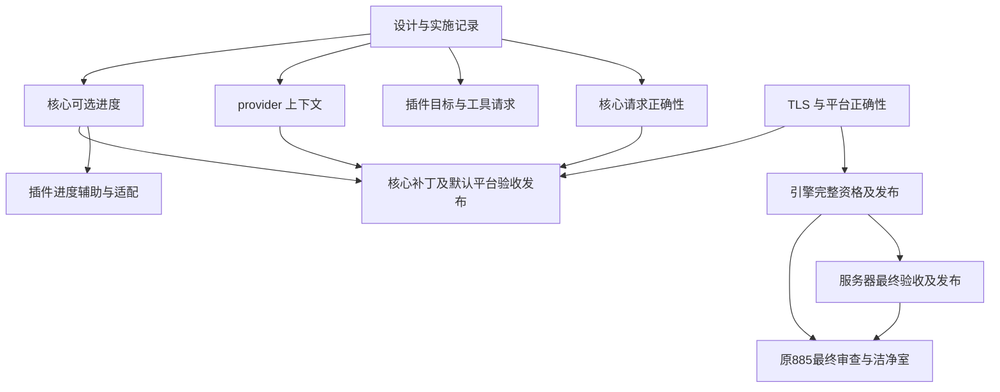

# 生态 885 与异构构建补充方案的实现依赖

**读者：** 推进 mcpp、插件、平台及语言服务发布的维护者。

**本文回答的问题：** 已确认的设计分别如何实现、验证和发布，哪些工作确实互为前置。

**范围之外：** 把局部实验等同完整验收，以及未经验证的全部 HPC 覆盖承诺。

日期：2026-11-05。相关规范：[构建插件](../../docs/specs/build-plugins.md)、
[平台](../../docs/specs/platforms.md)、[目标侧](../../docs/specs/target-side.md)。
依据：[补充方案](2026-11-05-heterogeneous-build-semantics-and-plugin-boundaries-supplement.md)、
[第二轮实验](2026-11-05-heterogeneous-build-research-and-experiments.md)、
[mcpp#885](https://github.com/mcpp-community/mcpp/issues/885)、
[mcpp#887](https://github.com/mcpp-community/mcpp/issues/887)。

状态：用户已要求继续实现 #885 与补充子方案。按工作主题分别提交 PR，不以其中
一个主题通过代表其他主题完成。以下为启动时状态；后续按具名检查点追加实证。

## 1. 当前交付与剩余范围

mcpp 2026.11.3.1 已发布，内置平台 0.23.3；公开平台已到 0.23.5，消费者可以显式
选择。IDE 0.2.0 已交付。原 #885 的引擎、服务器及最终验收仍需闭环，不能只凭新
方案实现完成就关闭原交付。

复核到引擎候选 `39f8589` 的完整 CI `41901404153` 已终止失败；两个 Linux 映像
均因原生 TLS 段和 TLS 重定位被 seal 拒绝，没有 bundle。旧观察器已停止，未从
失败构建触发诊断发布或资格提升。服务器对应候选也不能据此获准发布。

## 2. 实现批次

| 编号 | 改动主题 | 真正前置 | 验证与退出条件 |
|---|---|---|---|
| I0 | 保存设计、实验及依赖记录 | 已有用户实现指令 | 独立文档 PR，引用可定位、状态不夸大 |
| I1 | 核心完整请求验证、重复实现政策与集合规范化 | 无其他实现前置 | 新二进制的非法输入、次序及有效输入 E2E；比较单测；旧合法元数据保持兼容 |
| I2 | 插件 L2 统一读取；SYCL 归属目标及按需工具；相邻规则复核 | 通用语义已定；可与 I1 同时实现 | 单实现、混合目标、负向请求、工具可见性及多阶段实际产物 |
| I3 | requirement 消费上下文与 exclusive 链接闭包 | 无 I1/I2 前置 | 独立程序、应用供给、同程序冲突、共享库及身份控制 |
| I4 | 核心可选 action 进度 | 现有 action/执行模型 | 各角色、并发、关闭、失败、取消、普通及机器输出；真实产物不作为 stamp |
| I5 | 插件进度写入辅助与外部构建适配 | I4 的协议和运行通道 | 新核心集成，旧核心有明确可选降级；未知总量与限频 |
| I6 | 平台默认版本跟进与核心补丁发布 | 对应平台公开可安装，核心改动通过各自门槛 | 默认/显式/锁、std BMI、宿主与目标图、launcher 自举及完整发布资产 |
| L1 | 引擎 ThinLTO 的 TLS 正确性 | 小型双架构控制定位 | 平台约定覆盖最终 LTO codegen；seal 与执行控制，不移除检查 |
| L2 | 原 #885 引擎资格与发布 | L1，平台及依赖已公开 | 完整 CI、原始工作负载和性能门槛、台账、双源产物校验 |
| L3 | 原 #885 服务器资格与发布 | L2 的合格引擎 | 更新候选/lock，最终 CI 与已发布引擎一致，再发布 |
| L4 | 原 #885 最终审查、洁净室及清理 | L2、L3 及其余原门槛 | 最终数字与真实公开安装，证据保存，相关项目仅保留最近构建 |

I1、I2、I3、I4 可分别推进；发布时只声明实际完成范围。I2 的普通修复不等待新核心
进度接口，也不等待完整多节点测试。I4 的核心与 I5 的辅助保持版本边界。
多目标归档的独立 SDK 失败继续在工具链/插件流程中定位，不作为新增核心模式的
理由。安装目录污染按不可变发行包契约处理，不把全量哈希所有包放到每次构建中。

## 3. 依赖图

图中的文档前置是交付记录，不要求等待文档 CI 才开始本地实现。没有画出 I2 到
L2 的边，因为语言服务引擎不依赖 SYCL 目标修复。I6 的合并与发布次序按最终
实际兼容性安排，不从图推出可绕过某项 required check。

## 4. 启动控制：ThinLTO 丢失最终 TLS codegen 约定

LLVM 23.1.3 上将 `__thread` 变量用 `-femulated-tls -flto=thin -fPIC` 编译为 bitcode，
再以 ld.lld 链接。x86_64 默认 LTO 输出含 TLS 段及 DTPMOD/DTPOFF 重定位，
aarch64 含 TLS 段及 TLSDESC。最终链接增加 `-mllvm -emulated-tls` 后，两者均无
TLS 段，转为 `__emutls_get_address` 与 emulated storage。

该双架构小型复现与真实 CI 拒绝一致，证据位于
`/tmp/mcpp-885-thinlto-tls-fix/results.json`。它不等于 clangd 完整资格通过。
该约定属于映像平台的链接/codegen 契约，优先在平台数据中补齐，使其他 LTO
消费者同样受益；不在通用 mcpp 核心增加 openkal TLS 分支。

## 5. 实现检查点（2026-11-05）：请求、消费上下文及平台

I1 已在同一核心 PR #888 提交。新二进制通过 23 项 accelerator 单测和 E2E 1011。
I3 第一批实现将 provider/requirement/exclusive 的身份改为包索引，按所选消费包的
普通依赖闭包验证；宿主构建边不进入目标上下文。库 requirement 在最终消费者内
绑定，应用可以通过兄弟依赖供给。工作空间根 pin、成员 pin、CLI pin 依次覆盖，
短名只有唯一匹配时可用，同短名跨 namespace 可以使用完整 `namespace:name`。
绑定仍只验证，普通依赖继续决定编译和链接输入，没有借 pin 删除其他实现。

新二进制的 E2E 1012 通过独立 exclusive、应用供给、缺失供给、同程序互斥、成员
与 CLI pin、跨 namespace 同短名和完整身份控制。原 E2E 81、601 同样通过。
共享库、测试与宿主工具的进一步控制以及完整核心 CI 仍待完成，不据此宣布 I3
全部验收。I4/I5 的可选进度尚未实现。

插件实际实现复用 #52（提交 `8d4b150`），保留原 CMake cross contract。46 项
plugin-logic、真实 musl CMake cross build/run、真实 SYCL 旧写法、独占 NVIDIA、
双 NVIDIA 与 SPIR-V/NVIDIA 混合构建通过。规则设备链接命令的中间产物已核验
双 NVIDIA fatbin 与混合 SPIR-V/NVIDIA 镜像。当前驱动返回 CUDA 803，GPU 执行
未获资格。多目标静态归档的 SDK 流程仍待定位。

平台修复 PR #19 的四种宿主完整 CI `41922140543` 全部通过，已发布 0.23.6。
GitHub/GitCode 源码一致，SHA256 为
`51903d50b436e81047b74b460ea1e7e23be25704ab601438b160b9370a7017c2`。
索引 PR #709 的候选与消费者检查通过并合入，发布任务已触发。引擎 PR #16 的
平台选择已更新到该版本，须待公开索引可安装后重跑完整资格。原性能、seal 和
补丁台账门槛保留。服务器 PR #75 第三次尝试的独立 macOS job 已通过，目前失败
只剩严格引擎候选门槛，服务器最终发布仍等待合格引擎。

## 6. 发布执行约束（2026-11-05，用户补充）

核心 PR #888 同时携带构建版本 `2026.11.5.1`；bootstrap 保持公开的
`2026.11.3.1`，不提前安装未发布版本。中英文使用文档、协议及插件文档与最终
实现同轮更新。

最终提交的核心 CI 通过后，再独立完成一次生态视角 PR review。审查涵盖插件新旧
接口、宿主/目标图、平台默认及显式覆盖、交叉构建、打包与发布资产、语言服务和
增量行为；将发现、证据及限制记录在本方案中。未经该审查不得合入或创建发布 tag。
如审查需要改代码或文档，则修正后以新提交重新完成适用检查。

确认无问题后合入 #888；先取消该合入触发的 main CI，再创建新版本 tag，优先
执行 Release CI。Release 的完整平台资产、镜像和索引可安装性验收完成后，再从
main 显式触发常规 CI。记录合入 SHA、被取消的 run、Release run、公开安装证据
和重新触发的 main run，避免用旧提交或上一轮 CI 代替本轮验收。

I4 当前本地集成控制已通过五种 action 角色、真实对象链接运行、关闭开关、JSON
输出及内部计数完成后的失败退出。新增进程组取消控制检出中断退出未清理通道，
现已接入现有 `mcpp::run::add_cleanup`；仍待新版本二进制重建后复验，不将修改
意图计为通过。

## 7. 新版本本地检查点（2026-11-05）

候选二进制实际报告 `mcpp 2026.11.5.1`，SHA256 为
`26bee63a21372057d01c95dc3a18e832b3ae67fc7b4251b2e2b90488464ddd50`。
该二进制通过 E2E 01、1011、扩展 1012、1013。1012 追加共享 provider、测试链接
单元与 host-only 不能供给 target requirement 控制；1013 的进程组取消清理复验
通过。此前进度解析单测 3 项通过；新版本完整 directives 单测仍在执行。

默认平台已在现有隔离 GLOBAL 洁净室的新中性项目验证：没有 `platform` 覆盖，
实际从公开索引解析 0.23.6；ThinLTO 的 x86_64 映像封装并运行输出 TLS 值 7，
aarch64 映像交叉构建和封装通过。该项使用本地候选编译器和公开平台依赖，不能
等同最终发布资产安装验收。证据为
`/tmp/mcpp-885-core11351-default-platform-verified.json`。

插件进度辅助已追加至 #52（`d215e0d`），逻辑测试 49/49 通过。通用 enable/快照
类型放在标准库辅助，原子文件 writer 为独立可选 feature，复用 os.fs；普通 CMake
消费方不因启用阶段报告引入该运行库。CMake adapter 在新核心下真实构建并运行，
独立实跑验证快照有效、正常阶段报告和不可写通道不影响构建。它只报告自己拥有的
configure/build-install 阶段，不估计未掌握的编译任务总数。旧核心下退化保持可用。

中英文核心使用文档、SPEC-007 及其目录、平台默认示例已同步。结构与风格检查
通过，修改的文档已用 pandoc 渲染并进行第二遍阅读。以上是 CI 前的本地检查；
用户要求的最终生态 review 仍待最终提交 CI 通过后执行。

## 8. 集成边界检查点（2026-11-05）

新版本 directives 单测 74/74 通过。进度 E2E 另行通过 verbose 与未修改 action
不重新执行的控制。

插件 writer 的集成定位到一个既有核心缺陷：build-only 库声明的 target-side
provider 仍参与最终产物的层选择。最小包只在 build.mcpp 中使用
`provides=["mcpp:kernel-abi=openkal"]` 的库，目标源码却收到 `__OPENKAL__`，
复现见 `/tmp/mcpp-885-host-layer-probe/before.json`。核心现按 `buildTimeOnly`
过滤 target-side provider、requirement、条件 requirement、kernel interface
需求及 hosted 标准库资格；宿主子构建中的实际 target instance 仍照常选择层。

E2E 1014 的直接、传递与同包双角色控制通过。修正后二进制 SHA256 为
`b440228697715797c80f9e297070ef4ea33f625a5e50f29be827861d298b54cd`。
其进度正常/verbose/关闭/JSON/失败/取消/增量控制通过；默认公开平台的中性
ThinLTO native run 和 aarch64 seal 复验通过，证据为
`/tmp/mcpp-885-core11351-hostfix-default-platform-verified.json`。

插件 #52 的 CI 又检出 object storage 的既有增量缺陷：shader 更新后 `.S` 的
`.incbin` 路径没有变化，`restat` 剪枝阻断实际 payload 到汇编对象的更新；header
与 sidecar 控制通过。修正责任在插件 surface body 生成器：在执行期为 assembly
记录内容校验值，保持接口半部稳定。该修正及等长内容与未变化时间戳控制仍在验证，
不靠撤销核心 `restat` 掩盖缺失的数据依赖。

SYCL SDK 归档控制确认：多架构直接对象链接通过，同对象组成的多架构 archive
仍报 `add_seven` 重定义；关闭自动 SPIR-V 或 code split 不改变结果。单架构
archive 供给多架构 consumer 在样例中通过，但两种架构的 device IR 字节和
`target-cpu` / `target-features` 实际不同，不能将单份 IR 复用提升为一般等价。
`__CUDA_ARCH__` 控制在该 SYCL 前端未定义，所得 -1 不能作为架构专化的证据。
因此保留插件/工具链阶段划分问题，不增加核心后端枚举或岛屿模式；尚无通用
多架构静态库交付验收。原始记录位于 `/tmp/mcpp-885-sycl-archive-controls/`。

核心 CI 的权威入口是名为 `ci` 的工作流；同提交的 Windows CRT measurement
是另一工作流。`82fc9b3c` 对应 `ci` run `41930942590`，不是已通过的
`41930942462` measurement。新增层隔离修正需要以更新后的提交重新完成 CI。

## 9. 可移植通道与插件集成检查点（2026-11-05）

进度通道现在复用 os.fs 的有界共享读取，并在环境变量边界显式进行 UTF-8 路径
转换。E2E 1015 在非 ASCII 工程路径中启动原生 Python worker，验证启用通道、
有效快照和结束清理；不依赖 PTY 或 Unix 信号，可进入 Windows 与 macOS 的
现有 E2E 矩阵。本地 Linux 实跑通过，不能替代尚待执行的其他宿主验收。
新二进制 SHA256 为
`ee2d7fc270d3cec32d699396c10fde19de507b439f6d13bb337d139a168e87f1`；
3 项快照单测和 E2E 1013 的正常、verbose、关闭、NDJSON、失败、取消与增量
控制复验通过。中英文手册及 SPEC-007 同步明确路径编码，内部快照仍只更新
状态显示，不新增 NDJSON 子任务事件。

插件 object storage 修正已完成验证：旧版 2026.11.3.1 与新核心均通过 50 项
逻辑测试；真实 shader 的变长及等长内容修改均到达对象和最终二进制；未修改
内容保留生成 assembly 的时间戳。证据为
`/tmp/mcpp-885-object-incremental-verified.json` 与
`/tmp/mcpp-885-object-equal-size/verified.json`。包含该修正的 #52 提交
`3e9fc36` 的 CI `41934375976` 已通过。

独立 worker 的 `plugins-progress` feature 只包含标准库快照类型和可选 os.fs
writer，不再隐式引入只能由构建程序导入的 plugins-core。普通可执行 worker
在已发布 2026.11.3.1 下构建并运行，关闭通道和显式通道两种控制通过；新核心
通过真实 action 启动 C++ worker、写出快照并运行最终应用，同时确认 host-only
OS 库未泄露目标 ABI。该修正和 CI fixture 已追加至同一 #52 的 `aa2c16e`，
其 CI `41937665962` 正在执行。

原始引擎工作已独立推进：platform 0.23.6 修正后的 engine `6129288` 在
`41927099461` 的两种 Linux 映像、原生 Linux/Windows、Ubuntu 20.04 下限及
四平台映像运行验收均通过，原生 macOS 仍在编译。server #75 的候选引用已在
`4ab6263` 切换至该精确生产提交与 run，CI `41937027539` 正在重新接纳；旧的
macOS 无 runner 取消记录不能作为新候选失败的证据。

Linux 原生与 bundle 产物已齐备，故先以不可变 artifact ID、SHA256、生产提交
和 run 冻结输入，启动独立对照 `41938352961`，不等待原生 macOS。对照仍使用
原来的工作量、计量方式和阈值，且不代替完整发布接纳或 ledger promotion。
最终核心提交仍须完整 CI 后再执行用户要求的独立生态 review；核心版本保持
2026.11.5.1，发布后再推进插件新版集成与原始 engine/server 发布链。

## 10. 多目标 archive 的责任定位（2026-11-05）

已进一步定位 §8 留下的 SYCL archive 失败。锁定 SDK 的独立 bundler 为 sm_89
和 sm_90 分区解包时，各自都输出两种架构成员；与普通对象精确解出的设备
bitcode 字节一致。驱动生成的五段 bundle ID 与 archive 匹配器的环境/target ID
划分不一致，结合相应提交源码可解释该混合。只补全 bundle ID 的环境位置、
保留原有 payload 字节的合成控制恢复了每个分区一个正确成员。

完整命令、版本、输出成员和 SHA256 已保存，并追加至
[实验 §5.3](2026-11-05-heterogeneous-build-research-and-experiments.md#53-实现期追加sdk-archive-的目标身份混合2026-11-05)。
这确定了调查应落在 SDK 身份匹配与插件阶段，不构成生产 SDK 已修复或多目标
静态库已交付的声明。当前 #52 不隐式删掉架构，也不向核心增加专属链接模式。

## 11. 所选静态库成员的上下文修正（2026-11-05）

集成预检追加了常见布局：helper、provider 与 app 都列入 workspace members，
helper 声明 requirement，app 同时依赖两库。旧候选把已由 app 覆盖的 helper
又作为独立消费者检查，实际拒绝构建，见
`/tmp/mcpp-885-cap-member-library-probe/before.log`。这与应用可供给库需求的
契约冲突，前一用例只把应用列为成员，没有覆盖这一布局。

修正按现有目标类型和可达关系消除纯静态库/entry 成员的重复上下文；成员自身
的可执行、共享库或测试目标仍独立检查。库被单独选择时仍检查其自己的闭包。
不从其他应用借 provider，也不放宽同一产物的 exclusive 冲突。

新二进制 SHA256 为
`c7717799809941e8f72613a7cc290fc89a342bb1b5e03ccc15f03733e858dc53`。
最小布局实际构建通过；扩展 E2E 1012 将两应用、helper 与两 provider 全部列为
成员，构建和运行通过，并验证 helper 单独选择和自有测试不能借应用的 provider。
原共享库、测试、pin、独立产物、宿主边及限定身份控制均通过；既有 E2E 81、601
复验通过。中英文手册同步说明该边界。这是 CI 前的集成修正，最终提交仍须完整
CI 后再进行独立生态 review。

原引擎的精确 Linux 对照 `41938352961` 已收集并按未修改的脚本重算：两宿主
共 16 个语义会话及就绪、热 CPU、缺页、路径对等控制通过，冷 CPU 分别为
1.195（x64）和 1.153（ARM64），均高于 1.15。原始 ZIP、输入身份和失败保留；
不据此发布引擎或提升台账。精确当前产物的冷采样与 syscall 计数已完成，仍是
定位证据，不是资格替代。采样中的独立 snapshot 后台进程另行标记，不能把其
样本全部归入原有 readiness CPU。证据目录为
`/tmp/mcpp-885-engine612-early-parity/`、
`/tmp/mcpp-885-engine612-cold-perf/` 和
`/tmp/mcpp-885-engine612-cold-syscalls/`。

## 12. 冷阶段后续定位与发布准备（2026-11-05）

引擎 `6129288` 的完整 CI `41927099461` 已结束：四平台原生构建、两个 Ubuntu
20.04 下限、两架构映像、bundle、四平台映像运行与另外三个 warm-prime 宿主通过。
Linux x64 冷 CPU 为 14.66 / 12.35 = 1.187，高于 1.15；该项是唯一失败。
此前冻结对照的负向结果继续保留，不以其他宿主通过替代它。

实际 syscall 计数中的约 68,000 次 `fstatfs` 定位到 musl realpath 的目录属性预查。
规范已规定可选 resolved-name 操作在不支持时返回 `kal_err_not_supported`；保留弱
入口、词法后备、错误与边界检查，直接调用操作即可。musl #84 准备 0.27.6，原生
GCC/LLVM 的实际 helper 控制与候选 POSIX 工程通过。密封组件在同一输入上交替
运行 14 次，CPU 中位比为 0.859，syscall 控制的 `fstatfs` 从 222 降到 0；符号链接
重定向、词法后备与缺失路径语义保持。该数字只属于组件，不是 clangd 达标声明。

新测试遇到的 macOS 宿主头文件类型冲突已限定在测试中处理；Mach-O 上刻意缺失
弱符号的控制明确允许该单一未绑定名字，并实际运行检查空入口。生产 ELF 映像
的弱入口规则不变。该控制现已在 macOS CI 通过，完整包矩阵仍待结束。

runtime #65 准备 0.18.7，通过已有同名分支图检验两种分配器都选择 musl 0.27.6；
platform 0.23.7 的一致版本组已在本地准备，待两个前置公开后执行完整平台验收。
这些工作不要求核心 #888 的默认平台提前依赖未发布版本；核心仍选公开 0.23.6。

服务器 #75 的 Windows dev 归档已实际通过 43 项服务器与 10 项 devtools 测试，
随后清理退出程序时遇到 sharing violation 32。现只对共享/锁冲突作最长 10 秒的
重试，其余错误立即失败；本地瞬时冲突、非共享错误与超时控制通过。同一 PR 的
最终 CI 已重新启动，候选接纳与性能门槛未放宽。

发布准备补齐 CHANGELOG 的 2026.11.5.1 条目；Release 按该版本标题提取说明，
缺失条目会拒绝发布。包含本次说明的最终提交仍须完成核心 CI，随后再独立进行
生态 review。新增证据已逐文件校验并验证归档往返：
`/home/speak/workspace/mcpp-885-realpath-and-final-core-diagnostic-evidence.tar.gz`，
152 个文件，SHA256 为
`4d7b783c27bb25dc75c354af72e98dc4b47037ab75043f792a28dceeeb10083a`。
