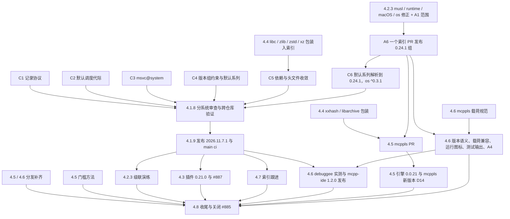

# 生态 #885 收尾设计：核心、插件、openkal、语言服务与编辑器的一轮闭合

**读者：** 推进 mcpp、mcpp-plugins、openkal 家族与 mcpplibs.os、mcppls 与 mcppls-clangd、mcpp-ide、两个索引的维护者。

**本文回答的问题：**

- 关闭 [mcpp#885](https://github.com/mcpp-community/mcpp/issues/885) 还差什么；
- 各仓库分别怎样改、按什么顺序发布；
- 怎样验收。

**范围之外：**

- mcpp 本身以 ok 映像分发：用户已决定延后，分析保留在附录 B；
- mcppls #77 中与发布无关的性能优化实验；
- #887 之外新增的加速器厂商支持。

日期：2026-11-07。依据：

- #885 正文与 2026-11-05、2026-11-06 两条补充；
- [实现依赖记录](2026-11-05-heterogeneous-build-implementation-plan.md)；
- [编译器尝试恢复](2026-11-06-compiler-attempt-recovery.md)、[BMI 发布与编译器上限](2026-11-06-bmi-publication-and-compiler-cap-closeout.md)（两份均位于 #889 分支）；
- [第 4 部分设计](2026-11-03-ecosystem-part4-beyond-native-design.md)；
- mcpp-index 的 `docs/mwrap.md`。

修订：

- 第一版：质量审查与计划（原文件 `2026-11-07-ecosystem-885-closeout-review-and-plan.md`），提出 D1–D7，用户批准。
- 第二版：测量 O1–O4，提出 D8、D9。
- 第三版（取代并重命名原文件）：按用户决定把 mcpp 映像分发延后；把 mwrap 规范扩展为“头文件收敛到最小范围”；
  把审查、测量与计划整理为按仓库组织的设计。
- 第四版：按用户决定，C 标准库的宏也收敛（新增 libc-m，4.4.1）；`msvc@system` 在本轮修复（C3）；级联架构
  优化本轮实施（4.2，D12）；#889 按提交检查点组织（D11）；第 10 节重做多视角深度审查。
- 第五版：mcpp-ide 统一版本语义，前两位为共享系列、末位留给各组件（D15）；补入运行入口图标与测试输出、
  结果标识的设计（D16）；D10、D11、D13、D14 已批准；第 10 节按生态、架构、性能、交互、用户体验、agent 体验
  重新审查。
- 第六版（本文）：D12、D15、D16 批准；核心版本号改为 2026.11.7.1，继续使用 #889；第 11 节为实施计划与检查点记录。

## 1. 目标

本轮结束时同时满足：

1. 核心 2026.11.7.1、插件 0.21.0、openkal 0.24.1 更正组、mcpplibs.os 0.3.1，以及新增的六个 mwrap 包装都已发布。
   每一项都满足 D5 所说的“已发布”：GitHub、GitCode、索引、市场、中立环境安装。
2. 已经在 GitHub 发布、但分发不完整的 mcppls 0.0.20 与 IDE 0.2.1 补齐分发。mcpp-ide 以 1.2.0 发布，内容包括：
   - 统一的版本语义（D15）；
   - 适配 mcppls 0.0.20 的载荷并兼容旧版（D13）；
   - 运行入口图标与测试输出、结果标识（D16）。
3. 头文件收敛到最小范围：第三方库与 C 标准库的头文件只出现在各自的 mwrap 包装里（D10）。
4. 级联架构改为“精确版本只出现在平台版本组与锁文件”，并以一次演练证明叶子修复只需发布两个包（D12）。
5. 所有已知缺陷要么已修复，要么有跟踪议题，并在用户文档中如实写为限制。
6. #885 发布最终台账后关闭。

## 2. 现状（2026-11-07）

| 仓库与工作线 | 状态 | 缺口 |
|---|---|---|
| mcpp 2026.11.5.1（#888） | 已发布，索引与 GLOBAL/CN 已验 | main 上的 `ci` `41960218833` 被取消后未重跑；修复分支 `ci/2026.11.5.1-macos-release-repair` 未删除 |
| mcpp 2026.11.7.1（#889） | `614227f1`，27 提交，src +1602/−185，tests +2009；`ci` 76 成功 1 失败 | Windows 交叉构建间歇失败（Q1）；范围过大（Q4） |
| mcpp-plugins 0.21.0（#52） | `79f7ba6d` CI 6/6 | 等核心公开后做最终集成；PR 正文过时 |
| openkal 0.24 组、os 0.3.0 | 已发布、已入索引 | musl#83、runtime#64、macOS 规则缓冲区、os 不认识扩展长度名字（Q9、Q1） |
| mcppls-clangd 0.0.20（#16） | 已发布 | 无；O4 证实其度量 |
| mcppls 0.0.20（#75） | 已发布；JetBrains 已补交（#78，run `42268066561`，HTTP 201，审核中） | GitCode 与 xim 索引仍是 0.0.19 |
| mcpp-ide 0.2.1（#4） | 已发布（含 JetBrains、Open VSX） | GitCode 与 xim 索引仍是 0.2.0；GUI 验证只在 Linux 上做过 |
| mcpp-index | — | `MCPP_VERSION` 为 2026.11.3.1，openkal 测试成员停在 0.23 组（Q10） |
| xim-pkgindex | okrun/okld/okprof 0.5.0 已入 | mcppls、mcpp-ide 条目落后 |

## 3. 审查结论摘要

第一、二版的审查条目保留编号，正文以本节为准。

| 编号 | 结论 | 设计中的处置 |
|---|---|---|
| Q1 | #889 的 Windows 交叉失败由两个缺陷组成：A 类（扩展长度名字无法经 os 定位）是确定性的，已被 `8791c2ca` 绕开；B 类（记录发布瞬间读取出错被当成控制器已死）是 #889 引入的间歇性回归，失败率 10/40 | 4.1.1、4.2.3 |
| Q2 | “控制器已结束”的判定把瞬时读取错误等同于死亡（H1 已证实；H3、H4 已排除） | 4.1.1 |
| Q3 | `copy_atomic` 仍走同一个有缺陷的 os 调用，在 `settle`、备份恢复、缓存保留三处执行 | 4.1.1 |
| Q4 | #889 的范围远超“收尾” | D11 提交检查点，4.1.8 分系统审查 |
| Q5 | #839 已由 #841 修复但未关闭；#803 待处置 | 4.1.7 |
| Q6、Q7 | mcppls 0.0.20、IDE 0.2.1 分发不完整 | 4.5、4.6 |
| Q8 | 2026.11.5.1 发布后没有重跑 main `ci` | 4.1.9 |
| Q9 | openkal 0.24 组带着已知缺陷发布，发布门禁没有对照未关闭缺陷 | 4.2.3、A6 |
| Q10 | 索引与测试固定落后 | 4.7 |
| Q11 | 引擎冷 CPU 的通过来自产品本身（O4）；macOS 靠重跑通过的问题仍在 | 4.5 第 4 项 |
| Q12 | IDE 0.2.1 前向引用尚未发布的 2026.11.7.1 | 4.1.8、4.6 |
| Q13 | IDE #4 在 exact-head CI 被取消的情况下合入 | 4.8 |
| Q14 | #52、#75、#885 的公开记录过时 | 4.3、4.8 |
| Q15 | 证据在 /tmp（1711 项、41 GB，磁盘 100%） | D6，4.8 |
| Q16 | 已知限制缺少跟踪议题 | 4.1.3、4.8 |
| Q17 | 强杀持锁构建后，孤儿构建边与下一次构建竞争；#889 只修好了拆分调度 | 4.1.2、D8 |
| Q18 | 一个叶子修复引起六七级发布；两周 161 个家族版本中约 40 个只为跟随下层 | 4.2、D12 |
| Q19 | IDE 0.2.1 只认 mcppls 第 4 版载荷清单，遇到 0.0.20 的第 5 版载荷无法启动；载荷清单没有成文契约 | 4.6、D13 |
| Q20 | 映像引擎不带 zlib，读不了带 zlib 的 clangd 写出的索引分片，于是丢弃分片、重新索引并反复告警 | 4.5 第 4 项、D14 |
| Q21 | 各编辑器的运行入口只有文字：VS Code 是纯文字 CodeLens，Neovim 没有标识，CLion 的 gutter 图标没有验收 | 4.6.3、D16 |
| Q22 | VS Code 中测试没有输出：后端状态映射与 mcpp 契约不一致；通过的测试丢失输出；输出没有归属到测试项 | 4.6.4、D16 |

## 4. 设计

### 4.1 mcpp 2026.11.7.1（继续使用 #889，按提交检查点组织）

#889 继续作为唯一的核心 PR（D11）。每个检查点是一组相连的提交，满足三点：

- 能单独构建，并通过它自己的本地验证；
- 在本设计记录中追加一段检查点记录：提交、验证、结论；
- 不改动其他检查点已经验证过的行为。

完整 CI、20 次重复验收与生态审查放在最后，对整个 PR 做一次。

| 检查点 | 内容 | 节 |
|---|---|---|
| C1 | 编译器事务记录协议 | 4.1.1 |
| C2 | 默认调度的构建代际 | 4.1.2 |
| C3 | Windows `build.mcpp` 的宿主工具链 | 4.1.3 |
| C4 | 平台版本组参与版本解析；默认平台改为版本系列 | 4.1.4 |
| C5 | 依赖与头文件收敛 | 4.1.5 |
| C6 | 默认平台、os 与启动器跟进 0.24.1 / os 0.3.1 | 4.1.6 |

#### 4.1.1 C1 编译器事务记录协议

问题见 Q1–Q3，证据见附录 A.1。

1. **读取三分类。** 事务记录的每个读者（`controller`、witness、`.rc`、证书、指针）统一按三类处理：
   - 名字不存在：返回“不存在”；
   - 名字存在但打不开：在调用方既有的截止时间内有界退避重试；
   - 内容损坏、或重试到期仍打不开：失败。

   不新增超时常量，也不放宽任何既有界限。
2. **存活只看进程身份（D4）。** `controller_alive` 改为三值：活、死、尚不可知。记录暂时不可读时为“尚不可知”。
   阶段一以已持有的 supervisor 身份继续判断；阶段二在既有启动宽限内继续等待。只有进程身份确认结束，并且再读
   `.rc` 仍然不存在时，才报控制器丢失。
3. **单一命名空间（D2）。** 事务模块内的记录、备份与恢复，包括 `copy_atomic`，统一使用 `std::filesystem`。
   这样既绕开 os 的缺陷，也与 os 0.3.1 的修复（4.2）互不依赖。
4. **每个出口都留状态。** supervisor 的 `return 130` 补写 `.rc`。测量表明它不是失败原因，但违反了既有约定。
5. **正式诊断。** 判定失败时输出一行：哪个条件成立、记录读取类别、两个身份的存活结果、日志与 `.rc` 的状态，
   不含路径与用户名。
6. **回归与验收：**
   - 在 Windows 扩展长度路径上实际执行 `settle` 的增量重建，以计数确认走到了 `copy_atomic`，补齐附录 A.4
     没有证实的部分；
   - 一个库层控制：打开与 rename 交错，旧实现失败、新实现通过；
   - #890 的同一 workflow 重复 20 次全部通过，且没有出现判定诊断（D1）。修正无效时 20 次全过的概率约为 0.3%。

#### 4.1.2 C2 默认调度的构建代际（D8）

默认调度的编译边也经 `__compiler-cap` 执行器运行。执行器登记带内核锁的参与者，并受同一个编译器许可约束；
下一次构建在上一代参与者全部结束前不进入构建目录，超出既有清理界限时明确拒绝。

不采用“把 Ninja 放进进程单元”：POSIX 上 Ninja 1.12.1 以 `POSIX_SPAWN_SETPGROUP` 把每条构建边放进各自的
进程组，而 openkal-linux 的进程单元就是进程组。

验收：

- 本机强杀控制在默认与拆分两种调度下各 75 轮，零失败，后续构建为空操作；Windows 原生 E2E 做同样的控制；
- `compile_commands.json` 与 `mcpp emit build-database` 的输出与改动前一致，仍是编译器本身的 argv，不带执行器
  前缀。mcppls 与 mcpp-ide 读取这两份数据；
- O5：Linux 每条边约多 1 毫秒（附录 A.5）。Windows 以整次构建墙钟时间的变化报告。D8 的批准以此为前提。

**许可数属于代际，不写进 build.ninja。** 最初的实现把许可数写成每条边的 `--cap N`，于是许可数不同的两次构建得到
不同的 build.ninja，快速路径的字节比较（e2e 861）失败。许可数现由代际记录承载：代际所有者记录为
`mcpp-compiler-run-v1` 加一行 `<id> <started> <cap>`，执行器从所在代际读取；build.ninja 旁的 `.mcpp-compiler-cap`
供快速路径复用，缺失时快速路径改为重新规划。不属于任何代际的执行器从 `--cap` 或 `MCPP_COMPILER_CAP` 取得
许可数。MSVC 协程提示跳过 `__compiler-cap … --` 前缀后再识别编译器（e2e 892）。

**macOS 上短暂“不存在”的许可槽。** macOS 宿主层对正被他人持有的槽偶尔报告 not_found，而内核实际返回 EAGAIN
（openkal-macos#45）。许可目录仍在时，执行器把它当作“被持有”，连续 5 秒仍无法解释才失败。

#### 4.1.3 C3 Windows `build.mcpp` 的宿主工具链（Q16，D11）

**现象。** 在默认使用 MSVC 的 Windows 宿主上，为裸交叉目标执行 `build.mcpp` 时，构建程序的宿主工具链解析把
`msvc@system` 当作索引包，走进了安装路径。

**契约。** `<name>@system` 表示使用本机已安装的工具链：解析器只做探测，探测不到就以“本机没有”拒绝，从不进入
索引安装路径（`lifecycle` 中已有“mcpp never installs the machine's Visual Studio”的约定）。构建程序的宿主工具链
与普通宿主构建走同一条解析，不另设分支。

**回归。** 把规范 ABI 布局 fixture 恢复为 #889 改动前的形式，即由构建程序提供 include 目录，在 Windows MSVC 宿主上
为裸交叉目标执行。旧实现失败，新实现通过；32/64 位布局断言保持不变。

#### 4.1.4 C4 平台版本组参与版本解析，默认平台改为版本系列（D12 的核心部分）

1. **版本组是约束，不再只是事后检查。** 目标图选定平台后，平台 `[platform.versions]` 中的每一项都以精确版本参与
   该图的解析，与各请求方的约束取交集。
   - 交集为空时，用既有的 `platform-version-group` 拒绝，并同时写出平台与请求方；
   - 只服务宿主的实例与来自目录或仓库的开发树，沿用现有的排除规则；
   - 现有的 `step4b_check_platform_versions` 保留为断言：解析结果仍须满足版本组。

   这是 SPEC-013 的通用语义，不是 openkal 的特例。旧的家族包本来就精确固定，在新语义下结果不变。
2. **默认平台是版本系列。** 目标表把 `x86_64-openkal`、`aarch64-openkal` 的默认平台从
   `mcpplibs.openkal-platform@0.24.0` 改为系列 `^0.24`：
   - 解析时取系列中最新、且平台声明的 `mcpp >=` 下限不高于当前引擎的版本；
   - 结果写入 `mcpp.lock`，`--locked` 与离线构建按锁文件复现；
   - 平台规格的字符串形式 `name@<约束>` 接受 SemVer 约束，表格形式沿用依赖语法。

   此后平台发布补丁版本不再需要发布 mcpp。
3. **生成的启动器以兼容范围依赖 os。** `distribution.cppm` 写出的清单由 `os = "0.3.0"` 改为 `os = "^0.3.1"`，
   具体版本由目标图与锁文件决定。这同时消除了“mcpp 用内置平台构建启动器，所以平台 CI 需要候选 mcpp”的自举
   循环（`MCPP_SOURCE_REF`）。
4. **规范与文档：** SPEC-013 的版本组与默认平台两节、`docs/35-platforms.md`、`docs/05-dependencies.md` 中英文同步。
5. **验收：**
   - 解析单测与 E2E 覆盖以下情形：索引中有更新的补丁但版本组指定旧版本，结果为版本组的版本；交集为空时拒绝并写出
     双方；默认系列跳过下限过高的平台；锁文件复现；离线构建；
   - 用候选索引，让 2026.11.5.1 与新引擎分别解析 0.24.1 组（4.2），结果一致；
   - 级联演练见 4.2 第 4 项。

#### 4.1.5 C5 依赖与头文件收敛（D10）

| 来源 | 现状 | 设计 |
|---|---|---|
| zlib、zstd、xz | `[dependencies.compat]`；`src/pack/compress_codecs.cpp` 与 `src/pack/distribution.cppm` 直接 `#include` | 依赖 `mcpplibs.mwrap.zlib`、`.zstd`、`.xz`（4.4）。这两个文件改为 `import`，宏常量取自 `.macros`，`LZMA_STREAM_INIT` 一类的初始化宏取自 `<mwrap/xz/macros.hpp>` |
| nlohmann/json | `modules/libs/src/json/json.hpp` 是复制进仓库的源码，由 `mcpp.libs.json` 包装，40 处 `import` | 依赖索引中的 `nlohmann.json`（3.12.0，原生模块包），删除复制的头文件与 `mcpp.libs.json`。`detail::json_sax_dom_callback_parser`、`unknown_size` 先核对索引包是否导出；不导出的改用公开 API，不重新复制 |
| C 标准库的宏 | 52 个文件的全局模块片段为宏引入 `<cstdio>`、`<cstdlib>`、`<cerrno>`、`<cctype>`：`stderr` 203 处，`stdout` 79 处，`EOF` 20 处，`errno` 4 处实际使用，以及 `ENOENT`、`EACCES`、`ENOEXEC`、`EPIPE`、`BUFSIZ` | 只为函数而包含的直接删去，函数由 `import std` 提供。错误码改用 `std::errc`。`stderr`、`stdout`、`EOF`、`BUFSIZ`、`errno` 取自 `mcpplibs.mwrap.libc`（4.4.1） |
| 操作系统头文件 | 只在 `src/native/{posix,windows}/lock.cpp` | 保持不变，它们已经是按系统选择的最小区域 |

另加仓库检查 `.github/tools/check_include_regions.sh`（与 `check_modules_wiring.sh` 同类）：`src/` 与 `modules/` 中除
两个锁文件外不得出现 `#include`；测试目录不在检查范围内。

`nlohmann.json` 已由 mcpp-ide 以 GCC 16.1、由 mcppls 以 LLVM 23 实际构建并使用。

实施记录：

- C 宏以 `namespace libc = mcpplibs::mwrap::libc::macros;` 引用：`libc::stderr()`、`libc::EOF`。`ESRCH`、`EPERM`、
  `EISDIR` 等同样改用 `std::errc`；`_IOLBF` 是 ISO C 的宏，同样取自 libc-m（`libc::_IOLBF`）。
- 构建程序的源码模板是原始字符串中的 C++ 文本，其中的 `#include` 属于生成的程序，不属于 mcpp 的单元，不在
  收敛范围内。
- 生成的启动器以 `mcpplibs.mwrap.zstd` 解压载荷，清单写 `"mcpplibs.mwrap.zstd" = "1.5.7"`。

验收：

- SPEC-014 §5 的容器往返测试与 pack E2E：gzip、raw DEFLATE、zstd、xz 的写出字节与改动前逐字节一致；
- json 的全部单测与 E2E 通过；
- 写到已关闭管道（EPIPE）与终端输出的现有测试通过；
- 四种工具链上的完整构建（风险见第 8 节）。

#### 4.1.6 C6 默认平台、os 与启动器跟进

4.2 的更正组公开后：

- 默认系列解析到 openkal-platform 0.24.1；
- mcpp 自身与生成的启动器依赖 os `^0.3.1`。mcpp 有 25 处 `os::fs` 读、写、rename、stamp、identity、lock 调用，在
  Windows 上同样受扩展长度名字影响，所以 mcpp 自身也要跟进，不只是启动器。

#### 4.1.7 议题处置

- #839：以附录 A.3 的数据关闭，注明由 #841 修复；强杀残留由 C2 处理。
- #803：外部贡献，与新的许可设计重叠。审查后给出合并方式，或说明后关闭。
- #840、#843：过期探针，说明后关闭。
- 本轮实施中新发现、在 #889 修复的缺陷：
  - 构建目录接管（design 2026-10-31 §8）后，前任目录中拆分编译的完成证书仍写着前任的对象路径，下一次构建在准入时
    拒绝（“cached compiler certificate does not name its own object”），直到 `mcpp clean`。mcpp 升级时每个配置都会
    遇到。现在接管时删除这些记录；准入时遇到其他目录的证书（目录被移动或在别处恢复）视为无记录，重新编译该对象。
    回归 e2e 1022。
  - `mcpp test` 的依赖横幅显示约束（`v^0.3.1`），而不是解析出的版本。回归 e2e 196。
  - cl.exe 的调试构建以 `/Zi /FS` 把一个目录全部编译的调试信息写入同一个 PDB，写入经由 mspdbsrv.exe；该服务由
    第一个 cl.exe 启动，并在它结束后继续存在。C2 的执行器在每个编译结束时回收它的进程单元，回收持有该服务的单元
    即结束了仍在写入的其他编译（C1090，PDB API 错误 23；e2e 258 在 Windows 上间歇失败）。现在调试信息写入各自的
    对象（`/Z7`），对象缓存与目录接管也以对象自足为前提；包的标志中的 `/Zi`、`/ZI`、`/FS` 在 cl.exe 上于编译前
    被拒绝。回归 e2e 1023 与单元测试 CheckSharedPdbWord。
- 清单外新发现、按 D11 建议题的问题：mcpp#898（图中提供 C 库却不提供 C++ ABI 时，错误在 std 模块预编译阶段才出现，
  规划阶段没有拒绝）。
- #896、#897（D17）：两者都是 mcpp 的缺陷，在本轮修复。
  - #896：名字相同、命名空间不同的两个包同时进入构建图时，链接计划按裸名字建立的索引让后者覆盖前者，前者的
    库不被链接。裸名字只在唯一时登记，其余按完整身份查找。回归 e2e 1018。
  - #897：一个依赖先经不带特性的边定型，之后的边再请求新特性时，新特性带来的依赖不被遍历。解析为每个依赖记录
    已请求的特性；后来的边带来新特性时，合并新激活的特性依赖，更新该包的依赖表，并把新增或变化的子依赖（含
    转发）重新放入工作队列。回归 e2e 1019。

#### 4.1.8 分系统审查与跨仓库验证

按检查点 C1–C6，以及原有的启动配置与具名测试运行器、下载进度截止时间、中英文文档与规范，逐项记录发现、证据与
结论。

跨仓库验证：

- mcpp-plugins CI 以 `mcpp_source_ref` 指向候选；
- mcpp-ide 用候选核心跑 0.2.1 的调试启动场景，验证 `debuggee` 选择与旧引擎降级（Q12）；
- 发布 canary 覆盖 mcppls 与 xlings；
- 候选索引中全部 openkal 消费者在新解析语义下通过（mcpp-index 的跨命名空间候选测试）。

#### 4.1.9 发布

依次完成：

1. 最终 CI → 生态审查 → 合入；
2. 取消 main CI → `release.yml` → 本地 `gtc` 补 GitCode → xim-pkgindex bump → 确认 CDN → GLOBAL/CN 安装；
3. 重跑 main `ci` 并记录 run，同时补上 2026.11.5.1 遗漏的那一次（Q8）；
4. 删除修复分支。

### 4.2 openkal 家族：0.24.1 更正组与级联架构（D12）

#### 4.2.1 问题

附录 C 的统计：10-24 到 11-07 两周内，家族发布了 161 个版本。其中约 40 个只为跟随下层的新版本而发，自身源码未变：
runtime 约 23/27、musl 约一半、os 约 5/12。

根因有四条：

1. 家族包之间写裸版本。裸版本等于一个已发布版本时按精确匹配处理，所以每一层都精确固定下层。
2. 平台版本组只做事后检查，不参与选版本。
3. mcpp 把默认平台编译进目标表，把启动器的 os 版本编译进生成的清单。
4. 消费方在多处写死平台版本（mcppls-clangd 的 workflow 中有四处）。

结果是一个叶子修复要依次发布 image → musl → runtime → platform → os → mcpp，每一级都要 CI、GitCode、索引 PR
和约 5 分钟的 CDN 等待，最后还拖动 mcppls、mcppls-clangd、IDE 重新验证。

#### 4.2.2 架构：精确版本只出现在两处

| 编号 | 改动 | 所在 |
|---|---|---|
| A1 | 家族包之间改用兼容范围：musl 写 `openkal-linux = "^0.25.0"`，runtime 写 `openkal-musl = "^0.28.0"`，os 写 `openkal = "^0.24.0"`。补丁版本承诺可以直接替换：openkal 的 C ABI 由规范固定；C 库与 C++ 运行时的补丁不得删除或改变已导出的符号。家族现有 CI 只检查规范的数据布局，没有检查导出集合；导出集合比对由 A6 的 workflow 承担（`tools/family_release.py exports`）：以新旧两个平台补丁构建同一映像，用 `llvm-nm` 比较映像链接的 C 库与 C++ 运行时目标文件的全局符号，补丁版本只允许新增 | 各家族仓库的 0.24.1 PR；比对在 openkal-platform |
| A2 | 平台版本组参与解析 | mcpp C4 |
| A3 | 默认平台为版本系列并写入锁文件；启动器以范围依赖 os | mcpp C4 |
| A4 | 消费方只在一处声明平台：mcppls、mcpp-ide 用系列加锁文件；需要以精确产物做资格的 mcppls-clangd 保留精确版本作为资格身份，但收敛到一处，按自己的节奏升级 | 各消费方 PR（4.5、4.6） |
| A5 | 一个版本组只开一个索引 PR：组内所有新版本与平台补丁一起提交，用跨命名空间候选测试一次验完，只等一次 CDN | mcpp-index |
| A6 | 家族发布 workflow（放在 openkal-platform，即版本组的所在）：输入版本组，核对每个成员的标签与 GitCode 镜像，生成 A5 的单一索引变更（作为产物保存，由维护者据此开 PR；平台仓库不持有索引仓库的凭据），运行新旧两版 mcpp 的候选解析，对补丁组做导出集合比对，并把各成员仓库未关闭的缺陷列入发布说明 | openkal-platform：`tools/family_release.py`、`.github/workflows/family-release.yml` |

精确版本此后只出现在两处：平台的版本组，以及各项目的锁文件。叶子修复的路径变为“叶子包 + 平台补丁”，两者以
一个索引 PR 同时发布；musl、runtime、os、mcpp 与各消费方都不必跟着发布。只有当叶子以二进制形式进入别的产物时
才需要重建，例如 okrun 静态链接系统实现，这时由 image 发补丁。

#### 4.2.3 0.24.1 更正组（本轮）

| 包 | 修正 | 回归 |
|---|---|---|
| openkal-musl（musl#83） | 目录名缓存保留完整名字；放不下时记录溢出，改用目录自身身份解析，不再拼出截断的绝对路径 | 议题中 16 棵子树、每棵 10 个 72 字节分量的深树，`remove_all` 等相对操作 |
| openkal-llvm-runtime（runtime#64） | Windows 带卷前缀的路径判为绝对路径 | 议题中的最小程序，原生 MSVC 与映像运行时各跑一次 |
| openkal-macos | 隔离规则的缓冲区按授予数与路径上限计算容量；放不下时返回表示容量的错误码，而不是 `invalid` | 16 个最长路径授予的实际启动 |
| mcpplibs.os | `locate()` 及经它定位的所有 `os::fs` 操作接受扩展长度名字：`\\?\X:\…` 按 `X:/…` 匹配，`\\?\UNC\server\share\…` 按 `//server/share/…` 匹配 | Windows CI 以扩展形式名字覆盖读、写、rename、stamp、identity，并固定附录 A.1 的读取对照 |

1. 每个家族仓库一个 PR，按提交检查点组织：修正 → A1 范围 → 发布准备。
2. 这一组是最后一次逐级的精确级联，之后由 A6 一次发布：platform 0.24.1 的版本组名列全部新版本，os 0.3.1 随组发布。
3. 合入后按家族约定把 main 强推到 `openkal-0.24`。
4. **级联演练（D12 验收）。** 0.24.1 公开后，在候选索引上虚拟发布一个只改测试的 openkal-ld 补丁和对应的平台补丁，
   确认只有这两个包变化，新旧两版 mcpp 都解析到版本组，并记录所需的发布数与耗时。
5. **过渡兼容。**
   - 2026.11.5.1 没有 A2。对 0.24.1 组，A5 的原子发布保证“索引中最新的补丁”就是版本组的版本，旧引擎经事后检查
     同样通过。
   - 0.24.0 及更早的组仍是精确固定，不受影响。
   - 旧引擎只有在一种情形下会被拒绝：显式固定较旧的平台，同时没有锁文件，又遇到之后发布的补丁。拒绝信息已经指出
     应选哪个平台版本，`docs/35-platforms.md` 写明升级到 2026.11.7.1 即可解决。

os 0.3.1 是所有 os 消费者的修正。mcppls、mcpp-ide、mcpp-plugins 目前没有显式构造扩展长度名字，但这种名字也可能
由系统 API 返回，所以它们各自的本轮 PR 都跟进 os `^0.3.1`。

**实施记录：0.24.2 补丁组，即演练的实况。** 0.24.1 公开后，#889 的 e2e 988 在 Windows（wine）上失败：启动器无法
启动 okrun。原因是 runtime 0.19.1 的修复不完整：`X:` 只有后跟分隔符时才是根名，而 `lexically_normal` 逐段用 `/=`
重建结果，`D:` 被当作普通名字，随后的根目录 `/` 替换了它（`D:/a/b` 变成 `/a/b`）。`weakly_canonical` 与
`path("D:/a") / "/b"` 同样丢卷。os 0.3.1 的 Windows 托管行也因此失败。另有两处 os 自身的缺陷：

- `fs::extended` 用 `std::filesystem::absolute`，托管方式下它把 `C:\...` 当作相对名；
- `locate` 在规范化之后才去掉 `//?/`，而 POSIX 规则的 C++ 库把开头的 `//` 读作 `/`。

修正以新架构发布，即 D12 演练的实况，不再做虚拟演练：

| 步骤 | 内容 | 时间（UTC） |
|---|---|---|
| 发现 | e2e 988 在 wine 下复现；对比 0.24.0 与 0.24.1，定位到 runtime | 00:42–00:55 |
| 叶子 | openkal-llvm-runtime#68、PR #69（`path.cpp` 原地标记，覆盖件 `operator/=` 与 `append` 保留卷；两个探针在 Linux 与 wine 下通过），发布 0.19.2 | 00:55–01:20 |
| 平台补丁 | openkal-platform#23：版本组只改 runtime；标签与 GitCode 镜像；A6 的 `resolve` 以新旧两版 mcpp 解析候选组，导出集合比对 2553/3622 个符号，无删除 | 01:20–01:31 |
| 一个索引 PR | mcpp-index #723（`family_release.py index` 写出），合入并发布 | 01:31–01:35 |
| 下游 | 只有 os 跟进自身的修正（0.3.1，mcpp-index #724）；musl、image、mcpp 都没有为 runtime 发版 | — |

共两个发布（runtime、platform），一个索引 PR，从发现到索引公开约 55 分钟。演练同时暴露了 A6 自身的两个缺陷，已在
#23 修正：workflow 默认的 `bash -e` 使 `exports | tee` 吞掉失败；比对把 libc++ `_LIBCPP_HIDE_FROM_ABI`（ODR 签名
ABI 标签）的内联函数算作导出符号。组已入索引时变更为空，`git apply` 失败，也已修正。

### 4.3 mcpp-plugins 0.21.0（继续使用 #52）

1. 立即更新 PR 正文：当前头 `79f7ba6d`、已验证范围、未验证组合。
2. C 标准库头文件（D10）。核对后，插件的单元不使用任何 C 宏：`<cctype>`、`<cstdlib>` 与部分 `<cstdio>` 只为函数
   而包含，直接删去，函数由 `import std` 提供；保留的只有 ISO C 以外的平台函数所需的头文件（`popen`、`dlopen`、
   `setenv`），并在包含处注明。`docs/plugin-development.md` §4 写明这一规则，以及需要 C 宏时取自
   `mcpplibs.mwrap.libc`。插件因此不依赖 libc-m。
3. 核心 2026.11.7.1 公开后，把正式 CI 的固定版本改为它，并加入“子工程安装静态库并构建独立可执行程序”的
   集成回归。
4. 最终 CI → 审查 → 合入 → 发布 → 索引 → 实际消费者验证。
5. 以实际消费者证据关闭 #887。SYCL 归档的目标身份混合：在 mcpp 建立 `upstream-bug` 议题，并向 SDK 上游报告；
   插件文档列出这一限制。

### 4.4 mwrap 包装（新仓库与 mcpp-index）

| 仓库 | 包 | 版本 | 唯一实现 | 消费者 |
|---|---|---|---|---|
| `mcpplibs/libc-m` | `mcpplibs.mwrap.libc` | 17.0.0（4.4.1） | 目标的 C 库 | mcpp、mcppls、mcpp-plugins |
| `mcpplibs/zlib-m` | `mcpplibs.mwrap.zlib` | 1.3.2 | `compat.zlib` | mcpp |
| `mcpplibs/zstd-m` | `mcpplibs.mwrap.zstd` | 1.5.7 | `compat.zstd` | mcpp |
| `mcpplibs/xz-m` | `mcpplibs.mwrap.xz` | 5.8.3 | `compat.xz` | mcpp |
| `mcpplibs/xxhash-m` | `mcpplibs.mwrap.xxhash` | 0.8.3 | `compat.xxhash` | mcppls |
| `mcpplibs/libarchive-m` | `mcpplibs.mwrap.libarchive` | 3.8.7 | `compat.libarchive` | mcppls |

每个仓库都按 mwrap 规范实现：

- 标签系列 `mwrap-<version>`；
- 审计全部公开头文件，以 `export using` 导出原拼写的实体；
- 对象常量映射到 `.macros`，其余宏留在 `<mwrap/<library>/macros.hpp>`；
- 带默认模板、中英两份 README、许可、API 与行为测试、installed consumer 测试；
- 首发通过 mwrap 的发布审计。

包名沿用 compat 的身份（例如 `xz`，而不是 liblzma），使包装与唯一的实现一一对应。CI 覆盖实际构建消费者的全部
工具链：mcpp 用的 GCC 16.1（Linux 与 x86_64-linux-musl 交叉）、LLVM 23.1.3（macOS、Windows）；mcppls 各宿主的
工具链与 openkal 映像工具链。libarchive 的公开 API 最大，用仓库 `tools/` 中的生成与审计工具做完整清单，不能只导出
mcppls 用到的部分。

mcpp-index 增加 `pkgs/mwrap/*.lua` 与 `tests/mwrap/*`，候选检查通过后发布。

#### 4.4.1 libc-m：C 标准库的模块形态

**是否标准、跨平台。** 需要映射的内容分三类：

| 类别 | 内容 | 处理 |
|---|---|---|
| ISO C，各平台都有 | `stdin`、`stdout`、`stderr`、`EOF`、`BUFSIZ`、`errno`，以及 `EDOM`、`ERANGE`、`EILSEQ` | 进入 libc-m |
| POSIX，ISO C 没有 | `ENOENT`、`EACCES`、`ENOEXEC`、`EPIPE`。Windows CRT 也定义它们，但取值不同 | 用 C++ 的 `std::errc`，它可移植地给出这些条件 |
| 函数与类型 | `fflush`、`fputs`、`fwrite`、`fprintf`、`getenv` 等 | `import std` 已经提供，不映射 |

所以 libc-m 的内容全部是 ISO C，与操作系统无关。这正是它不该放进 mcpplibs.os 的原因：os 负责“std 没有说的
操作系统能力”。也不叫 `mcpplibs.os.libc`：libc 通常指 C 库的实现（如 musl），而这个包不实现任何东西。

**为什么 `std.compat` 不够。** 命名模块不能导出宏，`std` 与 `std.compat` 只导出函数和类型；`stdout`、`errno`、`EOF`
在每个标准库实现中都是宏（例如 UCRT 中 `stdout` 展开为 `__acrt_iob_func(1)`）。

**命名与版本。**

- 仓库 `mcpplibs/libc-m`，包 `mcpplibs.mwrap.libc`，符合 mwrap 的 `<upstream>-m` 与 `mcpplibs.mwrap.<library>`
  约定。不用 `mlibc`：这个名字已被 managarm 项目的一个 C 库实现占用，而且同样会被误读为实现。
- 上游是 ISO C 标准。C++23 以规范性引用纳入 ISO/IEC 9899:2018（C17），所以版本取 `17.0.0`，在
  `[package.metadata.mwrap]` 中记录这一映射。C++26 改为引用 C23 时，发布 `23.0.0`。

**接口。**

- 根模块 `mcpplibs.mwrap.libc` 以 `export import std.compat;` 加上 `.macros`，导入一处即得到完整的 C 标准库。
- `mcpplibs.mwrap.libc.macros` 在 `mcpplibs::mwrap::libc::macros` 中给出：
  - 对象宏：`stdin()`、`stdout()`、`stderr()` 返回 `std::FILE*`；`errno()` 返回 `int&`；`EOF`、`BUFSIZ`、`EDOM`
    等为 `inline constexpr`；
  - ISO C 其余头文件中可以映射的对象宏，按 mwrap 要求完整审计后一并映射。
- 不能映射的宏留在 `<mwrap/libc/macros.hpp>`：`assert`、`va_*`、`offsetof`、`setjmp`。

**唯一实现。** 实现是目标的 C 库，由 mcpp 的目标基准选定（glibc、musl、UCRT、macOS libSystem、openkal-musl、
mingw）。mwrap 规范目前只写了 compat 与内置源码两种实现来源，需要在 mcpp-index 的 `docs/mwrap.md` 中补一句：
“C 标准库的实现由目标的 C 库提供”。

**测试矩阵。** 覆盖上述每一种 C 库与 libstdc++、libc++、MSVC STL 的组合，检查映射值等于头文件中的宏值，并实际
写入 `stdout()` / `stderr()`。

**实施记录（17.0.0）。**

- `tools/iso_c.toml` 按头文件列出 ISO C17 附录 B 的 334 个对象宏。每个宏在 `#ifdef` 下映射：在 Linux 上是常量表达式
  的为 `inline constexpr`，其余为 `constexpr decltype(auto) X()`。可选宏（如 `FE_UPWARD`）只在目标定义时出现。
- `HUGE_VAL`、`HUGE_VALF`、`HUGE_VALL`、`INFINITY`、`NAN`、`math_errhandling`、`FLT_EVAL_METHOD`、`FLT_ROUNDS` 在某些
  目标上不是常量，一律取函数形式（`tools/surface.toml` 的 `function`），使同一名字在各目标上形式相同。
- `<mwrap/libc/macros.hpp>` 包含函数式宏所在的头文件后，取消定义全部 ISO 对象宏：Windows CRT 的 `<stddef.h>` 定义
  `errno`，macOS 的头文件带入 `MB_CUR_MAX` 与 `NAN`，不取消则同一单元中的 `libc::errno()` 被宏展开。
- 生成器在 `generated-on`（Linux）上逐字节检查生成文件；在其他宿主上检查“Linux 上的常量在此处也是常量”。

**意义。**

- 每个模块化的 C++ 项目都会遇到同一个缺口：std 模块拿不到 C 的宏。目前 mcpp 有 52 个文件、mcppls 2 个、
  mcpp-plugins 2 个，各自在全局模块片段里包含 C 头文件。
- 独立成包后，各 C 库之间的差异只在一处审计和测试，消费者的头文件包含收敛为零。
- 它对生态以外的模块化项目同样可用。

### 4.5 mcppls 与 mcppls-clangd

1. **0.0.20 分发补齐：**
   - 本地 `gtc` 镜像到 `xlings-res/mcppls`，包括 `src-0.0.20.tar.gz`，逐个下载复核 SHA256；
   - xim-pkgindex 的 `mcppls`、`mcppls-nvim` 跟进到 0.0.20。0.0.20 起只有一个通用载荷
     `mcppls-payload-0.0.20.tar.gz`（57 MB，各宿主共用），载荷清单为第 5 版：`server.path` 是 `bin/mcppls.okb`，
     运行器按宿主写在 `platforms.<platform>.runner`（`libexec/okrun/<system>/okrun`）。配方的 xvm 别名按这一形态
     启动；0.0.19 及更早版本保留原来的按平台载荷与第 4 版别名；
   - GLOBAL/CN 洁净室中实际安装，并启动一次服务。
2. **本轮 PR（合入 main，随下一个版本发布）：**
   - libarchive、xxhash、C 标准库宏改用对应的 mwrap 包装与 `std::errc`；
   - 平台与 os 改为系列加锁文件（A4），os `^0.3.1`；
   - 完整 CI 通过后合入，随本轮的 mcppls 新版本发布（D14）。
3. **mcppls-clangd：** 四处 workflow 中的 `openkal-platform@0.24.0` 收敛到一处，作为资格身份（A4），并更新
   `ci/test_release_gates.py` 的检查。
4. **索引分片与 zlib（Q20，D14）：**
   - **现象（用户实测）：** 0.0.20 的会话日志对每个索引分片报
     “Error while reading shard …: Compressed string table, but zlib is unavailable”。
   - **原因：** 映像引擎由 `okgen` 以 `-DLLVM_ENABLE_ZLIB=OFF` 构建，原生引擎则静态链接 zlib。启用 zlib 的 clangd
     写出的分片压缩了字符串表，映像引擎读不了，只能丢弃分片、重新索引。写出这种分片的可能是 0.0.19 及更早的原生
     引擎，也可能是共用 `~/.cache/clangd/index` 或项目 `.cache/clangd` 的其他 clangd。语义结果仍然正确，但缓存
     失效、CPU 与时间浪费；只要有带 zlib 的 clangd 写入同一个存储，警告就会反复出现。日志中的
     “Rebuilding module …: no BMI for this command” 是上下文中首次构建 BMI 的正常信息，不属于问题。
   - **修正：**
     - 映像引擎以 compat.zlib 构建，启用 zlib，使原生与映像引擎读写同一种分片，这符合第 3 部分的原生/映像对等
       原则；
     - mcppls 让引擎把索引存储放在 mcppls 自有、按引擎身份区分的缓存目录中，不与其他 clangd 共用全局目录，
       旧分片随缓存回收清理。
   - **回归：** 原生引擎写出的分片由映像引擎读取，以及反向读取，都不再报错；同一工作区先后使用两种引擎时，
     不触发重新索引。
   - **发布：** 映像引擎的改动要发布新的引擎版本 0.0.21，按恢复后的 1.15 严格门槛与新登记的抽样规则做资格；
     mcppls 随后以 0.0.21 的引擎发布新版本，两者都按 D5 完成。
4. **性能门槛方法（#77）：**
   - 把 O4 的结果写入 #77；
   - 在引擎仓库登记严格门槛的抽样规则，合入后适用于下一个引擎版本：
     - 每个宿主至少 4 对交替的冷会话，取比值中位数；
     - 同一运行机内的离散上限以 O4 的 ±0.03 为基准；
     - 规定无效样本的判据；
     - 只在测量无效时允许重跑，重跑仍需满足完整样本数。

6. **分发形态与测试对象（D18）。** 三个项目的用户实际运行的都是 ok 映像，原生程序没有直接消费者。
   - **mcppls-clangd 0.0.21：** 发布只含 `clangd-<engine>-openkal.tar.gz` 与 `openkal-acceptance.json`，0.0.20 是
     最后一个带原生归档的版本；验收的原生参照仍为 `v0.0.17` 的归档。PR 与 push 的 CI 构建映像、bundle，在四个
     系统上验收，并构建一个原生引擎（linux-x64）运行补丁系列的单元与 lit 测试。其余原生引擎、Ubuntu 20.04 floor
     包、warm-prime 与分片交换只在对比运行中进行，即手动触发 `build-test` 并指定平台或 `all`。引擎输入变化的版本，
     其变更记录写明对比运行，发布 workflow 检查这一条。映像平台随之改为 0.24.2。
   - **mcppls 0.0.21：** 服务端单元测试在 Linux 上一次构建为两个架构的 ok 映像
     （`mcpp test --target openkal --no-run --archive`），由各系统的运行器在四个系统上运行（`openkal-test`）。
     原生服务端与工具的单元测试默认只在 linux-x64 运行，带 `native` 输入的手动运行覆盖全部平台。引擎候选只取
     引擎 PR 的映像部件 `clangd-openkal`。以映像运行测试发现，6 个测试以 `argv[0]` 重新启动自身，而映像不能
     直接作为程序启动；测试改为按 `os::env::self_command` 启动，即映像经其加载器启动。
   - **mcpp-ide 1.2.0：** `backend-openkal` 在四个系统上把后端测试构建为本机架构的 ok 映像并经运行器运行；其余
     平台的原生行由 `native` 输入触发。以映像运行测试发现，openkal 不表示权限位（`chmod` 返回 `ENOSYS`，
     创建文件时忽略 mode，openkal-musl 的既定设计），映像无法创建可执行文件；测试夹具在 POSIX 上以符号链接
     提供模拟服务器。

### 4.6 mcpp-ide（含 mcpp-vscode、mcpp-clion、mcpp-nvim）

mcpp-vscode、mcpp-clion、mcpp-nvim 与后端都在 mcpp-ide 仓库中（`mide-plugins/`）。独立的 `mcpp-community/mcpp-vscode`
仓库自 1.0.0 起已迁入 mcpp-ide，本轮在其 README 写明，并在执行前经确认后归档。

本节的全部改动以 mcpp-ide 1.2.0 一次发布（4.6.1 的统一版本的首个版本），按 D5 完成分发。

#### 4.6.1 统一的版本语义（D15）

**现状。** 后端、CLion、Neovim 为 0.2.1，VS Code 为 1.1.1。VS Code 扩展从独立仓库的 1.0.0 延续了市场身份，
所以与其他组件不同号。同一个版本号看不出组件之间是否兼容。

**规则。** 版本为 `X.Y.Z`：

- `X.Y` 是**系列**，由后端与全部插件共享，代表协议与共同行为。系列相同的组件之间保证兼容；
- `Z` 留给各组件**自己的补丁**，各自递增，互不影响。

例如 VS Code 1.2.3 与 CLion 1.2.1 都与后端 1.2.0 兼容。

**首个系列取 1.2。** 两个市场都要求版本单调递增：VS Code 已经到 1.1.1，系列必须高于 1.1；CLion 与后端从 0.2.1
升到 1.2.0 也是递增。本轮的改动（4.6.2–4.6.4，以及 A4）一起作为 1.2.0 发布，四个组件的 `Z` 都为 0。

**兼容判定。** 插件启动后端时，除现有的协议号检查外，还检查双方的系列相同；不同时给出明确提示，写出双方的版本
与安装方法，不再按版本号大小推断。

**发布与标签：**

| 情形 | 标签 | 发布内容 | 分发 |
|---|---|---|---|
| 系列发布（所有组件 `Z = 0`） | `v1.2.0` | 全部组件 | 两个市场、GitHub、GitCode、xim-pkgindex 的 `mcpp-ide` 与 `mcpp-ide-nvim` |
| 某个组件的补丁 | `<组件>-v1.2.Z`，组件为 `backend`、`vscode`、`clion`、`nvim` | 只有该组件 | 只更新该组件的渠道：`backend` 对应 xim 的 `mcpp-ide` 与 bundle-all，`nvim` 对应 `mcpp-ide-nvim` |

CHANGELOG 按系列分节，节内再按组件列出补丁。现有的 release workflow 改为按标签前缀选择要发布的组件，并校验该
组件清单中的版本与标签一致。

#### 4.6.2 与 mcppls 0.0.20 的载荷兼容（Q19，D13）

IDE 通过 mcppls 的载荷找到语言服务：后端 `languageservice.cppm` 的 `payload_command`、CLion 的
`Locate.runnablePayload`、Neovim 的会话代码，都读取载荷清单 `server.runner` 与 `server.path`。这是第 4 版的形态。
0.0.20 的第 5 版去掉了 `server.runner`，运行器改为按宿主写在 `platforms.<platform>.runner`。结果是，IDE 0.2.1 遇到
0.0.20 的载荷时，会直接执行 `bin/mcppls.okb`，因而失败。IDE 的 CI 固定使用 mcppls 0.0.19，所以没有暴露。根因是
载荷清单没有成文契约。

1. **mcppls 一侧：** 在 `docs/specs` 中发布载荷清单规范，附 JSON Schema，纳入 `validate.py`。规范覆盖第 4、5 两版，
   给出确定的启动规则：
   - 第 5 版：在 `platforms` 中取本宿主一项，命令为 `<runner> <server.path>`；
   - 第 4 版：命令为 `[server.runner] <server.path>`；
   - 本宿主不在 `platforms` 中：拒绝，并写出载荷服务的宿主。

   规范随 4.5 的本轮 PR 合入。
2. **mcpp-ide 一侧：** 后端、CLion、Neovim 三处读取器按规范同时支持两版；单文件的原生 `mcppls`（PATH、xlings）
   照旧支持。VS Code 经后端取得命令。宿主名到 mcppls 平台键（`linux-x64`、`linux-arm64`、`darwin-arm64`、
   `win32-x64`）的映射只在后端一处。
3. **测试：**
   - 单测以真实发布中的 `payload.json`（0.0.19、0.0.20 各一份）作为夹具，另加越界路径、缺少本宿主等负向用例；
   - VS Code、CLion、Neovim 各对 mcppls 0.0.19 与 0.0.20 跑一遍；
   - `kRequired` 不提高。

#### 4.6.3 运行入口的图标（Q21，D16）

**现状：**

- VS Code 在 `main` 上方用 CodeLens 显示纯文字“Run”“Debug”；
- CLion 已有 `McppRunLineMarker`，会在 `main` 与测试用例旁的 gutter 显示 ▶，但只在后端返回该文件的入口时才出现，
  GUI 检查没有断言它存在；
- Neovim 没有任何入口标识。

**设计：** 后端已经给出每个文件的入口（程序的 `main` 行、测试程序的 `main` 行、各用例行）。三个编辑器用各自原生的
方式呈现同一份数据，提示中写明目标、配置与平台。

| 编辑器 | 程序的 `main` | 测试的 `main` 与用例 |
|---|---|---|
| VS Code | CodeLens 改为带图标的 `$(play) Run`、`$(debug-alt) Debug`；当前文件是某个目标的入口时，编辑器标题栏的运行按钮（`editor/title/run`）提供运行与调试 | Testing API 的 gutter 图标（测试项已带 `range`），显示上次结果：通过、失败、未运行 |
| CLion | 保留 `RunLineMarkerContributor` 的 ▶，补上入口取不到时的原因日志 | 同上，图标随上次结果变化（已有 `getTestStateIcon`） |
| Neovim | sign column 显示 `▶`，`<leader>` 映射与 `:Mcpp run` 调用 | sign 按上次结果显示 ✓、✗；失败行进入 quickfix |

**验收：** 三个编辑器的 GUI 或冒烟检查分别断言：程序 `main` 行有运行图标；测试 `main` 与每个用例行有图标；运行后
图标随结果变化。VS Code 断言 CodeLens 标题中含图标，以及编辑器标题栏按钮存在。

#### 4.6.4 测试输出与结果标识（Q22，D16）

**现象（用户实测）：** VS Code 中 GoogleTest 用例没有输出；带 `main` 的普通测试程序也没有输出。

**原因（读源码确认）：**

1. **状态映射有误。** mcpp 的测试流状态为 `pass`、`compile_fail`、`run_fail`、`not_run`、`built`，后端
   `views.cppm` 的 `stream_record` 却按 `fail`、`skip` 映射。结果是 `run_fail` 与 `compile_fail` 都落入
   `errored`，超时也永远识别不出来。
2. **通过的测试丢失输出。** 后端把 `compile_output` 与 `run_output` 合成 `output` 转发，但 VS Code 只在失败时把它
   放进 `TestMessage`。通过的测试，其输出没有交给任何测试项。
3. **输出没有归属到测试项。** 两条运行路径都以 `run.appendOutput(text)` 写入，没有传测试项。VS Code 只在整次运行
   的终端里显示，点开单个测试或用例看不到输出。用例模式下，GoogleTest 每个用例的输出也没有按用例切开。

**设计：**

1. **后端：**
   - 状态映射与 mcpp 的契约逐值一致：`pass` → passed、`run_fail` → failed（`timed_out` 为真时为 timedOut）、
     `compile_fail` → failed 并标注编译失败、`not_run` → skipped（带原因）、`built` → skipped（仅构建）。旧值按
     未知处理，并记一次日志；
   - 每个测试记录都携带完整输出，并附 `outputTruncated` 标志：单项输出上限 1 MiB，超出时保留头尾并注明截断；
   - 用例模式下，按框架的边界切分输出。GoogleTest 用 `[ RUN      ]` 与 `[       OK ]` / `[  FAILED  ]`；
     Catch2 用已有的 JSON 报告。每个用例的输出与失败位置（`file:line`）随该用例的结果一起发出。
2. **VS Code：** 每条结果都调用 `run.appendOutput(output, location, item)` 归属到对应项，无论通过与否。失败时
   `TestMessage` 带上位置，在断言所在行内联显示；普通测试程序的失败，从输出中识别 `file:line:` 作为位置，识别不到
   时挂在 `main` 行。
3. **CLion：** SM 测试树为每个程序与用例发出 `testStdOut` 与 `testFailed`（带位置），通过的测试同样可以看到输出。
4. **Neovim：** `:Mcpp test` 的结果写入一个结果缓冲区，按测试分节；失败位置进入 quickfix；sign 显示结果。
5. **对 agent 与 CI 的契约不变：** `mcpp test --message-format json` 已为每个测试（包括通过的）给出 `run_output`，
   这一点由核心测试固定下来。用例级切分属于框架知识，只在 IDE 后端里做，不进入核心。mcpp 的 `mcpp-usage` 技能文档
   补一段按用例运行与读取结果的做法（`--print-launch -- --gtest_filter=…`、`--gtest_output=json`），供 agent 使用。

**验收：** 夹具工程包含 GoogleTest 用例（通过、失败、输出很多）、Catch2 用例、带 `main` 的普通测试（通过、失败、
超时、编译失败）。三个编辑器分别断言：

- 每个测试与用例都能看到自己的输出；
- 失败显示在断言行；
- 状态与 mcpp 的契约一致；
- 截断标志生效。

#### 4.6.5 其余事项

1. **0.2.1 分发补齐：** 本地 `gtc` 镜像到 `xlings-res/mcpp-ide`；xim-pkgindex 的 `mcpp-ide`、`mcpp-ide-nvim` 跟进到
   0.2.1；洁净室安装验证。1.2.0 发布后再按 4.6.1 跟进。
2. **跨仓库：** 用 4.1.8 的候选核心实测 `debuggee` 选择；启动配置的形状若有变化，随 1.2.0 一起适配。
3. **原生宿主：** 0.2.1 的 GUI 检查只在 Linux 上做过。在 Windows 与 macOS 运行机上，用同一个 packaged ZIP 运行
   稳定版检查。运行机提供不了 GUI 的项目，在发布说明与文档中逐项写为限制。
4. **A4：** 平台与 os 改为系列加锁文件，随 1.2.0 发布。

### 4.7 索引

- **mcpp-index：**
  - 核心发布后，`xpkgindex-update.yml`、`openkal-compat.yml`、`tests/openkal/pins.toml` 的 `MCPP_VERSION` 改为
    2026.11.7.1；
  - `tests/examples/openkal` 与 `openkal-platform` 成员移到 0.24.1 组；
  - 加入 4.4 的六个 mwrap 包与 `docs/mwrap.md` 的补充；
  - 0.24.1 组以 A5 的单一 PR 发布；
  - 更新 CHANGELOG。
- **xim-pkgindex：** mcpp 2026.11.7.1 的 bot bump（重开或空提交触发 CI，合入后删除机器人分支），以及 4.5、4.6 的
  条目。

### 4.8 收尾（原 T10）

1. 第 4 部分设计以带日期的更正块写入最终实测数字与实际版本组，不改写原文。
2. openkal 多角度审查（规范一致性、拒绝路径、安全、并发、跨平台），结合 4.2 的结果逐项给出结论。
3. 生态全局审查；xlings 洁净室真实验证：中立 cwd，`XDG_*` 指向洁净室，不用 shim。
4. 建立 Q16 的议题：SYCL 归档、`msvc@system`（在 C3 中关闭）、os 扩展长度名字（在 os 修复的 PR 中关闭），以及
   映像分发（D9）。
5. 证据归档（D6）：仍被引用的证据打包到 /tmp 以外的持久位置，附 SHA256 清单。之后清理本轮的临时目录与
   相关项目的过期构建缓存，并关闭本轮的探针 PR #890、mcppls-clangd#17。
6. 更新 #52、#75 的正文；在 #885 发布最终台账，逐项列出“实现提交 / 局部验证 / 最终 CI / 公开发布 / 镜像与索引”。
7. 流程：exact-head CI 被取消时不得合入（Q13）；家族发布经 A6，自动列出未关闭缺陷。

### 4.9 IDE 中的运行与构建反馈（D19）

**现象（用户实测，CLion）：** 右键 Run 时控制台先出现“mcpp: building…”，约 1 s 后才出现程序输出，代码没有改动时也是如此；构建时看不到 mcpp 的构建信息与进度；侧栏上没有 MC++ 图标。

**测量（Linux x86_64，无改动时）：**

| 命令 | 耗时 |
|---|---|
| `mcpp build`、`mcpp run` | 0.00–0.01 s（快速路径） |
| `mcpp run --print-launch`，单文件工程 | 0.08–0.10 s |
| `mcpp run --print-launch`，mcpp-ide 工程 | 0.30 s |
| 后端 `mcpp/availability` 与 `run/launch` | 0 ms 与上一行相同 |

**原因：**

1. `--print-launch` 不走快速路径（`try_fast_run` 以“the launch the full path composes”拒绝），每次都重新解析依赖、工具链并重做规划；`--message-format json` 下也只输出最后的 envelope，没有进度事件。
2. 后端的 `run/launch` 是一次同步请求，期间既不转发 mcpp 的叙述，也不转发进度；只有失败时才把叙述交给编辑器。CLion 与 Neovim 因此先打印固定的“mcpp: building…”，再静默等待。VS Code 在终端里运行 `mcpp run`，看得到 mcpp 的原始输出。
3. CLion 的 Build 作业转发了叙述（`job/output`），但没有处理 `job/progress`，看不到 `n/m` 进度；VS Code 与 Neovim 处理了这一通知。
4. CLion 的工具窗口注册在右侧，新 UI 默认不把第三方工具窗口放上侧栏。

**设计：**

1. **mcpp 2026.11.7.2。**
   - **原先的限制与取舍。** 2026-10-26 控制契约设计（§5.3、B4）要求启动描述与 `mcpp run` 的启动逐项一致；完整路径
     组合 runner 前缀、执行宿主、runner 携带的文件与运行契约环境，快速路径只组合程序、loader 环境与 subos 环境，
     而快速路径的正确性靠一份屡有漏项的拒绝清单（#544、#716、#755、riscv）。因此 `--print-launch` 只走完整路径。
     这不是必要的限制：没有改动时 `mcpp run` 本身就由快速路径以它组合的 argv 与环境执行程序，缺的只是完整路径
     才有的 `configuration` 与“两条路径组合相同”的保证。
   - **记录与比较。** 完整路径输出启动描述时，把它（不含本次的程序参数）记录在该配置的目录中
     （`launch/<program>.json`）。快速路径照常经过 `mcpp run` 快速路径的全部准入与 ninja，然后把自己组合出的
     `argv`、`env`、`via`、`program` 与记录逐项比较：相同则输出记录并附上本次的程序参数；不同或没有记录则退回
     完整路径，由它重写记录。输出因此在构造上就是完整路径的结果，不另设拒绝清单。
   - `--print-launch --message-format json` 输出 NDJSON：构建的 plan、waiting、progress、artifact 事件，最后一行是
     `mcpp.launch` 信封；特性名 `launch-stream`。不带 `--print-launch` 的 `run --message-format json` 被拒绝。不带
     `--message-format json` 时输出不变。
   - `mcpp test --print-launch` 不变：`mcpp test` 没有快速路径，每次都规划。
   - 回归 e2e 1024：两条路径的信封逐字段相同，且没有重新解析；改动源文件后重新编译并给出相同描述；被改动的记录
     不被使用并被重写；流式输出逐行是 JSON、含 progress、末行为信封；`--protocol-version` 列出 `launch-stream`。
     实测：单文件工程 0.09 s 降到 0.01 s，mcpp-ide 工程 0.30 s 降到 0.01 s。
2. **mcpp-ide 1.2.0 后端。** 新增作业种类 `launch`：mcpp 具备 `launch-stream` 时以 `--print-launch --message-format json` 执行（否则以 `--print-launch` 执行，只转发叙述），构建期间发出 `job/output`（mcpp 的叙述）与 `job/progress`，`job/finished` 携带 launch。`run/launch` 与 `debug/configuration` 保留，供同系列的旧客户端使用。
3. **CLion。**
   - Run 与 Debug 以 `launch` 作业构建：控制台实时显示 mcpp 的叙述，不再打印固定文字；无改动时只有 mcpp 的
     “Finished … in 0.01s”。Debug 的构建在进度对话框中显示 mcpp 的最后一行叙述与步数比例，随后取调试配置（mcpp
     走快速路径）。
   - Build、Test 与 Run 的进度显示在状态栏 widget 上（`<作业> n/m`）。
   - 在 idea.log 记录各段耗时：作业受理、构建、程序启动。
   - 工具窗口改为左侧（`anchor="left"`），与 Project 并列；第一次打开 mcpp 项目时把它的按钮放上侧栏（新 UI
     默认把插件的工具窗口放在“更多工具窗口”中），之后保留用户的调整。项目判定不变：打开的目录有 `mcpp.toml`。
4. **Neovim。** `:Mcpp run` 以 `launch` 作业构建，叙述写入 `mcpp://output`，进度进入状态行（`<作业> n/m`），与 Build 一致；冒烟测试覆盖。
5. **VS Code。** Run 仍在终端中运行 `mcpp run`；调试前的构建改用 `launch` 作业，进度进入状态栏。

## 5. 决定

| 编号 | 决定 | 状态 |
|---|---|---|
| D1 | #889 须在带结构化诊断的 20 次重复验收下全部通过才能合入 | 已批准 |
| D2 | 编译器事务模块的记录、备份与恢复统一使用宿主命名空间 | 已批准 |
| D3 | 核心等待 openkal 0.24.1 更正组与 os 0.3.1，以更正后的默认平台发布 | 已批准 |
| D4 | 存活只由进程身份判定，记录读取错误按类别处理 | 已批准，O1 证实 |
| D5 | “已发布”指 GitHub、GitCode、索引、市场、洁净室安装全部完成 | 已批准 |
| D6 | 证据持久归档，并以 SHA256 清单引用 | 已批准 |
| D7 | 严格性能门槛用预先登记的抽样规则；更换计量口径时并列报告新旧结果 | 已批准，O4 证实 |
| D8 | 默认调度的编译边经 `__compiler-cap` 登记为代际参与者 | 有条件批准：以 O5 证明对构建性能影响很小为前提 |
| D9 | mcpp 本身以 ok 映像分发延后，分析见附录 B | 用户已决定 |
| D10 | 头文件收敛到最小范围：第三方库只出现在各自的 mwrap 包装中；C 标准库的宏取自 `mcpplibs.mwrap.libc`（版本 17.0.0），错误码用 `std::errc`；操作系统头文件留在按系统选择的源文件中；mcppls 的收敛随本轮的 mcppls 新版本发布 | 已批准 |
| D11 | #889 按提交检查点 C1–C6 组织，清单内的事项（包括 `msvc@system` 与 D12 的核心部分）全部进入；清单外新发现的问题建议题 | 已批准 |
| D12 | 级联架构 A1–A6 本轮实施：精确版本只出现在平台版本组与锁文件；0.24.1 是最后一次逐级的精确级联；家族发布经 A6 一次完成，并列出未关闭缺陷 | 已批准，含 4.2.3 第 5 项的过渡规则 |
| D13 | mcppls 的载荷清单成文为规范（第 4、5 版），客户端按规范读取并同时兼容两版与单文件原生 mcppls；随 mcpp-ide 1.2.0 发布 | 已批准 |
| D14 | 引擎映像启用 zlib；mcppls 为引擎使用自有、按引擎身份区分的索引存储；本轮发布引擎 0.0.21 与对应的 mcppls 版本 | 已批准 |
| D15 | mcpp-ide 版本为 `X.Y.Z`：`X.Y` 是后端与全部插件共享的系列，同系列即兼容；`Z` 为各组件自己的补丁；首个系列 1.2；系列发布标签 `v1.2.0`，组件补丁标签 `<组件>-v1.2.Z` | 已批准 |
| D16 | 运行入口与测试结果以同一份后端数据、各编辑器原生的图标呈现；测试输出逐项归属，状态与 mcpp 契约逐值一致；用例切分只在 IDE 后端 | 已批准 |
| D17 | #896（同名不同命名空间的两个包只链接其一）与 #897（后到的边请求的新特性不被遍历）是 mcpp 的缺陷，并入 #889 修复（4.1.7） | 用户已决定 |
| D18 | mcppls-clangd、mcppls、mcpp-ide 自本轮版本起只分发 ok 映像，测试也以 ok 映像进行；原生构建保留为测试工具与对比运行，PR、push 与发布的 CI 默认只在 linux-x64 构建原生程序，其余平台的原生构建与测试由手动触发（4.5 第 6 项） | 用户已决定 |
| D19 | IDE 中的运行与构建反馈与终端一致：`run --print-launch` 走快速路径并可流式报告；后端以作业执行启动构建；CLion 与 Neovim 显示 mcpp 的真实叙述与进度；CLion 工具窗口位于左侧并默认显示（4.9） | 用户已决定 |

## 6. 执行顺序

立即可以并行开始的有：C1、C2、C3、C4、4.2.3 的修正与 A1、A6 的 workflow、4.4 的六个包装、4.5 与 4.6 的分发补齐、
门槛方法、mcppls 载荷规范、映像引擎启用 zlib。

关键路径为：4.2.3 → A6 → C6 → 4.1.8 → 4.1.9 → 4.3。C4 与 A1 互不阻塞，因为 4.2.3 第 5 项的过渡规则让旧引擎也能
解析 0.24.1 组。

## 7. 验收与关闭 #885 的条件

- 1 节的五项目标全部满足，且每一项都按 D5 完成。
- C1 的 20 次重复、C2 的强杀控制、C3 的 fixture 回归、C4 的解析测试按所列标准通过；O5 已报告。
- 全部字节一致性测试通过（C5）；`check_include_regions.sh` 通过。
- 级联演练表明叶子补丁只需发布两个包，且新旧两版 mcpp 解析一致。
- mcpp-ide 1.2.0：
  - 对 mcppls 0.0.19 与 0.0.20 的兼容性测试在三个编辑器上全部通过；
  - 运行图标与测试输出的检查全部通过（4.6.3、4.6.4）；
  - release workflow 按标签前缀选择组件，在 dry-run 模式下验证系列发布与组件补丁两种情形。
- 引擎 0.0.21 与对应的 mcppls 版本发布；跨引擎读取分片不再报错。
- main 上的核心 `ci` 已在发布后的 HEAD 上通过并记录 run。
- Q16 的议题均已建立或关闭；#887、#839、#803、#840、#843、#890、mcppls-clangd#17 均已处置。
- 第 4 部分写入最终数字；openkal 审查与生态审查已记录；洁净室验证通过。
- 证据已归档，临时文件已清理。
- 性能后续只在 #77 中保留；映像分发只在附录 B 与其议题中保留。

## 8. 风险

| 风险 | 影响 | 控制 |
|---|---|---|
| C1 修正后，B 类以别的形式重现 | 核心发布推迟 | 正式诊断保留判定原因；验收按 20 次重复 |
| 解析语义改动（C4）影响索引中其他包 | 普遍的解析回归 | 只对选定平台的版本组成员生效；以全部 openkal 消费者与 mcpp-index 候选测试验证；旧家族包精确固定，结果不变 |
| 范围依赖降低可复现性 | 同一源码在不同时间解析出不同版本 | 发布与资格以锁文件为准；mcppls、mcppls-clangd、IDE 的 CI 用 `--locked` |
| 补丁版本违背兼容承诺 | 消费方静默拿到不兼容的补丁 | A1 新增的导出集合比对；A6 在发布前跑新旧两版 mcpp 的候选解析与消费者测试 |
| 旧引擎遇到之后的补丁时拒绝 | 使用 2026.11.5.1 并固定旧平台的用户需要升级 | 拒绝信息已写明解法，文档说明；只在没有锁文件时出现 |
| libarchive 的完整 API 审计工作量大 | mcppls PR 推迟 | 不在核心关键路径上；未完成时该 PR 不合入，#885 台账如实记录 |
| `nlohmann.json` 与 `mcpp.libs.json` 的导出不同 | 迁移受阻 | 先核对导出差异；缺失的 detail 符号改用公开 API |
| C5 的大量机械替换（约 300 处） | 引入行为差异 | 按文件分组提交；终端、管道与 EPIPE 的现有测试，以及四种工具链上的完整 E2E |
| mcpp 的模块图新增 5 个模块（libc、zlib、zstd、xz、nlohmann.json）后，GCC 16.1 崩溃（#863 等先例） | C5 推迟 | 包装入索引后先以探针在四种工具链上构建；触发编译器缺陷时建上游议题并在实现中规避 |
| 更正组级联中又发现新缺陷 | D3 让核心等待 | A6 列出；属于已验证失败的修入，其他建议题 |
| D8 在 Windows 上代价偏高 | 默认调度变慢 | O5 先测量；不可接受时改换机制并重新请批 |
| mcpp-ide 版本从 0.2.1 跳到 1.2.0 | 用户与索引误以为是大变动 | CHANGELOG、两个市场与 xim 条目写明统一系列的原因；兼容由系列检查保证 |
| 测试输出很大 | 测试视图变慢、内存上涨 | 单项上限 1 MiB，保留头尾并标注截断 |
| GoogleTest 输出边界被程序自身的打印打乱 | 用例输出切分错误 | 以 GoogleTest 的 JSON 报告校正用例结果，边界只用于切分输出；切不开的部分归属到程序项 |
| 磁盘 100% | 本机构建与测量失效 | 先按 D6 归档，再清理；重任务经 `/tmp/mcpp-heavy.lock` 串行 |

## 9. 不在本轮的事项

- mcpp 以 ok 映像分发（D9）：延后理由与先决条件见附录 B，并建立议题保存。
- mcppls #77 中的可选性能实验。

## 10. 多视角深度审查（第五版）

### 10.1 生态

| 检查 | 结论与处置 |
|---|---|
| 各仓库的职责是否清楚 | 核心只承担通用契约：版本组参与解析、默认平台系列、测试流。框架知识（用例切分）在 IDE 后端；载荷格式归 mcppls 规范；C 标准库宏归 libc-m；操作系统能力归 os |
| 已发布产物之间是否互相兼容 | 发现并处置了两处已有的不兼容：IDE 0.2.1 与 mcppls 0.0.20（Q19）、映像与原生引擎的索引分片（Q20）。旧 mcppls 与旧引擎继续可用（D13、D14） |
| 版本号能否表达兼容 | mcpp-ide 改为“系列 + 组件补丁”（D15）；openkal 家族改为“范围 + 版本组 + 锁文件”（D12）。两者都把“是否兼容”交给可判定的规则，而不是比较版本号大小 |
| 分发是否完整 | D5 覆盖核心、插件、0.24.1 组、os、六个 mwrap 包、mcppls 0.0.20 补齐与新版本、引擎 0.0.21、mcpp-ide 1.2.0 |

### 10.2 架构

| 检查 | 结论与处置 |
|---|---|
| 核心是否新增特例 | 没有。C3 把 `@system` 写成通用契约；C4 是 SPEC-013 的通用语义；测试流契约不变 |
| 依赖方向 | 去掉复制的 json.hpp；每个 mwrap 包装只有一个实现；IDE 读取 mcppls 载荷依据成文规范，不再按实现反推 |
| 头文件最小范围 | 第三方与 C 标准库头文件只在各自包装中；操作系统头文件只在两个锁文件中；由 `check_include_regions.sh` 固定 |
| 一份数据，多处呈现 | 运行入口与测试结果都来自后端的同一份数据，三个编辑器只负责呈现（D16），避免三套各自推断的逻辑 |
| 补丁兼容承诺 | A1 新增导出集合比对；mcpp-ide 的系列检查与协议号检查并存 |

### 10.3 性能

| 检查 | 结论与处置 |
|---|---|
| 构建 | D8 每条边约 1 毫秒（Linux），mcpp 自举约多 0.06 秒；Windows 待 O5；C1 的重试只在名字存在但打不开时发生 |
| 编辑器 | D14 去掉跨引擎的重复索引；测试输出单项上限 1 MiB，超出时保留头尾，避免 VS Code 测试视图因为超大输出变慢；用例切分是流式的，不缓存整次输出 |
| 发布 | D12 把叶子修复的发布从六七级降到两级；A5 只等一次 CDN |

### 10.4 交互

| 检查 | 结论与处置 |
|---|---|
| 入口是否一眼可见 | 三个编辑器都用原生图标：VS Code 的带图标 CodeLens、标题栏运行按钮与 Testing gutter；CLion 的 gutter ▶；Neovim 的 sign |
| 结果能否就地查看 | 每个测试与用例的输出都归属到自己的项；失败显示在断言行；Neovim 的失败进入 quickfix |
| 状态是否可信 | 状态与 mcpp 契约逐值一致，编译失败、超时、未运行、仅构建分别呈现，不再一律显示为“错误” |
| 版本不匹配时如何提示 | 插件与后端的系列不同时，给出明确提示，写出双方版本与安装方法 |

### 10.5 用户体验

| 检查 | 结论与处置 |
|---|---|
| 升级是否无痛 | 旧版 mcppls 与 IDE 继续可用；分片告警的根因在 D14 修复；版本号从 0.2.1 到 1.2.0 的跳变在 CHANGELOG 与两个市场的说明中写明原因 |
| 告警是否有意义 | `Rebuilding module …` 是正常信息；分片告警属于缺陷，修复后不再出现；后端对未知状态值只记一次日志 |
| 跨平台一致 | Windows 与 macOS 的 GUI 检查用同一个 packaged ZIP 补做；运行机提供不了的项目逐项写为限制 |

### 10.6 agent 使用体验

| 检查 | 结论与处置 |
|---|---|
| agent 能否拿到与 IDE 相同的信息 | 能。`mcpp test --message-format json` 为每个测试（包括通过的）给出状态与 `run_output`，这一点由核心测试固定；IDE 的状态映射与它逐值一致 |
| 用例级信息 | 用例切分不进入核心，`mcpp-usage` 技能文档补充按用例运行与读取的做法（`--print-launch -- --gtest_filter=…`、`--gtest_output=json`） |
| 诊断能否被程序读取 | C1 的判定诊断是单行结构化文本，不含路径；构建失败原因、平台拒绝都有既有的 NDJSON 事件 |
| 版本与兼容能否被程序判断 | 版本组、锁文件与 mcpp-ide 的系列都是可判定的规则，agent 不需要猜测版本号大小 |

### 10.7 其他

| 视角 | 结论与处置 |
|---|---|
| 正确性 | 每个修正都有“旧实现失败、新实现通过”的控制，包括 Q21、Q22 的 GUI 与冒烟断言 |
| 证据 | Q22 的三个原因来自 `views.cppm` 与 `testing.ts` 的源码；Q21 来自三处插件的源码。在实现前，以夹具工程在三个编辑器中复现用户报告的现象，并把复现结果写入检查点记录 |
| 自举顺序 | D3 与 A1 互不等待，理由见 4.2.3 第 5 项 |
| 编译器 | mcpp 新增 5 个导入模块，先在四种工具链上试构建 |
| 安全与隐私 | 诊断不含路径；附录只出现运行机路径的形状 |
| 流程 | 延后项只有用户决定的 D9；不可逆操作（归档仓库、强推、市场发布）在执行前单独确认 |
| 范围与工作量 | 新增的 D15、D16 只在 mcpp-ide，不在核心关键路径上；mcpp-ide 1.2.0 依赖 mcppls 的载荷规范与候选核心的 `debuggee` 实测 |

审查后对正文做了三处修正：

- 4.6.4 补入单项输出上限与截断标志，防止超大输出拖慢测试视图；
- 4.6.4 补入 agent 侧的技能文档，使 agent 与 IDE 拿到同一份信息；
- 第 7 节把“组件补丁演练”改为 release workflow 的 dry-run 验证，不为验收真的发布一个补丁。

## 11. 实施计划与检查点记录

### 11.1 每个仓库一个 PR

| 仓库 | PR | 版本 | 内容 | 依赖 |
|---|---|---|---|---|
| mcpp | #889（标题改为 2026.11.7.1） | 2026.11.7.1 | C1–C6、第 4 部分实测记录、本设计 | 0.24.1 组与 os 0.3.1（C6）；六个 mwrap 包中 mcpp 用到的四个（C5） |
| openkal-macos | `openkal-0.24.1` | 0.22.1 | 规则缓冲区容量与错误码；A1 | 无 |
| openkal-musl | `openkal-0.24.1` | 0.28.1 | musl#83；A1 | 无（范围下限取已发布版本） |
| openkal-llvm-runtime | `openkal-0.24.1` | 0.19.1 | runtime#64；A1 | 无 |
| openkal-image | `openkal-0.24.1` | 0.5.1 | 运行器以 macOS 0.22.1 重建；A1 | openkal-macos 0.22.1 已入索引 |
| openkal-platform | `openkal-0.24.1` | 0.24.1 | 版本组；A6 workflow | 组内各成员的标签 |
| mcpplibs/os | `openkal-0.24.1` | 0.3.1 | 扩展长度名字的定位；A1 | 无 |
| libc-m、zlib-m、zstd-m、xz-m、xxhash-m、libarchive-m | 各自首个 PR | 见 4.4 | mwrap 包装 | 无 |
| mcpp-index | 按依赖分批的 PR，每批一个 | — | mwrap 包；0.24.1 组；`MCPP_VERSION` 与测试成员 | 各成员的标签 |
| mcpp-plugins | #52 | 0.21.0 | libc 宏；最终集成 | mcpp 2026.11.7.1 公开 |
| mcppls-clangd | 一个 PR | 0.0.21 | 映像启用 zlib；平台版本收敛到一处；抽样规则 | 0.24.1 组 |
| mcpp-language-server | 一个 PR | 0.0.21 | 载荷规范；mwrap；A4；引擎索引存储 | 引擎 0.0.21；xxhash-m、libarchive-m |
| mcpp-ide | 一个 PR | 1.2.0 | D15、D13、D16、A4 | mcppls 载荷规范 |
| xim-pkgindex | 每个产品的发布各一个 PR | — | mcpp、mcppls、mcpp-ide、nvim 条目 | 各自的发布 |

mcpp-index 与 xim-pkgindex 的 PR 数量由发布依赖决定：一个条目只能在它引用的标签存在之后提交。

### 11.2 依赖波次

1. **立即并行：**
   - 0.24.1 组中不依赖他人的四项：macOS、musl、runtime、os；
   - 六个 mwrap 包；
   - mcpp 的 C1、C2、C3、C4；
   - mcpp-ide 的 D15、D16；
   - mcppls 的载荷规范；
   - 引擎的 zlib 构建；
   - mcppls 0.0.20 与 IDE 0.2.1 的分发补齐。
2. **macOS 0.22.1 入索引后：** image 0.5.1 重建运行器。
3. **组成员标签齐全后：** platform 0.24.1 的版本组；以一个 mcpp-index PR 发布全组。
4. **全组与 mwrap 包公开后：** mcpp 的 C5、C6；mcppls 与引擎改用新组；mcpp-ide 的 A4。
5. **完整 CI 与生态审查后：** 发布 mcpp 2026.11.7.1；随后 mcpp-plugins 0.21.0、引擎 0.0.21、mcppls 0.0.21、mcpp-ide 1.2.0；
   各自的索引条目；洁净室验证；处置议题。

等待 CI 期间推进同一波次或下一波次中不依赖该 CI 的任务。

### 11.3 检查点记录

各检查点完成时在此追加：提交、验证命令与结果、结论。

| 检查点 | 提交 | 验证 | 结论 |
|---|---|---|---|
| C1 | `4e01eb88` | #890 同一 workflow 重复 20 次，Windows 交叉构建 20/20 通过，无判定诊断（run `42290667854`） | D1 满足 |
| C2 | `30b900f4`、`08341b38`、`8f021109` | 本机强杀控制；e2e 861、892、951、952、995、1010；单元测试 `test_detach_status` 以 `MCPP_TEST_LIFETIME_CAP` 覆盖代际许可数 | 许可数随代际；macOS 槽的短暂 not_found 见 openkal-macos#45 |
| C3 | `dd535308` | e2e 1017：Windows 上以 `msvc@system` 为裸交叉目标构建 openkal 32 位布局探针形态的构建程序 | `msvc@system` 只探测、不安装 |
| D17 | `74d1df46` | e2e 1018（#896）、1019（#897），以及特性与工作区相关的既有 E2E | 两个缺陷修复 |
| C4 | `605e9c27`、`ed87e648` | e2e 1020（版本组约束、交集为空的拒绝）、1021（默认系列、下限跳过、锁文件复现）；196、844 的锁文件逐字节不变 | SPEC-013 1.4 |
| C5 | `d5fd2ec4` | 单元测试 163 项通过；gzip、raw DEFLATE、zstd、xz、zip 的打包字节与改动前一致；json 与 EPIPE 相关 E2E 通过；`check_include_regions.sh` | 头文件只在两个锁文件 |
| 4.4 | 六个 mwrap 仓库各自的 PR #1；mcpp-index #721 | 各仓库三平台 CI 与上游一致性测试；GitCode 镜像逐字节一致 | 已入索引 |
| 4.2.3 | macOS 0.22.1（mcpp-index #720）、image 0.5.1、musl 0.28.1、runtime 0.19.1、platform 0.24.1（#22）；mcpp-index #722 | 各家族仓库 CI；mcpp-index 候选测试 | 已发布并入索引 |
| 0.24.2 | runtime 0.19.2（#69）、platform 0.24.2（#23）；mcpp-index #723 | wine 下的探针与 e2e 988；A6 `resolve` 与导出比对 | D12 演练的实况，见 4.2.3 实施记录 |
| os | os 0.3.1（#18）；mcpp-index #724 | 23 项 CI 全部通过，含 Windows 托管行与映像行 | 已发布并入索引 |
| C6 | `3b3240ee`，以及 `49e2bb1f`、`17d9cc1e` | e2e 988、956、961、986、995、1022、1000、196；单元测试 164 项 | 见下 |

## 附录 A 测量（2026-11-07）

### A.1 Windows 交叉构建（mcpp#890）

源码为 #889 头 `614227f1`。探针只保留 Windows 本机构建与 Windows→x86_64-linux-musl 交叉构建两个 job，后者用
同一个已构建的二进制重复执行。

- **基线（run `42253775511`）：** 5/20 失败。其中 4 次为“compiler controller ended without a final status”，
  1 次为“compiler witness: cannot read compiler transaction record”，发生在构建开始后 42–557 秒。成功的 15 次
  各耗时 863–1774 秒。
- **诊断（run `42253941066`，仅附加临时插桩）：** 5/20 失败，统计如下。

| 观察 | 数值 |
|---|---|
| 以扩展长度形式（`//?/D:/…`）拼写的记录 | 4228 条，OpenKal 读取全部失败（`invalid`），定位到 preopen `//`，相对名含冒号 |
| 以普通形式（`D:/…`）拼写的记录 | 122731 条，全部成功 |
| 失败判定 | 5 次，均在阶段一；判定时 supervisor 尚未创建日志 |
| 其中 `controller` 记录读取出错 | 3 次；三秒后记录可读，控制器与 supervisor 均存活 |
| 其中探测时记录已可读 | 2 次；一例三秒后 `.rc` 为 0，编译实际成功 |
| supervisor 出口 | 4241 次启动中，4228 次走正常出口；其余 13 次是失败构建中止时仍在运行的；没有其他出口，没有 terminate |

每次完整构建发布 254 条扩展形式的 `.rc` 记录，所以 `8791c2ca` 之前用 OpenKal 发布最终状态时必然失败。插桩中对
盘符 `D:` 的 identity 查询失败，是探针把盘符当作路径传入造成的，不构成发现。

### A.2 同一产物上的 v2 与 v3（mcppls-clangd#17，run `42254645814`）

已发布的 0.0.20：Linux x64 native 与 okrun 下的 `clangd.okb`，两者摘要与 release 一致。在 3 台运行机上各做 4 对
交替的冷会话；每次就绪读数取 v3，并在其前后各取一次未修改的 v2（`ae3956b^`）。

- 24 个会话中 v2 与 v3 全部一致（精度 0.01 秒）；
- image/native 比值中位数 1.082，最小 1.041，最大 1.103；
- 额外 CPU 中位数 0.74 秒；
- native 绝对 CPU 为 8.46–11.03 秒，随运行机变化；
- 全部会话成功。

### A.3 并发构建与强杀（本机 Linux，GCC 16.1，#839 的 24 模块工程）

| 场景 | 2026.11.5.1 | #889 |
|---|---|---|
| 两个存活构建，错开 0.1–0.5 秒 | 10/10 成功，后者等待构建目录锁 | 10/10 成功 |
| 强杀持锁者，默认调度 | 等待者失败 3/75 | 等待者失败 4/75 |
| 强杀持锁者，拆分调度 | 等待者失败 12/15 | 0/15，后续构建均为空操作 |

#889 的 75 轮中，60 轮使用 `614227f1` 的构建，15 轮使用同一分支此前构建的同版本二进制。失败形式为
“failed to read compiled module”或依赖文件缺失；强杀后进程表中可以看到收养到 init 的
`sh -c cp … .bak; g++ …`。用 SIGINT 的对照无效：后台进程继承了被忽略的 SIGINT，所以没有计入结果。

### A.4 Windows 增量重建（mcpp#890，run `42264255917`）

交叉构建成功后触碰 `src/*.cppm` 并重建。3 次中 1 次交叉构建本身以 B 类失败；另外 2 次增量重建都成功，约
9 分 45 秒。没有插桩确认是否调用了 `copy_atomic`，所以本项只说明未观察到失败。

### A.5 进程启动代价（本机 Linux）

`614227f1` 的 mcpp 连续启动 100 次（`--version`）共 0.07 秒，约 0.7 毫秒/次。

经 `__compiler-cap --sem <dir> --cap 8 -- /bin/true` 执行 200 次，共 0.24–0.29 秒；直接执行 `/bin/true` 200 次
为 0.07–0.08 秒。执行器每条边多出约 1 毫秒，其中包括取得许可锁。mcpp 自举约 464 条边，按 8 路并行约增加
0.06 秒，相对 2 分 36 秒的构建不到 0.1%。Windows 上的数值待 O5 测量。

## 附录 B mcpp 以 ok 映像分发（延后，D9）

**可行性。** 已有先例：mcpp-ide 0.2.0 起只发一个 `openkal-bundle-all` 归档（0.2.1 为 4 MB）。归档内有两种架构的
映像、各宿主的启动器与四个宿主的 okrun，xim-pkgindex 的三张表引用的是同一个 URL。mcpp 本身已经建立在 os 与
openkal 之上，Windows 与 macOS 上用 LLVM 23 构建。

**先决条件：**

| 编号 | 条件 | 现状 |
|---|---|---|
| P1 | 宿主相关逻辑改为运行期判断 | 约 95 处 `if constexpr (os::is_windows / is_macos / is_linux)` 在映像中都为假；须逐处区分宿主行为与目标行为，前者改用 `os::host()`；`lock.cpp` 改用 `os::fs::lock` |
| P2 | 用映像工具链（LLVM 23、libc++，openkal 运行时）构建 | Linux 上 mcpp 用 GCC 构建；#666（Clang 构建的 mcpp 在 ELF 检查中崩溃）未关闭 |
| P3 | openkal 与 os 在 mcpp 负载下正确 | 依赖 4.2 的全部修正 |
| P4 | 每个进程的启动代价可接受 | mcpp 每条编译边都会再启动自身；原生约 0.7 毫秒，经 okrun 的代价未测 |
| P5 | 映像以不受限的宿主权限运行 | 授予至多 16 个，须确认 okrun 对宿主程序的不受限启动方式 |
| P6 | 内置 xlings | 原生归档带各宿主的 xlings（20 MB）；xim 渠道宜改为依赖 `xim:xlings@<pin>` |
| P7 | 终端与交互 | `mcpp run` 交出终端、进度状态行、原始模式、Windows 控制台代码页，须在映像中实测 |

**恢复时的第一步：** 测量 O6（经 okrun 的单进程启动代价）与 O7（两种架构的 mcpp 映像在四个宿主上跑 E2E 子集），
再写独立的设计记录。xim-pkgindex 一侧只列 bundle-all 一个资源，其他渠道继续使用原生归档。

## 附录 C 家族发布统计（2026-10-24 至 2026-11-07）

| 仓库 | 版本数 | 只为跟随下层的版本（按发布说明） |
|---|---:|---|
| openkal（规范） | 9 | — |
| openkal-linux | 13 | — |
| openkal-macos | 13 | — |
| openkal-windows | 11 | — |
| openkal-emscripten | 7 | — |
| openkal-musl | 27 | 约一半，例如 0.27.2、0.27.4、0.27.7、0.28.0 写明“C 库源码未变” |
| openkal-llvm-runtime | 27 | 约 23 个，多数写明“runtime 源码未变” |
| openkal-image | 21 | 若干为跟随系统实现重建运行器 |
| openkal-platform | 21 | 全部是版本组数据，这是平台的职责 |
| mcpplibs.os | 12 | 约 5 个 |
| 合计 | 161 | 约 40 个纯跟随版本 |

同期 mcpp 的四个版本中，2026.11.3.1 与 2026.11.5.1 都包含默认平台的更新。
