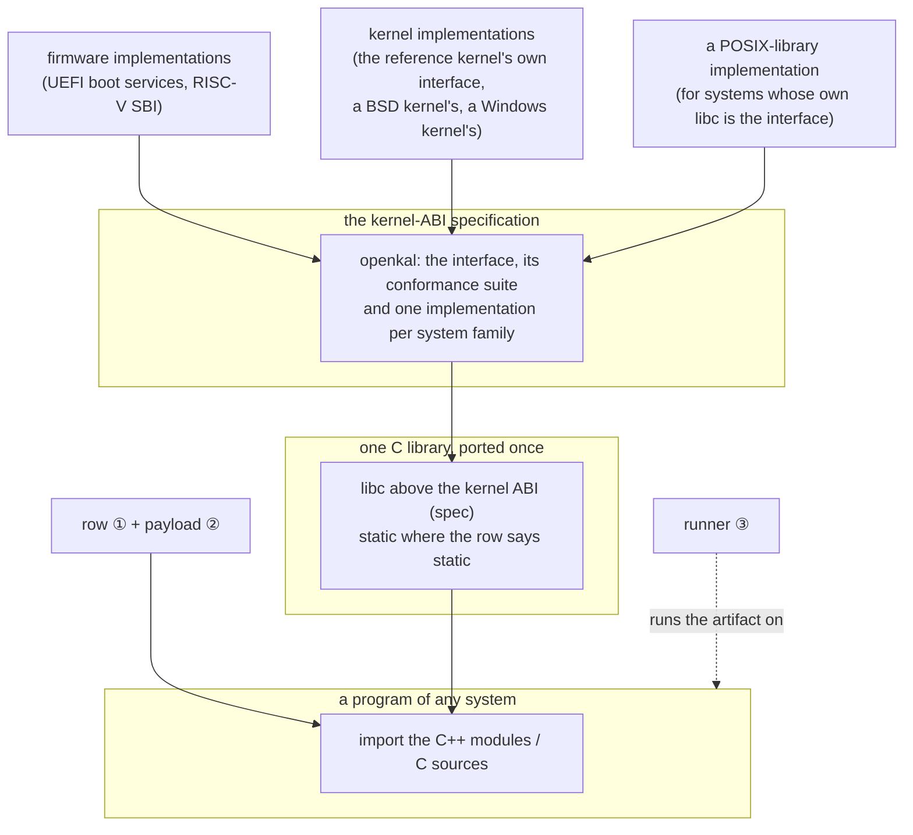

# The three-plane platform architecture: mcpp × openkal × xim

Date: 2026-11-12
Status: superseded by
[the ecosystem architecture optimization design](2026-11-12-ecosystem-architecture-optimization-design.md),
which extends sections 1, 2, 4 and 5 into four planes. Section 3 was written
before the round it describes was checked: its items 2 and 3 did not land in
the form stated there. A base package is read as a sysroot and the artifact
names the row's loader (not a loader "folded sysroot-relative" beside the
payload's own `-B/-L`), and an artifact of another system is not started at all
(not run as a child whose death is classified). The record of what was
implemented, with the check that holds each item, is section 15 of the
superseding design.

## 1. The statement

A platform enters this ecosystem as **data**, never as engine code. Three
data planes carry everything a target needs, and one normalisation layer
decides whether what was built is right:

| Plane | Carries | Where it lives | Invariant |
|---|---|---|---|
| ① row | serves/hosts/toolchain/sysroot/linkage/abi of a target identity | the toolchain model's table, or a platform package's own rows | target differences are data; the engine holds no per-target branch |
| ② payload | the toolchain bytes, and the base package that is the target's C library | the index (xim), installed by the fetcher through the revision channel | a build host needs mcpp itself and nothing else; where a row names a base package the host's link model yields entirely |
| ③ runner | how an artifact of another system starts (a declared prefix, an emulator, a loader) | row/platform data; resolved by the runner lookup | build never depends on a runner; running consumes the declaration |
| verification | one script, one expected output, normalised (CRLF, colour, codeset, console noise) | the shared harness | the harness knows no target; every executor family answers through it |

Two red lines hold throughout, and the gates hold them mechanically:
default behaviour is unchanged by any of it (the regressions stay green), and
no host name enters the engine — host differences are statements rows make.

## 2. The layering the planes serve

The specification's own rules make the layering safe: an implementation may
declare an interface absent (the conformance suite decides which absences are
legal), a C library above the interface never sits above an implementation
that would call back into it (layer-cycle refuses that graph at resolution),
and a program states which ABI it speaks by depending on one.

## 3. What the merged round established

Measured, not aspirational (each item landed with its gate green):

1. **Rows as the only place targets differ.** Eighteen identities build from
   one engine with zero per-target code; the identity that was missing
   arrived as one table row plus one base package.
2. **Base packages.** Where a row names one, the payload is the target's C
   library: the driver gets `--sysroot`, the payload's own `-B/-L`, a
   loader folded sysroot-relative, and the compiler's runtime directory —
   and the host's link words, runtime directories and closure rules yield
   entirely. A cross needs nothing from the machine it stands on.
3. **Foreign-kernel execution.** An artifact of another system, of this
   machine's architecture, runs as a child: its death by signal is named,
   its status returned unchanged, and the runner declaration follows it.
4. **ABI members as data.** `abi longjmp` states how a jump crosses the
   WebAssembly boundary; the probe renders the flag on both sides, and a
   row that is not the member's subject is refused rather than ignored.
5. **Corrective revisions.** A resource whose bytes must change without a
   version change is re-published under the same key with a raised
   revision; the updater channel enforces that a raise is total — every
   platform, one sha per url, shapes compared.
6. **One file, several systems.** A pack can hold the programs of several
   systems: a PE leads with a POSIX script in its DOS header, and every
   POSIX system's program rides behind it.
7. **Layer vocabulary.** `kernel-abi` is a layer the rows, the payloads and
   the requirement side all speak (`layers.kernel-abi`, `requires`), an
   implementation written above a C library never sits beneath one it would
   call back into — the resolution refuses that graph before anything is
   compiled — and a payload's kernel-abi is the target's system, so a
   requirement stated on it holds across every route to the row.

## 4. What the next systems consume

The same planes, with no engine work:

| Scenario | What it uses | What is left to build |
|---|---|---|
| A POSIX-family kernel with its own libc | the POSIX-library implementation of the ABI (already above every such libc), rows, a cross toolchain payload | the toolchain payload; a disk-image asset; an emulator runner |
| Firmware (UEFI, SBI) | the existing firmware implementations; an ordinary PE row and three link flags state a UEFI application — measured, no new target kind; a runner's exit status is the program's (the contract already carries firmware: the harness states the status) | an OVMF/emulator runner entry |
| A system's official media, booted | the disk-image asset class (`<system>-disk-image`): official media assembled into a bootable image, serial console, a marker protocol that separates the program's output from the machine's noise, exit codes carried through | the generic emulator harness (overlay isolation, expect/send primitives, the marker protocol); the naming and attribution conventions |
| Freestanding and bare-metal targets | the freestanding rows; a C-only, no-module path | the conformance hook-ups |
| Any corrective republish | the revision channel | nothing |

The one boundary this architecture states out loud: the **semantic plane** —
a process model, a terminal — is the program's own. The infrastructure
answers that a target can be built, started and judged; it does not port the
program.

## 5. Naming (index side)

- Generic assets and toolchains carry no prefix; a tool whose contract is a
  build-system session carries that system's prefix.
- A bootable-image asset is named `<system>-disk-image` — the thing, not a
  mechanism, not a format; the asset's file names carry the format.
- Official media is attributed to its publisher in the recipe; repacked
  bytes are provenance-recorded, double-mirrored, sha-identical.

These are conventions of the index, not engine vocabulary; the engine knows
none of the names.
