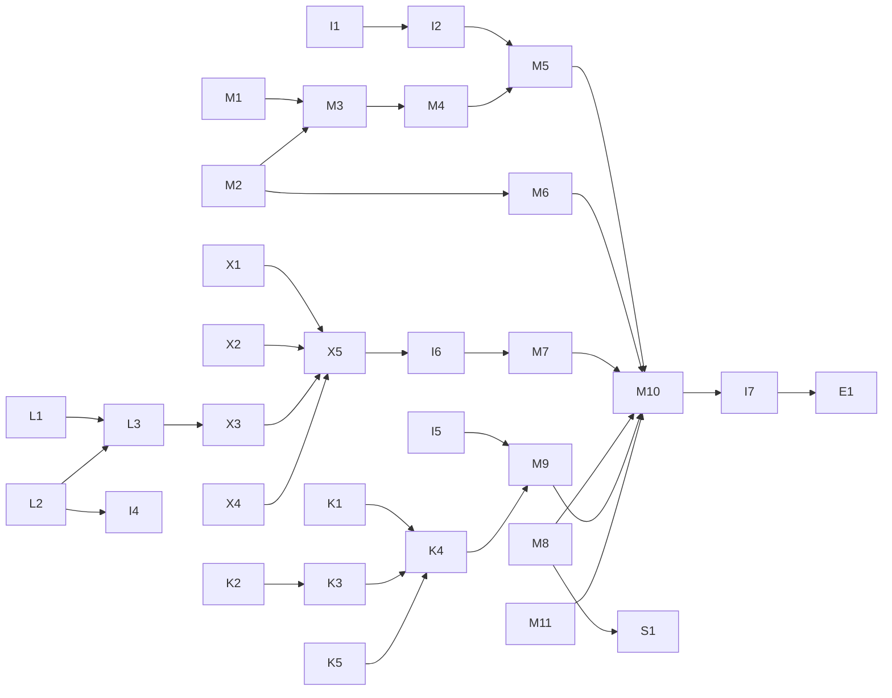

# 生态级方案：内核接口的供给与能力，派生状态的核对，存储的引用

**日期：** 2026-11-22（v6 2026-11-23，实施中的测定与修订见 §10） · **版本：** v6 · **基线：** mcpp main `53b80e1e`（2026.11.22.1 之后） · **规范：** SPEC-002 §2.4、§2.5、§3.2、
§3.3（目标侧）、SPEC-004 §2、§4.1（清单）、SPEC-006 §2.9、附录 A（工具链）、SPEC-013 §2、§6、§7.2、§8（平台）、
SPEC-016 §2（目标行与系统行）；xlings 的 xpkg-manifest-v1 §5.1、xpkg-resource-resolution、xlings-json；openkal 规范条款 6.1

**范围：** mcpp、xlings（含 Luban）、libxpkg、xim-pkgindex 与资源仓库、mcpp-index、openkal 家族、mcpp-language-server。
每个仓库一个拉取请求（§6）；实施计划与任务依赖见 §9。

## 0. 结论

**一条规则。** 派生的状态带有它所依据的事实；使用点核对该事实；不成立时重新生成或拒绝，不沉默地继续。存储的账目记录谁在
引用。共享视图中的内核头文件、存储回收、体检的修复、宿主驱动的链接包，是同一条规则缺席的四处（§3.10）。

**内核接口头文件（mcpp、索引、openkal）。**

1. Linux 的内核头文件是 `mcpp:kernel-abi=linux` 的一个预制供给者。陈述它用已有的键
   `[target.<selector>.layers] kernel-abi`，不新增清单键、原因标记或接线机制。
2. 平台键在没有平台的行上同样生效；此前本机与工程的这些键在这样的行上被接受而不起作用。
3. 缺省依次取两条事实中第一个回答者：基座自带的头文件、工具链声明的版本。两者都不回答时拒绝。共享缺省视图的链接不是
   事实；引擎数据中不放版本；引擎不向视图写入。
4. 供给者以 `-isystem` 排在基座之前接线，实现与版本由预处理测量回答。陈述与缺省走同一个决定函数、同一条接线、同一次
   测量；链接模型中按 C 库名与按文件存在与否的两处判断随之删除。
5. 某一层能否以载荷陈述，由行的系统数据决定，而不是由引擎按层名决定。内核接口与 C 库同属一个 SDK 或基座的系统没有这份
   数据，陈述被拒绝；`kernel-abi` 为 openkal 的各行由已有的规则一与规则二拒绝。引擎不为任何系统或实现写特例。
6. 内核头文件是目标的数据，不是宿主架构的程序。载荷在一个资源中携带各架构的 `asm`，交叉构建与本机构建用同一份载荷、
   同一条接线（§3.9）。已发布版本的新布局以 xpkg 的包装修订（`revision`）发布，不改写已发布的资源。

**存储与派生状态（xlings、Luban、索引）。**

7. 存储回收的引用集合由四部分构成：工作区的登记、各视图的链接所指向的载荷、被引用载荷所声明依赖的闭包、其他程序登记的
   根。mcpp 为构建所接线的每个载荷登记根；回收只有 xlings 的一个实现（§3.11）。
8. 载荷目录的删除属于安装器，不委托给包的钩子；修复在动作之后重新检测，未消除即报告失败（§3.12）。
9. 依据宿主事实生成的配置（宿主驱动的链接）记录该事实，在使用点与体检中核对，不同则重新配置（§3.13）。

**内核接口的能力（mcpp、openkal）。**

10. 一行能做什么（文件、启动程序、终端）是 `kernel-abi` 供给者所提供的接口。openkal 的实现已经陈述它；系统行的数据为
    传统的行陈述同一份事实，用同一套接口名。它经一个 `cfg` 谓词与机器可读的查询给出，工程不再按行手写（§3.17）。

**同一轮中并行的项。**

11. 构建数据库为生成的源文件陈述其来源（mcpp#1004，§3.14）。
12. 经 shell 运行一行命令在 libxpkg 中只有一个函数，输出以管道读取（libxpkg#52，§3.16）；沙箱网络加入命名空间的参数
    收敛为一个函数（§3.15）。
13. 平台的版本组包含构建程序所用的插件；已登记而未被服务的行与缺少运行器的行各自以测量决定其层级（§3.18、§3.19）。

## 1. 问题与实测

需要的是三件事：对更新的内核接口编译（新的系统调用、ioctl 与常量）；钉住所编译的头文件以便复现；同一清单在不同 home
中对同一份头文件编译。以下在 x86_64 Linux 上以 mcpp 2026.11.22.1 测得：

| # | 写法或状态 | 结果 |
|---|---|---|
| 1 | `[target.x86_64-linux-gnu.layers] kernel-abi = "xim:linux-headers@6.18.64"` | 被接受而无效果，`--strict` 下同样无报告；`LINUX_VERSION_CODE` 仍为 330497（5.11.1） |
| 2 | `[target.x86_64-linux-gnu.xlings.workspace] "xim:linux-headers" = "6.18.64"` | 载荷被安装，没有单元读取它 |
| 3 | `sysroot = { path = "<dir>" }`，目录为 glibc 2.44.3 与 linux-headers 6.18.64 的链接树 | 生效（397888）；代价是以手工组装的整个基座替换缺省基座，没有包身份 |
| 4 | `[toolchain] default = { …, companions = { linux-headers = … } }` | 拒绝，消息指向第 1 行的写法 |
| 5 | 共享缺省视图 `<home>/registry/subos/default/usr/include/{linux,asm}` | 链接到 linux-headers 5.11.1；同一 home 的缺省工具链 gcc 16.2.0 声明的是 6.18.64，即它构建时所用的版本 |
| 6 | musl 工具链（musl-gcc 15.1.0、16.1.0）自带的头文件 | 4.19.88（267096），没有升级的途径 |
| 7 | compat.libarchive 的条件 `cfg(all(linux, c-abi = "musl"))` | 本为 openkal 的图去掉 uapi 相关的功能，同时也去掉了原生 musl 上的这些功能，尽管第 6 行的头文件存在 |

**原因。**

- 第 1 行：应用平台的步骤在"无平台"时直接返回，本机与工程的 `[target.<selector>]` 覆盖表只在读到平台包之后才合并；读取
  这些字段的步骤（层与工具的补全、链接的驱动、输入、封装与脚本）以"平台生效"为前提。只经这些字段读取的键在没有平台的
  行上因此一并被丢弃，而清单的解析已经接受了它们。
- 第 5 行：视图由多个工具链共享，而它们声明的版本不同（gcc 16.2.0 为 6.18.64，捆绑的 LLVM 为 5.11.1），所以视图的链接至多
  对其中一个成立。视图由包的安装步骤写入，引擎的补全只在链接缺席时再写入 `linux`、`asm`、`asm-generic` 三个目录（载荷共
  有十四个）；视图的内容因此取决于 home 的历史。捆绑 LLVM 的载荷优先路径已经按工具链
  的声明读取内核头文件（SPEC-006 §2.9 的两条记录规则）；gcc 的 sysroot 路径读取的却是视图。同一层有两种来源。

**根因。** Linux 行上 `kernel-abi` 的供给者既不是数据，也没有可用的显式覆盖。缓存键按头文件集合（`targetHeaderSet`）
区分，所以不会混用对象；但同一份清单在两个 home 中所编译的头文件可以不同。

## 2. 概念与取舍

### 2.1 内核头文件属于哪一层

SPEC-006 附录 A 写明，原生行上系统自身的接口由基座供给，属于 `kernel-abi`：

- `*-linux-gnu` 的基座供给 `kernel-abi` 与 `c-abi`；
- macOS 的 SDK、Windows 的 SDK、MinGW-w64 与 FreeBSD 的基座同样如此。

Linux 是唯一把内核接口与 C 库分开发布的系统：内核头文件是一个独立的包，版本与 C 库无关。因此它是 `mcpp:kernel-abi=linux`
的一个预制供给者。目标侧今天已经把传统栈的 `kernel-abi` 命名为三元组的操作系统名（`linux`），本设计为它补上供给者与版本。
在 openkal 的栈上，这一层是 openkal，Linux 头文件不在栈中（§3.7）。

### 2.2 不采用的方案

| 方案 | 不采用的原因 |
|---|---|
| 工程级的 `system-headers` 键 | 它是 `kernel-abi` 的第二种拼写，在五层闭集之外开出第六条通道。提供者条目的 `system-headers` 回答的是另一件事：`kernel-abi` 被 openkal 替代时，资源编译这个工具步骤仍要读系统自身的头文件。它不进入程序的单元，保持原样 |
| 归入 `sysroot` | `sysroot` 是供给 `c-abi` 的整个基座（SPEC-002 §3.1 的 c-abi 独占律）。为了换内核头文件而替换整个基座，粒度错误，也没有包身份 |
| mcpp-index 的包，经依赖边可见 | glibc 自身的头文件包含 `<linux/…>`，`std` 模块的预编译也读它们。头文件集合是配置作用域（C：全图一个值，只从根读取），依赖边是使用需求作用域（U），同一程序中的不同包会对不同的版本编译。载荷已经在 xim 上，再包一层是重复的数据 |
| 由 xlings 为每种组合组装视图 | 组合由引擎的接线完成即可（§3.5），不需要第二套物理组合；按组合命名的视图还会带来缓存键与清理的新问题 |
| 在 `companions` 中加入 `linux-headers` | `companions` 是编译器的工具，属于宿主轴；内核头文件是目标的输入，属于目标轴（SPEC-004 §4.1） |
| 引擎数据中放一个缺省版本 | 今天没有一行由它回答：gcc 与捆绑的 LLVM 都声明版本，musl 工具链与交叉基座自带头文件。它会使结果取决于 mcpp 的版本而不是工具链，并需要随发布维护。没有回答者时拒绝并指出陈述的写法，比沉默地选一个版本更准确 |
| 版本下限规则（不低于 C 库的声明） | 没有数据支撑：索引中的 glibc 包不声明 `linux-headers`，glibc 上游支持对较旧的内核头文件编译。不成立的组合由编译本身报告 |

### 2.3 行业对照

| 生态 | 表达 | 归属 |
|---|---|---|
| Buildroot | `BR2_KERNEL_HEADERS_*`，版本不得高于目标上运行的内核 | 工具链与 sysroot 的独立组件 |
| crosstool-NG | `CT_LINUX_VERSION` | 同上 |
| Yocto | `linux-libc-headers`、`LINUXLIBCVERSION` | 同上 |
| Debian / Fedora | `linux-libc-dev` / `kernel-headers` | 系统中的独立包 |
| Zig | 每个架构内置一份；目标带操作系统版本区间（`x86_64-linux.4.19...6.6-gnu.2.38`） | 目标属性 |
| Apple / Windows / Android | SDK 版本；另有部署目标（`-mmacosx-version-min`、`_WIN32_WINNT`、API level） | SDK 与 C 库一体 |
| Rust | `linux-raw-sys`（rustix 使用） | 普通依赖；Rust 不读 C 头文件，绑定是生成的代码 |

从中可以读出四点：

1. 在 Linux 上，内核头文件是 sysroot 中独立版本化的组件，与 C 库分开选择。
2. 其他系统的内核接口与 C 库同属一个 SDK，可以选的只有 SDK 版本。
3. Rust 能把它作为普通依赖，是因为没有 C 头文件经它被包含；C 与 C++ 的情形与此不同。
4. 业界分两个轴：编译时可见的接口（头文件或 SDK 的版本），与运行时的下限（部署目标）。Linux 工具链的惯例只陈述前者，
   运行时的下限由运行时的 `ENOSYS` 探测承担。本设计只陈述前者。

### 2.4 设计准则与本方案的对应

| 视角 | 准则 | 本方案中的体现 |
|---|---|---|
| 底层与架构 | 机制在引擎，事实在数据；一层一个供给者 | 测量方式、位宽、载荷布局与接口清单都在系统行的数据中；引擎不出现系统名、层名的分支 |
| 收敛 | 一个概念一种拼写，一个机制一处实现 | 不新增清单键与原因标记；一个决定函数；回收只有 xlings 的实现；shell 命令行只有一个函数 |
| 通用性 | 规则对每一行、每个包成立 | 平台键在每一行生效；宿主事实、引用根是 xlings 的通用机制，包只陈述事实 |
| 跨平台 | 做不到的行给出原因与补救 | 内核接口不可分离的系统拒绝并指向 `sysroot`；本机与交叉同一条路径；能力是行的数据 |
| 稳定性 | 结果是陈述的函数，不是历史的函数 | 不读共享视图；派生状态在使用点核对；修复以结果而不是动作为准 |
| 兼容性 | 已发布的键、资源与载荷不变 | 包装修订而不改写资源；旧布局的载荷保持可用；旧客户端忽略新字段；清单以 mcpp 的下限保护 |
| 用户体验 | 一行陈述；做得更少不沉默 | `kernel-abi = "xim:linux-headers@<版本>"`；报告写出实现、版本、来源；每个拒绝带补救 |
| 简洁 | 删除多于增加 | 删去两处特判、视图写入、版本下限规则、引擎数据中的缺省版本、索引中按宿主架构的重复资源 |

## 3. 设计

### 3.1 陈述

```toml
[target.x86_64-linux-gnu.layers]
kernel-abi = "xim:linux-headers@6.18.64"
```

`layers.<层>` 的值有四种形式，前两种是本设计增加的：

| 形式 | 含义 | 来源 |
|---|---|---|
| `"xim:<名>@<版本>"` | 生态的载荷；拼写与规则同 `companions`（带版本的包） | prebuilt |
| `{ path = "<目录>" }` | 一个头文件目录；版本由测量回答，架构由陈述者负责；拼写同 `sysroot = { path = … }` | prebuilt |
| 包引用 | 依赖图中供给该层的包，SPEC-013 §7.2 不变 | graph |
| `false` | 数据与平台不为该层加入供给者，SPEC-013 §7.2 不变 | — |

- **哪一层接受预制形式由数据决定。** 行的系统数据为某层给出测量方式（§3.4）时，该层在这一行上接受载荷形式与目录形式；
  否则拒绝，并指出该行上陈述这一层的键（§3.6）。今天只有 Linux 的 `kernel-abi` 有这份数据，这与 SPEC-002 §3.3 把内核
  头文件列为可叠加层一致。引擎不按层名或系统名分支。
- **层次。** 依次为工程、本机（`config.toml`）、平台，按键替换（SPEC-004 §2、SPEC-013 §6）；都不陈述时为 §3.3 的缺省。
- **与依赖图的供给者。** 依赖图中已有包供给 `kernel-abi` 时（openkal 的实现），再陈述一个预制供给者违反规则一，被拒绝。
- **平台陈述载荷时。** 与平台陈述 `sysroot` 相同，在第二遍准备中决定（SPEC-013 §8）。
- **选择器的写法。** 选择器按三元组的成分书写（`cfg(env = "gnu")`）；以层键选择 `layers` 自身是循环的，与
  `manifest/platform-selector` 警告的情形同理。

### 3.2 平台键在每一行生效

- "选定了平台包"与"这一行有平台字段"是两件事，今天由同一个标志表示。没有平台的行有一份空的平台陈述；本机与工程的
  `[target.<selector>]` 覆盖表以同一合并规则（SPEC-013 §6）并入其中，层与工具的补全（SPEC-013 §7.2、§7.3）照常执行。
- 读取字段的步骤读字段本身；只有含义来自平台包的步骤（平台包的身份、版本组、平台程序）以"选定了平台包"为前提。
- `carrier` 的含义由平台的映像定义（SPEC-013 §11）。在没有平台的行上写出时，以警告报告该键与原因，不使构建失败，因为一份
  本机配置可以同时服务有平台与没有平台的行。其余的键在每一行生效。

### 3.3 缺省

缺省为基座而决定：基座是预制的 C 库，而它的头文件包含系统的接口头文件（glibc 包含 `<linux/…>`）。因此凡系统行带有
`kernel-abi` 数据、且 C 库来自预制基座的行，都作这一决定并接线；依赖图中没有包供给 `kernel-abi` 时，它同时是该层的供给者。
依赖图中的包在系统的 C 库之上供给 `kernel-abi`（`*-linux-gnu` 上的 openkal 实现）时，该层的身份是那个包，这些头文件只是
基座的组成部分。C 库来自依赖图的行（openkal 承载的 `*-linux-musl`）不作这一决定。

没有陈述时，依次取第一个回答者：

1. **基座自带。** 包括 `sysroot` 的任一陈述形式、工具链自带的 sysroot（MinGW-w64、musl 工具链的 `<三元组>/`、按路径指名的
   编译器的厂商树）与宿主的 `/`，以测量确认（§3.4）。
2. **工具链的声明。** 基座为共享缺省视图，或为不带内核头文件的载荷布局（`xim:glibc@…`）时，取工具链载荷所声明的
   `linux-headers` 版本，按 SPEC-006 §2.9 的两条记录规则读取。它是工具链自身的运行时构建时所用的版本，也是 `companions`
   与今天的载荷优先路径所用的同一个读取函数。载荷带有目标架构的 `asm` 时回答（§3.9）；旧布局的载荷只带本机架构，只
   回答目标架构与本机相同的构建。载荷可以位于只读的系统层（Luban 的 `/xlings`）；读取函数按层查找，接线不写入任何层。

两者都不回答时，构建在编译前被拒绝，并指出陈述的写法（§3.6）。

共享缺省视图不作为第 1 条的回答者：它的链接是 home 的历史（§1 第 5 行）。引擎不再向视图写入内核头文件；视图中已有的链接
由包的安装步骤所有，保持原样，被接线遮蔽（§3.5）。视图可以属于只读的系统层，引擎写入它本来就不成立。

**对缺省构建的影响。** 在 x86_64-linux-gnu 上：

- 以 gcc 16.2.0 构建时，所编译的是它声明的 6.18.64，而不是视图碰巧链接的版本；
- 以捆绑的 LLVM 构建时不变（5.11.1，即其声明）；
- musl 工具链、交叉基座与陈述的基座不变（第 1 条）。

### 3.4 测量

内核头文件与 C 库用同一个探针步骤（SPEC-002 §2.4、SPEC-006 §3.9.3）：以最终的编译选项预处理探针单元，单元以
`__has_include` 包含系统行所指名的头文件。系统行的数据如下：

```toml
[[platform.system]]
name       = "linux"
uname      = "Linux"
kernel-abi = { header  = "linux/version.h",
               version = ["LINUX_VERSION_MAJOR", "LINUX_VERSION_PATCHLEVEL", "LINUX_VERSION_SUBLEVEL"],
               packed  = { macro = "LINUX_VERSION_CODE", bits = [16, 8, 8] } }
```

- **版本的读取。** `version` 的各个宏给出版本的各段；它们缺席时按 `packed` 的位宽解码，每段在其位宽的最大值处饱和。位宽
  是数据，引擎只实现解码。实测：6.18.64 的 397888 与其三个宏一致；5.11.1 只定义 `LINUX_VERSION_CODE`（330497）。
- **与陈述的比较。** 载荷形式所陈述的版本与测得的版本按测量的精度比较（饱和的一段不参与），不符时拒绝。
- **实现名。** 实现名为系统名 `linux`，与目标侧今天给传统栈的名字相同；`cfg(kernel-abi = "linux")` 与
  `requires = ["mcpp:kernel-abi=linux"]` 的含义不变，报告与核对另得到版本。
- **没有 `kernel-abi` 数据的系统行。** 这表示该系统的内核接口不是独立于其基座的包（§3.1、§3.6）。

### 3.5 接线

- **接线。** 供给者的头文件目录以 `-isystem` 加在基座自身的头文件目录之前，作用于每个单元与 `std` 模块的预编译；clang 与
  gcc 都在 sysroot 的系统目录之前搜索 `-isystem`，并且按文件继续向后搜索。这是链接模型已有的系统头文件目录列表，不是新的
  通道。
- **解析的结果。** 载荷的十四个目录（`linux`、`asm`、`asm-generic`、`drm`、`scsi`、`sound` 等）以及 glibc 自身对它们的包含都
  解析到供给者。供给者没有的文件解析到基座：`scsi/sg.h` 由 glibc 发布，仍取自基座。同一个文件不会从两个版本中读取。
- **版本之间被删除的文件。** 基座带有另一版本的内核头文件时，供给者中已不存在的文件仍可见。实测 5.11.1 的 833 个文件中
  有 17 个不在 6.18.64 中（`linux/reiserfs_fs.h`、`linux/raw.h` 等已移除的接口）。这与在发行版上升级内核头文件包的结果不同，
  作为性质写入规范；缺省路径上基座是不含内核头文件的载荷布局或被遮蔽的视图，前者没有这一情形。
- **与已有规则的关系。** 这是 SPEC-002 §2.5 中 `c++-abi` 替换的同一条规则：另一个供给者供给某层时，基座的该层让位；基座
  不被写入，也不被重新组装。链接模型中"目标不是 musl"与"基座缺少 `linux/limits.h`"两处判断由 §3.3 的顺序取代。
- **宿主图。** 构建程序所属的宿主图按其自身的行以同样的方式决定（SPEC-013 §4）。

### 3.6 拒绝

| 条件 | 原因标记 | 补救 |
|---|---|---|
| 行的系统数据不为该层给出测量方式，却写了载荷形式或目录形式（macOS、Windows、FreeBSD、`*-openkal` 上的 `kernel-abi`；任一行上的其他层） | `target-base` | 该行上陈述这一层的键：`sysroot`（`macosx@<版本>`、`msvc@<版本>`、基座包） |
| 载荷中没有目标架构的 `asm`（旧布局的载荷用于交叉构建，或目标架构未发布） | `target-base` | 带该架构的版本，或 `{ path = "<目标架构的头文件>" }` |
| 没有陈述，且 §3.3 没有回答者 | `target-base` | `layers.kernel-abi` 的写法，或带头文件的基座 |
| 测量与陈述不符（头文件缺席、版本不同） | `target-base` | 消息写出测得的实现与版本 |
| 载荷引用不带版本 | 清单错误 | 消息给出示例，与 `companions` 的消息相同 |
| 需要 `mcpp:kernel-abi=linux` 的包，处在 `kernel-abi` 为 openkal 的行上 | `layer-requirement`（已实现） | 原生的提供者（Linux 或 Windows 宿主上的 `musl-gcc`），或 openkal 的接口 |
| 在 openkal 的行上以 Linux 头文件替换 `kernel-abi` | 规则一的已有拒绝；`layer-requirement`，由 openkal-musl 已有的 `requires` 触发（§3.7） | 同上 |

不新增原因标记。`target-base` 今天的含义是"目标的基座不能服务这次构建"；内核头文件是基座旁的组成部分，docs/50 中它的说明
扩充为包含前四种情形。

### 3.7 openkal

- **层的身份。** openkal 承载的行上，`kernel-abi` 由依赖图中的实现包供给。再陈述一个预制供给者违反规则一；openkal-musl
  自身陈述 `requires = ["mcpp:kernel-abi=openkal"]`（已发布的事实，0.30.0 实测），替换该层违反规则二。两者都在编译前拒绝，
  不需要 openkal 家族的任何改动。
- **与 openkal 能力模型的关系。** openkal 规范条款 6.1 规定接口的存在是链接期的事实，运行时才报告不支持被视为缺陷。
  Linux 的 uapi 不是 openkal 的接口；在这些行上提供它，会使"不存在"退回为运行时的 `ENOSYS`（openkal-musl 对没有对应
  操作的系统调用号如此回答）。拒绝与该模型一致。
- **不变的部分。** openkal 在 Windows 上的提供者条目中的 `system-headers` 不变（§2.2）：它只由资源编译读取，不进入程序
  的单元。

### 3.8 报告与缓存

- **报告。** 目标侧报告的 `kernel-abi` 行写出实现、测得的版本、供给者与来源，例如
  `linux 6.18.64 (xim:linux-headers@6.18.64, …)`。陈述的来源用已有的层次名；缺省的来源为基座或工具链的声明。SPEC-013 的
  `fields` 对每一行给出 `layers.kernel-abi`。
- **缓存。** `targetHeaderSet` 按存储的相对路径记录头文件目录，供给者的身份因此进入缓存键。换版本会使全图重新编译，包括
  `std` 模块；同一组合在各工程之间经全局缓存共享。不需要迁移：每个版本的 mcpp 本来就使缓存键改变。

### 3.9 架构：一份载荷，各架构的 `asm`

- **事实。** `make headers_install` 的产物在各架构之间只有 `asm/` 不同；其余十三个目录与架构无关。内核源码自身、Zig 的
  内置头文件都按"公共部分加每架构一个目录"组织。今天的索引按宿主架构发布两个资源（x86_64、aarch64），各带宿主的 `asm`，
  这把目标的数据当作了宿主的程序，交叉构建因此没有载荷可用。
- **布局。** 一个与架构无关的资源：

  ```
  include/                    与架构无关的目录；asm 由安装步骤链接到本机架构
  arch/<架构>/include/asm/    每个已发布架构一份，<架构> 用 xpkg 的架构名（x86_64、aarch64、riscv64、loongarch64）
  ```

  `include/asm` 的链接使读取 `include/` 的已有消费者（共享视图、已发布的 mcpp）不变。
- **在 xpkg 中的表达。** 版本条目写单一的 URL 与校验和，不带架构键，按 xpkg-manifest-v1 §5 对每个架构都适用；`archs` 列出
  资源所带的架构。架构是 xpkg 资源解析的维度，用于随宿主不同的程序；与架构无关的数据不使用它。
- **已发布的版本。** 6.18.64 的新布局以 `revision = 1` 与新的资源名发布（xpkg-manifest-v1 §5.1.1）；`floor` 不提高，
  已安装的旧载荷保持可用（§5.1.2）。因此引擎不能假定布局，而是读取它：载荷带有 `arch/<目标架构>/include` 时把它排在
  `include` 之前，这一布局写在系统行的数据中；没有该目录时载荷只服务本机架构。本机与交叉走同一条路径，引擎不比较架构。
- **不采用：`xlings install --host`。** `xlings download --host <OS-ARCH>` 已存在，把它扩展到安装需要存储路径带上架构，并
  波及回收与体检；它解决的是"安装另一架构的程序"，而这里要的是数据。

### 3.10 一条规则，四处缺席

| 位置 | 派生的状态 | 所依据的事实 | 失效的方式 | 处置 |
|---|---|---|---|---|
| 共享视图的 `usr/include/linux` | 安装时写入的链接 | 哪个包先安装 | 多个工具链声明不同版本，视图至多对一个成立 | mcpp 不读视图，由陈述或工具链的声明决定（§3.3） |
| 存储回收 | 版本库与工作区的登记 | 谁在引用载荷 | 登记不含视图的链接目标、依赖闭包与其他程序的引用 | §3.11 |
| 体检的修复 | "已移除""已修复"的报告 | 目录是否已清空 | 报告依据的是动作的发起而不是结果 | §3.12 |
| 宿主驱动的链接包 | 以安装时的驱动版本命名的链接 | 宿主当前加载的驱动 | 宿主升级后链接悬空，使用时无人核对 | §3.13 |

xlings 的规则"派生的状态可以由任何流程重建"与"读不到不等于没有引用"已经陈述了这条规则的两半；本设计补上"使用点核对"，
并把它写入 xlings 的规范。

### 3.11 存储的引用（xlings，openxlings/xlings#712）

- **实测。** `self clean --dry-run` 的引用集合只取版本库与各 SubOS 工作区的 `active`、`installed`。它列出仍被
  `subos/default/usr/include/*` 链接的载荷；对 mcpp 的私有 home 试运行，列出 154 个包（约 16 GB），其中是各工程在用的
  基座、库与平台包。mcpp 按存储路径接线，回收之后的下一次构建即失败。
- **引用集合。** 以下四部分的并集，任何一部分读不到时拒绝（已有的二值规则）：
  1. 工作区的登记（不变）；
  2. 各视图中的链接所解析到的载荷；
  3. 上述载荷的安装记录所声明依赖的闭包（工具链声明的 `linux-headers`、`binutils`、`glibc`）；
  4. 根：`<home>/data/roots/<所有者>/` 下指向 `xpkgs/<存储名>/<版本>` 的链接，由其他程序登记。这是 Nix 的 gcroots 的
     做法。
- **根的形态。** 一个根是一个符号链接，名为 `<存储名>@<版本>`；它的修改时间是最后一次使用。悬空的根被忽略并清除。
  登记与更新是创建或触碰一个链接，不需要锁，也不需要 xlings 的进程。
- **mcpp 一侧。** mcpp 为每次构建所接线或读取的载荷登记根，并在使用时更新其时间；`mcpp cache gc` 按已有的未使用期限删除
  过期的根，随后调用 xlings 的回收。回收只有一个实现，期限的策略属于所有者。
- **已有的 home。** 升级前的 home 中没有根。mcpp 把 home 的格式向前移动时，为现存的每个载荷登记一个根，时间取当时；
  这一步执行一次，幂等，有记录。它与登记逻辑在同一个版本中发布。
- **不采用。** home 声明所有者而 xlings 拒绝（mcpp 需要第二个回收的实现）；把载荷登记进工作区（工作区的含义是 SubOS
  激活了什么）；由 xlings 读取工程的锁（工程的位置不可枚举，格式属于 mcpp）。
- **Luban。** 系统层（`/xlings`）的载荷由已有的归属判断保护；根与视图的链接按层读取，用户层的根可以引用系统层的载荷。

### 3.12 移除的归属与修复的核对（xlings，openxlings/xlings#711）

- **实测。** 带有清扫痕迹而不在版本库中的载荷，`self doctor --fix` 报告已修复而磁盘不变：移除只运行包的钩子，钩子经
  版本库回收目录，没有记录时什么也不做；随后的安装因目录非空而判定"已安装"。每次运行重复同样的循环并以 1 退出。
- **规则。** 安装目录是安装器创建的，它的删除也属于安装器：钩子运行之后，安装器删除目录，再报告"已移除"。修复在每个
  动作之后重新检测；发现仍在时报告失败与原因，不报告已修复。
- **测试。** 已有的测试以登记过的包构造痕迹，覆盖不到这一形态；新增的用例构造未登记的载荷。

### 3.13 依据宿主事实的配置（xlings、libxpkg 与索引，openxlings/xlings#727）

- **实测。** 宿主驱动的链接包以安装时的驱动版本命名链接并记录该版本；宿主驱动升级后链接悬空，包仍为"已安装"，使用点
  不核对，程序退回到另一个实现。
- **陈述。** 包在包表中静态地陈述其配置所依据的宿主文件（该例为宿主当前加载的驱动的版本文件）。它是数据而不是钩子：
  包表静态可求值是 xpkg v1 的原则，核对不应运行包的代码。
- **机制。** xlings 在配置时记录这些文件内容的摘要；在激活、进入 SubOS 与体检时比较；不同则重新运行配置，不能重新配置
  时报告。比较不放在每一次经垫片的启动上。链接由配置步骤按当前事实以通配生成，不依赖文件名的列表。
- **兼容。** 较旧的客户端忽略该字段，行为与今天相同。
- **范围。** 同一族的各个包（宿主驱动的链接、其 WSL 与 Vulkan 的变体）用同一机制。

### 3.14 生成的源文件的来源（mcpp，mcpp-community/mcpp#1004）

- **问题。** 规则把编写的源文件变换为被编译的单元时，构建数据库只把编写的文件列在该步骤的输入中；消费者无法区分"编辑
  它即改变该单元的文件"与"步骤恰好读取的文件"。
- **采纳。** `mcpp::action` 增加 `origin`（指名它的一个输入）；构建数据库的生成条目增加 `origin`（S1 的增量字段）。
  只有步骤陈述时才写出，引擎不从输入推断。来源文件同时被列为该集合的单元时，已有的重复提供者错误说明这一关系。
  生成单元的角色在步骤陈述了它所提供的模块时由陈述给出。
- **不采纳 `line-mapping`。** 生成文件中的 `#line` 指令本身是事实，由消费者读取；另作陈述会与文件不一致。

### 3.15 加入命名空间的参数（xlings，openxlings/xlings#732）

修复已经合入：监督者为 root 时以命名空间所有者的身份启动网络辅助程序。同样的拼接写在会话与工作进程两处；它收敛为
提供者中的一个函数，与已有的参数函数并列，并在以 root 运行的测试行中增加 `net=nat` 的用例。

### 3.16 经 shell 运行一行命令（libxpkg，openxlings/libxpkg#52）

- **实测。** Windows 上 `os.iorun` 把重定向拼在命令行之后交给 `cmd /c`；命令行以引号开头且不止一对引号时，`cmd` 去掉
  首尾两个引号，重定向落入引号之内，读回的输出为空。索引中有三个包各自绕过。
- **根因有两层。** 一是 `cmd` 的去引号规则未被固定；二是输出的读取依赖对调用者的命令行做字符串拼接，调用者自带重定向时
  同样出错。
- **规则。** 经 shell 运行一行命令只有一个函数：Windows 上为 `cmd /d /s /c "<整行>"`（`/s` 使去引号规则确定），其他系统
  为 `sh -c`。输出以管道读取，不拼接重定向。`os.exec`、`os.iorun` 与其余经 `std::system` 的各处都调用它。
- **兼容。** 包中已有的绕过写法在修复之后仍然成立；它们在索引所支持的最低客户端包含该修复之前保留。

### 3.17 行的能力：`kernel-abi` 的接口（mcpp，mcpp-community/mcpp#1005 第 1 项）

- **问题。** 一行能否启动程序、有没有文件与终端，今天只有运行才知道；工程因此在 CI 中按行手写清单，实现获得能力之后
  清单即过时。
- **已有的一半。** openkal 的实现包以 `[kernel-abi] provides-interfaces` 陈述它提供的接口；包以 `requires-interfaces`
  陈述所用的接口，缺少时以 `interface-not-provided` 拒绝；运行器已经把所提供的接口交给被运行的程序。openkal 规范
  条款 6.1 规定接口的存在是构建期的事实。缺的是传统的行的陈述，以及让清单与工具读到它的出口。
- **数据。** 系统行的 `kernel-abi` 数据（§3.4）增加该系统所提供的接口。接口名沿用已有的清单（`openkal.fs`、
  `openkal.process` 等）：它是生态中对平台接口唯一有规范、有版本的命名，mcpp 把它当作不透明的名字。C 库限定了能力的
  行（没有进程的行）由其系统行如实陈述。
- **出口。**
  1. 谓词 `cfg(interface = "<接口名>")`，用于源文件、标志与测试的条件；
  2. 目标侧的报告与 SPEC-013 的 `fields` 对每一行给出 `layers.kernel-abi.interfaces`，测试程序经已有的环境变量读到同一
     清单。
- **限制。** 接口在目标侧决定之后才可知，它在依赖解析之后。以该谓词选择依赖、平台或 `layers` 是循环的；这样写时报告，
  与 `manifest/platform-selector` 的情形同理，不沉默地取假。
- **效果。** 一个实现获得某个接口之后，各工程的测试不经修改即覆盖它；mcpp-index 中按实现名书写的条件可以按接口书写。

### 3.18 平台系列与构建程序的插件（openkal-platform，mcpp#1005 第 2 项）

- **实测。** 平台的版本组（SPEC-013 §7.5）列出家族的十四个成员，不含构建程序所用的插件包；平台在自己的构建依赖中以
  确切版本指名它。工程也指名该插件时，平台的修订发布即与工程的版本冲突。
- **处置。** 版本组加入该插件包；SPEC-013 §15.1 已规定构建程序的版本条目。工程以兼容范围指名或不指名版本，由版本组
  决定。这是平台包的数据，mcpp 不变；它是否对宿主图的请求成立，在实施时测定（§8）。

### 3.19 行与运行器（mcpp、索引、平台包，mcpp#1005 第 3、4 项）

行的层级是测量的结果：CI 构建并运行为 `verified`，构建并链接为 `preview`，否则保持 `planned` 并写出测得的原因。

| 行 | 今天 | 需要的事实 | 归属 |
|---|---|---|---|
| `riscv64-linux-musl` | 已登记，有提供者条目 | 索引中的工具链载荷在两种宿主上可用；用户态模拟的运行器 | mcpp 数据、索引 |
| `i686-linux-gnu` | 已登记，索引中没有载荷 | 该架构的基座载荷与编译器运行时 | 索引、mcpp 数据 |
| `x86_64-macos` | 已登记，有提供者条目 | 在该架构的宿主上的 CI | mcpp 数据与 CI |
| `wasm32-wasi` | 没有行 | 行的定义、基座载荷、C 库的识别、运行器 | mcpp 数据、索引 |
| iOS 模拟器的两行 | `verified`，没有运行器 | 提供者条目的 `runner`；它启动设备并在构建树之外留下状态，按 SPEC-016 以 `enabled = false` 陈述，由工程开启 | mcpp 数据 |
| 固件之上的 openkal 行 | 没有行 | 平台包定义该行（`[[platform.define]]`） | openkal 家族 |

每一行是数据与包，彼此独立，也不依赖本方案的其余部分；它们并行进行，随所在仓库的同一个拉取请求合入。

### 3.20 openkal 实现的缺口（openkal 家族，mcpp#1005 第 6 项）

- 环境的条目上限（各实现中的固定常量）：继承更大环境的进程丢失其余条目，这是沉默的截断；改为按需增长，或在超出时
  报告。
- 固件与 DOS 的实现中同步地启动程序：实现之后它们提供 `openkal.process`，§3.17 使各工程的测试随之覆盖。
- **映像在 i686 上启动映像（mcpplibs/openkal-image#46）。** okrun 0.7.2 的 `linux-i686`（openkal-platform 0.31.2 的载体）上，
  一个 i386 映像以 `fork` 与 `execve` 启动另一个映像时，复制出的进程读出映像的头与 OPENKAL 注记、映射并释放文件、读取
  `/proc/self` 之后以 127 结束，不写任何消息；同一路径在 x86_64 上进入映像，i386 映像启动宿主程序也正常。两点都是缺陷：
  - **结果。** 依条款 6.1，`openkal.process` 是该行陈述的接口，运行时不能以失败代替它；
  - **沉默。** 复制出的进程在启动失败时没有写出原因，与 `kal_process_spawn` 拒绝时按原因返回（`kal_err_not_program` 等）
    不一致。

  修复按根因进行，在 i686 的宿主上复现，而不是只在 x86_64 上推断：找到复制出的进程中放弃启动的那一步（定位装载器、
  解析映像名，或 32 位上的长度与缓冲），修复它；复制出的进程启动失败时，把原因写到标准错误，再以 127 结束，与宿主程序
  启动失败的约定相同。`examples/starts` 加入 i686 的运行行，作为该行 `openkal.process` 的回归测试。修复随 openkal-image
  的补丁发布与平台版本组的修订进入本轮（K5）。
- 它们随家族的一次发布与版本组的修订进入索引；mcpp 内置的缺省平台版本随之更新。

### 3.21 平台定义的行的打包（mcpp，mcpp#1007）

按目标逐个打包一个有两个程序目标的 C 工程（`--all-programs`）时，两处结果与工程的陈述不符。两处都在 mcpp 内，归入本轮；
工程自身的发布做法（DJGPP 行改用 `--mode static`、WebAssembly 改用 `--pkg-format web`）是绕行，不是修复的对象。

- **平台包陈述的链接方式没有到达构建。** djgpp-platform 的提供者陈述 `linkage = "static"`，缺省（vendored）模式仍按动态
  程序求其运行时闭包，而 go32 程序既不是 ELF、PE 也不是 Mach-O，于是被拒绝。根因有两层，都是基础设施：
  - 行的缺省链接方式只从内置表的行视图（`TargetInfo`）读取；平台包定义的行不在内置表中，选中的提供者的事实被跳过。
    行在其提供者之下的视图由一个函数给出（`view_of(row, provider)`），内置表、非缺省的提供者与平台包定义的行都经它
    得到同一组字段，三处不再各自拼装。
  - 路径形式的平台包，其提供者以 `path:<dir>` 指名所属的包（SPEC-013 的引用字符串形式），而引用文本的解析不认识这一形式，
    把它读作缺少版本的载荷；选择按所选平台过滤提供者时，路径平台的提供者因此全部落选，它陈述的每个键都不生效。解析补上
    该形式，与规范所列的字符串形式一致。
  - 链接方式为静态、且文件格式不是三种可询问装载器的格式之一时，程序没有运行时闭包，打包不再询问装载器；链接方式不是
    静态时，同一文件仍被拒绝并写出格式，因为闭包无从得知（"做得更少不沉默"）。
- **Web 行只为一个程序带上模块。** 启动脚本的伴随文件（`.wasm` 等，按文件名主干的家族）只为与包同名的程序收集；
  `--all-programs` 的其余程序只带启动脚本。伴随文件改为对打包的每个程序收集。`cmd.exe` 中的 `.exe` 不是原因。

回归由两个 e2e 覆盖：路径平台的静态提供者下，两个原始映像格式的程序都被打包，去掉 `linkage` 后被拒绝并写出格式；
Web 行上两个程序各带其模块。

## 4. 跨平台

| 行 | `kernel-abi` 的供给者 | 写 `layers.kernel-abi` 的结果 |
|---|---|---|
| `*-linux-gnu`，本机 | 工具链的声明（共享视图）或陈述的基座 | 生效 |
| `*-linux-gnu`，交叉（如 `xim:aarch64-linux-gnu-sysroot`） | 基座 | 生效；载荷须带目标架构（§3.9） |
| 原生 `*-linux-musl`（`musl-gcc`） | 工具链自带（4.19.88） | 生效，接线相同 |
| openkal 承载的 `*-linux-musl`、`*-macos-musl`、`*-freebsd-musl` | openkal 的实现 | 拒绝（规则一、规则二）；不接线 Linux 头文件 |
| `*-linux-gnu` 上带 openkal 实现的图 | openkal 的实现；Linux 头文件仍是基座的组成部分 | 拒绝（规则一）；缺省照常接线 |
| `*-openkal` | 加载器（openkal） | 拒绝（系统数据不给出测量方式） |
| macOS、Windows（msvc 与 gnu）、FreeBSD | 与 C 库同属 SDK 或基座 | 拒绝，指向 `sysroot` |

## 5. 兼容性

- **没有新的清单键。** `[target.<selector>] layers` 自 2026.10.27.1 起存在。
- **行为变化**（写入 CHANGELOG）：
  1. 平台键在没有平台的行上生效，此前被丢弃；
  2. 在共享视图上以 gcc 构建时，所编译的是工具链声明的内核头文件；
  3. compat.libarchive 在原生 musl 上恢复 Linux 相关的功能（索引侧）。
- **较旧的 mcpp。** 读取带载荷形式的清单时，在没有平台的行上忽略该键（与此前相同）；在有平台的行上，它把该值当作索引中
  的包去解析而失败。使用载荷形式的清单因此应当以 `[package] mcpp = ">=<release>"` 写出 mcpp 的下限。
- **索引。** `latest` 的移动只影响不带版本的新请求；已激活的版本保持，钉住版本的包（捆绑的 LLVM 钉 5.11.1）与 mcpp
  不变。已发布的资源与校验和不变；6.18.64 的旧载荷保持可用。
- **较旧的 xlings 客户端。** 忽略包表中的宿主事实字段与 `revision` 之外的新内容；新布局的资源在它们上同样安装，因为
  `include/` 的形状不变。
- **较旧的 home。** 没有根的 mcpp home 在升级时登记现存的载荷（§3.11）；未升级的 mcpp 的 home 上，回收的行为与今天相同。
- **构建数据库。** `origin` 是增量字段，符合 S1 的消费者忽略未知字段。
- **谓词 `interface`。** 较旧的 mcpp 把它报告为未知的谓词；使用它的清单同样写出 mcpp 的下限。

## 6. 改动面

每个仓库一个拉取请求。

| 仓库 | 内容 | 条款 |
|---|---|---|
| libxpkg | shell 命令行的单一函数与管道读取；包表的宿主事实字段 | §3.16、§3.13 |
| xlings | 回收的引用集合与根；移除的归属与修复的核对；宿主事实的记录与比较；加入命名空间的参数；规范、文档、测试；libxpkg 的版本 | §3.11、§3.12、§3.13、§3.15 |
| xim-pkgindex 与资源仓库 | `linux-headers` 的新布局（6.18.64 `revision = 1`、7.3.5）与 `latest`；`gcc`、`binutils` 的 `latest`；宿主驱动链接包的陈述；§3.19 各行的载荷；xlings 与 mcpp 的版本 | §3.9、§3.13、§3.19 |
| openkal 家族 | 版本组加入插件包；实现的缺口；固件之上的行；一次家族发布 | §3.18、§3.19、§3.20 |
| mcpp | 见下 | §3.1 至 §3.8、§3.11、§3.14、§3.17、§3.19 |
| mcpp-index | compat.libarchive 的条件改为 `cfg(all(linux, kernel-abi = "openkal"))`；已发布的 mcpp 已把传统栈的 `kernel-abi` 命名为 `linux`，因此不依赖新的 mcpp | §1 第 7 行 |
| mcpp-language-server | S1 的 `origin` 字段文本 | §3.14 |

**mcpp 的各项：**

- `modules/manifest`：`layers.<层>` 的载荷形式与目录形式；谓词 `interface`；
- `modules/toolchain-model`：系统行的 `kernel-abi` 数据（测量、位宽、载荷布局、接口）、版本解码、`builtin.toml` 的各系统行、
  §3.19 的行与运行器、缺省平台的版本；
- `src/build/prepare/platform.cpp`：每一行都有平台陈述；"选定了平台包"与"有平台字段"分为两个事实，链接规划、标志与后端中
  读取字段的各处改读字段本身；
- `src/build/prepare/base.cpp` 与探针：一个函数按 §3.1 的陈述与 §3.3 的顺序决定供给者，随后测量与 §3.6 的拒绝；载荷优先
  路径与 sysroot 路径都调用它；
- 链接模型：每种模式都在基座之前接线，删除"目标不是 musl"与"基座缺少 `linux/limits.h`"两处判断；
- 基座补全：不再写入内核头文件。glibc 的补全按 SPEC-006 §2.2.1 对本生态所有的视图保留，它属于 `c-abi`；
- 目标侧模型：`kernel-abi` 带上版本、来源与接口，并写入报告与 `fields`；
- 存储：根的登记、home 格式的一步、`mcpp cache gc` 调用 xlings 的回收；捆绑的 xlings 版本；
- 构建程序的接口与构建数据库：`mcpp::action` 的 `origin`、生成条目的字段、角色与重复提供者的消息；
- 规范：SPEC-002、SPEC-004、SPEC-005、SPEC-006、SPEC-013、SPEC-016；用法：docs/04、docs/09、docs/20、docs/22、docs/50 的
  中英文；CHANGELOG。

## 7. 验证

- **单元测试。**
  - `modules/toolchain-model/tests`：版本解码（各段的宏优先；397888 解码为 6.18.64；一段在其位宽处饱和）、与陈述按精度
    比较、系统行的解析、§3.3 的顺序（写成纯函数）；
  - `modules/manifest/tests`：值的四种形式与拒绝。
- **e2e（一个脚本，`# requires: linux`）：**
  1. x86_64-linux-gnu 上没有平台，陈述载荷形式：单元测得 397888，报告写出该行，`--strict` 下不再无声；
  2. 缺省：视图链接 5.11.1 时，以 gcc 16.2.0 构建测得 6.18.64，以捆绑的 LLVM 构建测得 5.11.1；
  3. 目录形式；
  4. aarch64-linux-gnu 上：新布局的载荷生效（以目标编译器测得版本，`<asm/unistd.h>` 给出该架构的调用号）；旧布局的载荷
     `target-base`；
  5. 内核接口不可分离的行上的载荷形式，以及 Linux 行上 `layers.c-abi` 的载荷形式：`target-base`；
  6. 没有平台的行上，`[target.<triple>.link] flags` 到达链接命令，`carrier` 给出警告；
  7. 基座带有另一版本时（宿主的 `/` 或带头文件的目录基座），陈述的版本被测得，`<scsi/sg.h>` 仍可包含；
  8. openkal 承载的 x86_64-linux-musl 上的载荷形式：规则一或 `layer-requirement`，以实测的先后为准。
- **金丝雀。** 金丝雀矩阵的各行预期不变；任何一格不同即为失败。
- **xlings。** 回收：视图链接的目标、依赖闭包与登记的根各一例不被列出，根目录读不到时拒绝；修复：未登记的清扫载荷一次
  收敛；宿主事实：记录的值改变后在使用点重新配置；root 下的 `net=nat`。
- **索引。** 新布局的资源在两个架构的宿主上安装，`include/asm` 指向本机架构；`latest` 移动之后索引的 CI 全部通过。
- **生态。** 在全新的 home 中以 gcc、捆绑的 LLVM 与 musl 工具链各构建一次；mcpp 的私有 home 上回收的试运行不列出任何
  在用的载荷；Luban 的系统层只读时构建不写入视图。

## 8. 实施时测定

1. 内核接口不可分离的行（§3.6 第一行）是否在获取 SDK 或工具链之前就被拒绝；第 5 个 e2e 用例取在本机上无需获取即可拒绝
   的一行。
2. 平台字段的每一个读取者（链接规划、标志、后端、执行、打包）逐一核对，列出在没有平台的行上改为生效的键；规范的表以
   核对的结果为准。
3. openkal 的行上陈述预制供给者时，规则一与规则二哪一个先报告；消息以先报告者为准写入规范。
4. `*-linux-gnu` 上带 openkal 实现的图：基座的头文件决定与该层的身份分开之后，openkal 家族的测试是否不变。
5. mcpp 今天以何种方式安装载荷而不进入工作区的登记；根的登记点取在读取函数（`companion_dir` 一类）还是安装点。
6. 平台的版本组中的插件包条目是否约束宿主图中工程自身的请求（§3.18）。
7. §3.19 的每一行：载荷是否存在、是否在 CI 的宿主上构建并运行；结果决定其层级。

## 9. 实施计划与任务依赖

### 9.1 任务

| 编号 | 仓库 | 任务 | 依赖 | 完成的判据 |
|---|---|---|---|---|
| L1 | libxpkg | shell 命令行的单一函数，管道读取 | — | 带引号且含空格的程序路径读回输出；三个系统的单元测试 |
| L2 | libxpkg | 包表的宿主事实字段 | — | 字段被解析并给出；缺席时与今天相同 |
| L3 | libxpkg | 发布 | L1、L2 | 版本进入 mcpp-index |
| X1 | xlings | 引用集合：视图链接、依赖闭包、根 | — | §7 的回收用例；根目录读不到时拒绝 |
| X2 | xlings | 安装器删除目录；修复后重新检测 | — | 未登记的清扫载荷一次收敛 |
| X3 | xlings | 宿主事实的记录、比较与重新配置 | L3 | 记录的值改变后在激活与体检时重新配置 |
| X4 | xlings | 加入命名空间的参数函数；root 下的 `net=nat` 用例 | — | 两处调用同一函数；用例在 root 的测试行通过 |
| X5 | xlings | 规范、文档、发布 | X1 至 X4 | 发布与 GitCode 的资源 |
| I1 | 资源仓库 | 新布局的构建脚本；6.18.64 修订与 7.3.5 的资源 | — | 两处发布，校验和记录 |
| I2 | xim-pkgindex | `linux-headers` 的条目、安装步骤的链接、`latest` | I1 | 两个架构的宿主上安装，`include/asm` 指向本机 |
| I3 | xim-pkgindex | `gcc`、`binutils` 的 `latest` | — | 索引的 CI 通过，含最低客户端 |
| I4 | xim-pkgindex | 宿主驱动链接包陈述其事实，按当前事实生成链接 | L2 | 旧客户端行为不变；新客户端在 X5 之后核对 |
| I5 | xim-pkgindex | §3.19 各行的载荷 | — | 每个载荷在其宿主上安装 |
| I6 | xim-pkgindex | xlings 的版本 | X5 | 索引指向新版本 |
| K1 | openkal-platform | 版本组加入插件包 | — | 工程不指名插件版本时构建通过 |
| K2 | openkal 各实现 | 环境的上限；固件与 DOS 的程序启动 | — | 各实现的 CTS |
| K3 | openkal-platform | 固件之上的行 | K2 | 该行构建并在模拟器中运行 |
| K5 | openkal-image | i686 上映像启动映像（openkal-image#46）：复现、根因修复、失败时写出原因、i686 的 `examples/starts` | — | i686-openkal 上 `"%COMSPEC%" /c exit 3` 得 3 |
| K4 | openkal 家族 | 家族发布，进入 mcpp-index | K1 至 K3、K5 | 版本组的新版本可解析 |
| M1 | mcpp | 平台键在每一行生效 | — | §7 e2e 第 1、6 例 |
| M2 | mcpp | 系统行的数据、解码、接口 | — | 单元测试 |
| M3 | mcpp | `layers` 的两种形式、决定函数、测量、拒绝 | M1、M2 | §7 e2e 第 1 至 5、7、8 例 |
| M4 | mcpp | 接线，删除两处判断，停止写入视图 | M3 | 缺省构建在三种工具链上通过；金丝雀不变 |
| M5 | mcpp | 新布局的读取与交叉 | M4、I2 | §7 e2e 第 4 例 |
| M6 | mcpp | 谓词 `interface` 与查询 | M2 | 单元测试；报告与 `fields` 给出接口 |
| M7 | mcpp | 根的登记、home 格式的一步、`cache gc` | X5、I6 | 私有 home 上回收的试运行不列出在用的载荷 |
| M8 | mcpp | `origin`：构建程序的接口与构建数据库 | — | 单元测试与一个 e2e |
| M9 | mcpp | §3.19 的行与运行器 | I5、K4 | 每一行按测量得到其层级 |
| M10 | mcpp | 规范、文档、CHANGELOG、缺省平台的版本、发布 | M1 至 M9、M11、K4 | 全部检查通过；发布与 GitCode 的资源 |
| M11 | mcpp | §3.21：行视图的单一函数、`path:` 引用的解析、无闭包的静态程序、每个程序的伴随文件 | — | §3.21 的两个 e2e |
| S1 | mcpp-language-server | S1 的字段文本 | M8 | 文本与 mcpp 的输出一致 |
| D1 | mcpp-index | compat.libarchive 的条件 | — | 原生 musl 与 openkal 两种行的 CI |
| I7 | xim-pkgindex | mcpp 的版本 | M10 | 索引指向新版本 |
| E1 | 生态 | §7 的生态验证；各 issue 的评论与关闭 | I7 | 全新 home 上的各项验证通过 |

### 9.2 依赖关系



### 9.3 顺序与并行

- **关键路径。** L1、L2 → L3 → X3 → X5 → I6 → M7 → M10 → I7 → E1。libxpkg 与 xlings 的发布决定 mcpp 的发布能否开始收尾。
- **第一批，互不依赖。** L1、L2、X1、X2、X4、I1、I3、I5、K1、K2、K5、M1、M2、M8、D1。其中 mcpp 的 M1、M2、M3、M4、M6、M8
  在本地完成，不等待任何发布。
- **等待 CI 的时间。** 一个仓库的检查运行时，进行另一个仓库的任务；mcpp 的检查在较大的检查点推送，而不是每次提交。
- **合入的顺序。** libxpkg；xlings 与 openkal 家族（互不依赖）；xim-pkgindex 的 I2 至 I6；mcpp；xim-pkgindex 的 I7；
  mcpp-index 的 D1 与 mcpp-language-server 的 S1 可以在各自就绪时合入。
- **xim-pkgindex 的一个拉取请求。** I2 至 I6 在一个拉取请求中；I7 是 mcpp 发布之后的版本更新，按发布流程是另一次变更。
- **§3.19 的行。** 测量未通过的行保持原层级并写出原因，不阻塞其余任务。

## 10. 实施中的测定与修订（v6）

以下是实施中测得、并已据此修订实现的事实；前文条款按此理解。

1. **载荷布局（§3.9）。** "各架构之间只有 `asm/` 不同"被资源构建的检查推翻。6.18.64 上，除 `asm/` 外，`linux/a.out.h`
   只由 x86 安装，`linux/kvm_para.h` 在 riscv 上不安装。布局因此为：`include/` 只放各架构逐字节相同、且位于 `asm/` 之外的
   文件；`arch/<架构>/include/` 放该架构的其余文件，`asm/` 整体属于它。构建脚本每次都比较，而不是假定。安装步骤把本机
   架构的 `asm/` 与各架构独有的头文件链接进 `include/`。
2. **已发布版本的修订（§3.9）。** 索引的保护规则要求更正的资源带 `<版本>-r<修订>` 的标签与资源名，并保持版本条目的形状。
   因此 6.18.64 的修订 1 是资源 `6.18.64-r1`（`linux-headers-6.18.64-r1.tar.gz`），各宿主架构的条目指向同一个资源。7.3.5
   是新版本，写单一的 URL。
3. **接口的陈述位置（§3.17）。** `interfaces` 是系统行的键，与测量用的 `kernel-abi` 表分开：macOS、Windows、FreeBSD 陈述
   接口，但不接受预制的 `kernel-abi`。iOS 与 Emscripten 不作为系统加入系统表，因为系统表决定 `mcpp pack --systems all`
   的范围与多系统单文件的选择。它们的行各自陈述 `interfaces`，先于系统读取，与 `object-format`、后缀"行先于系统"的
   读法相同。接口清单是供给者的陈述，测试仍然是对它的验证（openkal-image#46 是一行声称 `openkal.process` 而实际失败的
   反例）。
4. **谓词已存在（§3.17）。** `cfg(interface = …)` 自 2026.11.13.1 起对依赖图的供给者成立。本轮补上的是系统与行的陈述，
   以及 `mcpp why toolchain` 的 `layers[].interfaces` 与 `layers[].version`；机器可读的查询在这里，而不在 SPEC-013 的
   `fields`（无平台的行上它为 `null`）。
5. **目录形式（§3.1）。** `{ path }` 指向不带 `mcpp.toml` 的头文件目录时是预制形式；带清单时是依赖图中的包，与基座包的
   规则相同。
6. **缺省的回答者（§3.3）。** 基座是否自带由链接模型的模式判断（载荷布局即 `PayloadFirst`）；共享视图是 SubOS 的根之下的
   探测 sysroot，工具链自己载荷中的 sysroot（`musl-gcc` 的 `<三元组>/`）不是视图。工具链的回答只取其声明；编译器不在
   存储中时取 home 中最新的版本，并在报告中写明。依赖图在预制的 glibc 之上供给 `kernel-abi` 时（`*-linux-gnu` 上的 openkal
   实现），头文件仍按基座的组成部分决定并接线，层的身份不变。
7. **探针（§3.4）。** 探针单元按内容命名，写在临时目录中，不写入工程的 `target/`。

8. **插件与版本组（§3.18，K1）。** 测定的前提不再成立：工程以 `[build-dependencies.mcpp] plugins = "0.26.0"` 构建
   `x86_64-openkal`（openkal-platform 0.31.2 的构建程序钉 0.26.1）时，两个版本各属一个构建程序的解析，锁中为
   `mcpp.plugins` 0.26.0 与 `mcpp.plugins+b<摘要>` 0.26.1（`programs = ["build:mcpplibs.openkal-platform@0.31.2"]`，
   SPEC-013 §15.1，mcpp 2026.11.19.1 起）。平台的修订发布与工程指名的插件版本互不约束；把插件加入版本组反而会约束工程
   自己的请求（版本组参与解析，§7.5）。K1 因此不改动 openkal-platform，K4 不依赖它。
9. **索引中的行（§3.19）。** `riscv64-linux-musl`：x86_64 上的 musl 交叉载荷构建、静态链接，并在 qemu-user 下运行；该载荷的
   sysroot 不带内核头文件（`aarch64-linux-musl-gcc` 带 4.19.88），由其描述文件声明 `linux-headers` 6.18.64，修订 1 带
   riscv64 的头文件。行升为 `preview`，运行器为 `xim:qemu-user-riscv64`。`i686-linux-gnu` 与 `wasm32-wasi` 在索引中没有
   基座载荷与编译器运行时，保持 `planned` 与未登记。iOS 模拟器的两行以 `simctl-run` 为运行器，`enabled = false`。
   `x86_64-macos` 在 Apple silicon 的运行器上经 Rosetta 测定（探针工作流）：链接原先不带 `--target`，按 arm64 链接 x86_64
   的目标文件而找不到 `main`；链接改为凡编译指名目标即指名之后，C 程序链接为 x86_64 并在 Rosetta 下运行。C++ 程序仍不能
   链接：LLVM 载荷的 `libc++.a` 只有 arm64，链接器跳过它而不报警，libc++ 的符号全部未定义。该行因此保持 `planned`，
   所缺的事实是 x86_64（或通用）的 libc++ 载荷；macOS 的 CI 断言 C 程序的链接与运行。
10. **存储的根（§3.11，M7）。** 根的最后使用时间是链接自身的时间；读取它需要不跟随链接的状态查询，由 mcpplibs.os 0.4.8 的
    `fs::stamp_of(node, false)` 给出。根的登记点是构建图写出之处（图文本中指名的存储路径）与复用图的构建（图旁的
    `roots.list`），以及 `mcpp toolchain install`；`mcpp cache gc` 在回收之前先为没有根的 home 登记根，登记失败时不回收。
11. **平台定义的行的打包（§3.21，M11）。** DJGPP 行上的拒绝不是平台包少写了陈述：djgpp-platform 0.2.0 已陈述
    `linkage = "static"`，是引擎只从内置表读取行的缺省链接方式。同一测定发现路径平台的提供者在选择中全部落选（引用文本
    `path:<dir>` 不被解析），两处一并修复；改动后，以路径平台定义行的各 e2e 套件重新运行。
12. **运行时闭包的 `$ORIGIN`（D1 的测定）。** mcpp-index 在 mcpp 2026.11.22.1 之下的 LLVM 一路拒绝 `cuda-curand` 的测试程序
    （`libgcc_s.so.1 not found`），而该程序直接运行成功。glibc 对经链接打开的库，以打开它的路径所在目录展开 `$ORIGIN`
    （`LD_DEBUG=libs` 测得 `libgcc_s.so.1` 取自链接农场），闭包模型却先把找到的路径解析为链接的目标，再在目标的目录展开。
    模型改为：对象以其文件为身份，以打开它的目录为 `$ORIGIN`。农场中的 `libgcc_s.so.1` 仍然需要：LLVM 构建的程序不装载它，
    而 `libcurand.so.10` 的 DT_RUNPATH 只有 `$ORIGIN`。
