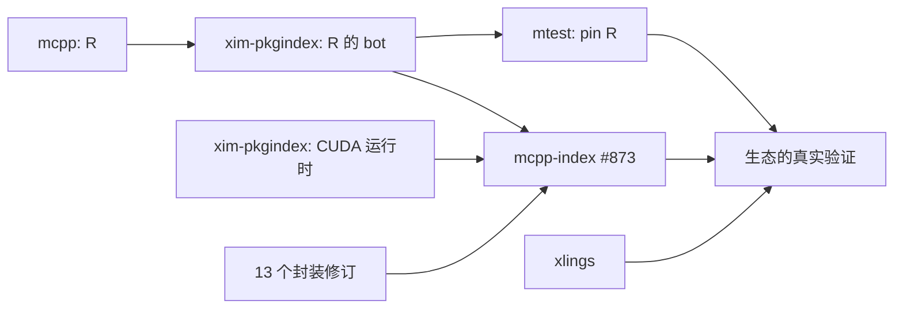

# 测试与 CI 一轮的收尾：平台列未命中的刷新条件（mcpp#996）、`i686-windows-msvc` 行、工作区索引与引号键的迁移、索引的全量验证

**日期：** 2026-11-22 · **版本：** v2（2026-11-22 评审确定第 4 节的登记、第 6.2 节的结构与拒绝、第 7 节的封装修订随本轮发布、第 10 节 GLOBAL 的源集合，后者在实施中按第 10 节所述修正） · **基线：** mcpp main `b9b63865`（2026.11.21.1 之后，含 #998、#999、#1000）、
mcpp-index 拉取请求 #873（`8676bc2`）、xim-pkgindex `6c55431` · **规范：** SPEC-013 §14 第 6 条（平台列的未命中）、
SPEC-004 §9 第 12 条（工作区的镜像表）、SPEC-016 §2（目标行）、docs/51（弃用表） · **所属：**
[生态的测试与 CI 方案](2026-11-20-test-architecture-upgrade-design.md) 的收尾。

## 1. 范围

本方案收拢 2026.11.21.1 发布之后未闭合的事项与新报告的 mcpp#996。每项给出事实、决定、实现、测试与文档，
并按仓库各一个拉取请求编排（第 11 节）。已合入的部分不再重述：#998（单元分片数按主干上次运行的时长）、
#999（索引刷新在另一进程旁的等待条件，套件按用例计数）、#1000（graph/860 按 ninja 边判定成员的并行）、
xim-pkgindex #1222（slint 声明 libXrender）。

## 2. 现状

| 项 | 状态 |
|---|---|
| mcpp main CI（`b9b63865`） | 73 个作业中 1 个失败：macOS e2e 作业 323 个程序通过、1 个失败，即 `RunExec/QueuedErrorOutputRenewsIdleAfterALineHandler`（exit 137、`timed_out`、0 行）；同一运行中 stdout 变体通过，该提交的拉取请求运行中两者都通过 |
| mcpp-index #873（pin mcpp 2026.11.21.1） | 全量运行 19 个分片成功、5 个失败、4 个在 90 分钟上限处取消（pin 改变后缓存为冷） |
| mcpp#996 | 未处理 |
| mcpp-index 根的 `[indices]` | 由 `workspace-position` 读取，该读取 2027.1 移除 |
| mcpp-index 的引号依赖键 | `quoted-dotted-dependency-key`，2027.2 移除 |
| mtest CI 的 mcpp（`.github/versions.env`） | 2026.11.14.1 |
| mcpp `.xlings.json` 的引导版本 | 2026.11.13.1 |
| mcpp 脚手架的 mtest（`kMtestRelease`） | 0.11.2；0.11.3 已发布 |

## 3. mcpp#996：平台列的未命中只在构成拒绝时刷新

### 3.1 事实

- SPEC-013 §14 第 6 条：本地索引副本没有认领一行、且没有答案时该行被拒绝（引擎不认识的行、`planned` 行），
  这是一次索引未命中，按依赖未命中的策略决定是否刷新；没有平台也能构建的行未命中时不刷新。
- 实现把两类不被拒绝的请求当作拒绝：
  1. 引擎不认识、由项目的 `[target.<triple>]` 段定义的行。段是自定义三元组的出口（docs/20），
     `step1_validate_target_tier` 对它不拒绝；`define_early_platform`（`src/build/prepare/platform.cpp`）对没有选择
     平台的不认识行一律以 `refreshOnMiss = true` 查询平台列。#996 的 `i686-windows-msvc` 属于这一类。
  2. 命名了工具链的 `planned` 行（`[target.<row>] toolchain`、`--toolchain`、消费者的子构建，即 `toolchainNamed`）。
     拒绝门不拒绝它；`step1_select_platform` 与 `named_provider` 以 `planned_row(t)` 决定刷新，不读 `toolchainNamed`。
- 项目表中的 `platform = "none"`：`define_early_platform` 只在选择不是 `none` 时记下 `chosen`，因此 `none` 之后仍查询
  平台列并可能刷新；`--platform none`（`chosenText` 非空）不查询。
- 刷新的去抖为 120 s（`kIndexRefreshDebounceSeconds`），未命中只在进程内记住（`g_columnMisses`），所以相隔超过两分钟的
  每次构建各刷新一次。#996 记录的三次构建各执行一次 `sync_index` 与 `update_packages`，共 12 至 19 s。

### 3.2 决定

- **一个谓词。** "没有平台时这一请求被拒绝"由一个函数回答：行不被认识、没有 `[target.<triple>]` 段且不由平台定义；
  或行为 `planned` 且没有命名工具链。三个查询点（`define_early_platform`、`named_provider`、`step1_select_platform`）
  以它的回答为 `refreshOnMiss`。谓词所读的事实与拒绝门所读的相同：段的查找（解析后按规范拼写比较，现在写在
  `toolchain.cpp` 的 `TargetOverrideCtx` 初始化中）与 `toolchainNamed` 各提取为一个共享函数，拒绝门与刷新决定调用
  同一函数，两者不能分叉。
- **平台列照常读取。** 不构成拒绝的未命中不刷新，本地副本中的平台列仍然回答：以段定义、而本地索引列出其平台的行，
  仍取得该平台。
- **`none` 是一个选择。** 表中的 `platform = "none"` 与 `--platform none` 一样结束平台列的查询。
- **不增加持久的未命中记忆。** 有了谓词，刷新只伴随一次被拒绝的构建，行为与依赖未命中相同（去抖、每个进程至多一次）。
  持久记忆是第二套"何时不刷新"的机制，与依赖未命中的策略不一致，不采用。

### 3.3 测试

- 单元：谓词对四种输入的回答（不认识且有段、不认识且无段、`planned` 且命名工具链、`planned` 且未命名）。
- e2e（Linux，隔离的 home，`--offline -v`）：`--target x86_64-toyos` 有 `[target.x86_64-toyos]` 段时输出不含平台列的
  刷新决定；无段时拒绝消息写出未刷新及原因（offline）；`--target i686-linux-gnu --toolchain <tc>` 不含刷新决定；
  表中 `platform = "none"` 时不含刷新决定。

### 3.4 文档

SPEC-013 §14 第 6 条写明两类不被拒绝的请求与 `none`，并标注实现版本；docs/35 的对应段（中英）；CHANGELOG 的 Fixed
一条（mcpp#996）。

## 4. `i686-windows-msvc` 登记为目标行

### 4.1 事实

- msvc 探测已把 i686 映射为 MSVC 的 `x86`（`src/toolchain/msvc.cppm` 的 `triple_for_arch` 与 `Host*/x86` 目录）；
  Windows CI 的 e2e（`tests/e2e/windows/msvc.cpp`）以 `[target.i686-windows-msvc]` 段构建并运行该目标。
- docs/20 写明它不是目标表的行，构建它的项目声明 `[target.i686-windows-msvc]`。2026-10-06 的方案（O3）把登记移出了
  当时的范围。
- #996 的第一项期望：它是与 `x86_64-windows-msvc` 一样不需要平台包的原生目标。

### 4.2 决定

登记为 `preview` 行：`modules/toolchain-model/data/builtin.toml` 增加 `triple = "i686-windows-msvc"`（`note = "PE"`、
`standard = true`），`msvc` 提供者的 `serves` 增加该行。行的事实在数据中，引擎不改。层级取 `preview`，因为它的覆盖是
一个 e2e 用例与本节新增的矩阵行和金丝雀行。项目写的段（如 `sysroot = "msvc@14.44"`）照常作用于已登记的行。

### 4.3 随之更新

- `tests/matrix/expected.tsv`：windows-x86_64 上 graph 与 payload 两种模式、llvm 与 msvc 两个编译器的四行，取拉取请求
  运行的 target-matrix 的测量。
- `tests/canary/matrix.tsv`：c、cxx 两个金丝雀在 windows-x86_64 上 build、static、run、test、pack 的十行，取带
  `ci:canaries` 标签的测量。
- README、README.zh-CN 与 docs/21（中英）的层级表（`check_target_tiers.py` 比对）。
- docs/20（中英）删去"不是目标表的行"一段，协程的说明保留。
- e2e `msvc.cpp` 增加不写段的构建与运行，带段的用例保留。
- CHANGELOG 的 Added 一条。

## 5. `RunExec/QueuedErrorOutputRenewsIdleAfterALineHandler` 的界

### 5.1 事实

- 用例的生产者是测试程序自身（`self_exe_path`）：先在 stdout 写就绪行，关闭 stdout，再在 stderr 每 30 ms 写一行，
  共 48 行，以 7 退出。父进程 idle 500 ms、total 3 s，行处理器在就绪行上睡 750 ms。
- 失败：exit 137、`timed_out`、0 行、`error_output` 为空。
- 运行循环（`src/run/run.cpp`）在判定空闲之前先读两个流：处理器返回后，队列中的 stderr 由 `drain_error` 读入并更新
  `lastOutput`。0 行意味着停止时管道中没有任何一行，即生产者在界内没有写出：或在启动后 500 ms 内没写出就绪行（idle
  从启动算起），或在处理器的 750 ms 内没写出 stderr 的第一行。两者都是生产者进程在负载下的时间超出了用例的界。

### 5.2 决定

- 用例的界与被测性质分开：idle 2 s，处理器睡 idle 加 250 ms，total 10 s。48 行（1.44 s）在处理器睡眠期间入队，处理器
  返回时队列不为空，被测的性质（队列中的输出更新空闲计时）不变。stdout 变体取同样的界。
- 失败消息写出启动到就绪行的时间与停止时已读的行数，复现时可区分超出的是哪一段。
- 两个用例的时间各增加约 1.5 s。

## 6. mcpp-index 的工作区索引（2027.1）

### 6.1 事实

- 根 `mcpp.toml` 的 `[indices] compat = { path = "." }` 由 `workspace-position` 读取（docs/51：2026.10.10.1 弃用，
  2027.1 移除），每个成员的构建都报告弃用。
- 285 个成员中：149 个不写 `[indices]`，按位置接受根的 `compat`；79 个写非空的 `[indices]`，以另一个名字指向同一
  检出（如 `mcpplibs = { path = "../../.." }`）；57 个写空的 `[indices]` 以避开根的重定向（mwrap 成员，使用测试 home
  中预备的完整候选内置索引；`tests/test_prepare_mwrap_indices.py` 断言该空表）。没有成员在自己的表中以两个名字指向
  同一位置。
- `[workspace.indices]` 按名字合并（`src/project.cppm` 的 `inherit_workspace_indices`），成员不能去掉一个工作区索引。
  把 `compat` 移入 `[workspace.indices]` 后，79 个成员得到同一检出的两个名字，xlings 报告
  `package '<ns>:<name>@<v>' is ambiguous`（已测：包的命名空间取自描述符，同一检出注册两次，同一限定名有两个候选）。
  57 个成员会同时得到检出与预备索引中的同名包。

### 6.2 决定

- **mcpp-index 不再有工作区级的索引。** 删去根的 `[indices]`；149 个成员各自写 `compat = { path = "<到检出的相对路径>" }`，
  与 79 个成员已有的写法相同。三类成员的索引集合都由各自的清单陈述，不依赖位置读取，也不需要合并语义的例外。
  `docs/mwrap.md` 关于保留旧重定向的一段与 `tests/test_prepare_mwrap_indices.py` 随之改写。
- **mcpp 的合并语义不变**（按名字合并，已发布）。
- **同一位置的两个名字被拒绝。** 合并之后（以及同一份清单之内）两个索引项指向同一位置（路径按规范化后的路径，git 按
  地址与修订）时，mcpp 拒绝，消息写出该位置、两个名字、后果（该位置的每个包成为两个候选）与修正（保留一个名字），
  并带原因 token（docs/50）。此前这一情况到 xlings 安装时才以 ambiguous 失败，消息不指明原因。规范写入 SPEC-004
  §9 第 12 条，用法写入 docs/07（中英）。
- 考虑过而不采用：成员退出工作区索引的新键（为一个仓库的布局增加清单词汇）；按位置去重、由近者命名（解决 79 个成员，
  不解决 57 个）；成员的 `[indices]` 整表替换工作区的（改变已发布的合并语义）。

## 7. 引号依赖键（2027.2）

### 7.1 事实

- docs/51：`quoted-dotted-dependency-key` 2026.11.8.1 弃用，2027.2 移除；父包与子包并存时的唯一写法不在其列。
- mcpp-index 的 30 个成员清单以引号写依赖键（如 `"mcpplibs.mwrap.imgui" = "1.92.8"`），都不属于上述例外。
- 13 个 mwrap 包已发布的模板写引号键，模板归档不可变（安装模板检查的说明行）：fribidi 1.0.16、imgui 1.92.8、
  libarchive 3.8.7、libpng 1.6.43、lua 5.4.7、miniaudio 0.11.25、pocketpy 2.2.0、quickjs_ng 0.17.0、sdl3 3.4.18、
  xxhash 0.8.3、xz 5.8.3.1、zlib 1.3.2、zstd 1.5.7。

### 7.2 决定

- 30 个成员清单改为不加引号的选择器（#873）。
- 13 个封装仓库各发布一个封装修订（`docs/mwrap.md` 的修订规则：`1.0.16` 之后为 `1.0.16.1`，`5.8.3.1` 之后为
  `5.8.3.2`），模板写不加引号的选择器；#873 在描述符中加入这些版本，安装模板检查以新版本为对象，
  `check_installed_template.py` 中引号键的放行随之删除。

## 8. mcpp-index #873 的完成

全量运行与上一次每周全量运行逐成员比较。上一次运行本身大面积失败，可比的成员结果为 267 个。

| 成员 | 现象 | 决定 |
|---|---|---|
| linux llvm `cuda-curand`（引入） | `libcurand.so.10` 需要 `libgcc_s.so.1`，按 2026.11.21.1 的 DT_RUNPATH 规则在 LLVM 工具链下不可达（`runtime/dlopen-unreachable`） | xim-pkgindex 的 libcurand 描述符声明 GCC 运行时依赖并加修订；其它 CUDA 组件以同一闭包检查测量，需要者一并声明 |
| windows `archive`、`libarchive-bundle` | 测试程序在 0.01 s 内以 133 退出 | 以下各项在同一 runner 上以前一 pin（2026.11.20.1）复测，区分引擎的回归与包的问题：引擎回归在 mcpp 的拉取请求中修正，包的问题在描述符、封装或测试成员中修正 |
| windows `sdl2` | SDL 2.32.10 的 `SDL_endian.h:40` 在 clang 23 下 `definition of builtin function '_m_prefetch'` | 同上 |
| windows `taskflow-module` | taskflow 4.1.0 的 `tfprof.hpp:339` `definition with same mangled name` | 同上 |
| linux `sqlitecpp` | 失败 | 同上 |
| slint 的安装模板检查 | libXrender 不可达（`--strict` 下的一条降级） | #1222 已发布，新安装的 RUNPATH 含 libXrender；重跑中复核 |
| 4 个取消的分片 | 90 分钟上限 | 缓存热后重跑 |

#873 的 pin 取本轮 mcpp 的新版本（第 9 节），合入前的一次全量运行中每个成员在每条腿上 ok，或为 n/a 并写明原因。

## 9. 版本与 pin

- mcpp 发布一个版本（下称 R，版本号按发布当日），包含：CHANGELOG `[Unreleased]` 中 #999 的两条 Fixed；第 3、4、5 节；
  第 6.2 节的拒绝；脚手架的 `kMtestRelease` 改为 0.11.3，docs/05（中英）的示例同步。`.xlings.json` 保持 2026.11.13.1：
  以 2026.11.21.1 引导时，hermetic 作业在缓存恢复的 home 中得不到 binutils（第 13 节），该缺陷由 R 修正，因此引导版本在 R
  发布、镜像并进入索引之后按发布流程移到 R。
- R 发布之后：合入 xim-pkgindex 的 bot 拉取请求；mcpp 的 `.xlings.json` 移到 R（发布流程的引导版本收尾）；mtest 的 `.github/versions.env` 的 `MCPP_VERSION` 改为 R；mcpp-index
  #873 的四处 pin 改为 R。

## 10. xlings

- **`test_root_mount`。** 在 mount namespace 的属主不可得的主机上（`ioctl(NS_GET_USERNS)` 返回 EPERM，如嵌套的用户命名
  空间），normalize 进入"derive captured mount namespace owner"的分支而失败；CI 的主机上通过。决定：testkit 增加能力
  `mntns-owner`（探测 `NS_GET_USERNS`），该用例以它为前提，前提不成立时以原因跳过；Linux 单元测试的线声明它，在那里缺失
  即失败；产品在 EPERM 时的拒绝写出原因。
- **镜像。** GitHub runner 上 `mirror = GLOBAL` 时，xlings 的下载仍以 `ghfast.top` 为第一个源（mcpp 显示的是 xlings
  事件中的 `sourceHost`）。实施中读到的事实：`mirror` 未设时即为 GLOBAL，它选择 xlings 自己资源的区域（github 或
  gitcode）；配方的 GitHub 地址另有第三方代理回退，由 `mirror_fallback`（`auto` 缺省、`off`、`force`）控制，`auto` 下
  写明 sha256 的候选按连接延迟排序（xlings 设计 2026-06-04）。评审时确定的"GLOBAL 的源集合不含 CN 代理"会使未作配置的
  中国大陆用户失去代理回退，因而改为：语义不变，xlings 的文档（中英）写明代理回退及其控制。

## 11. 仓库、拉取请求与顺序

| 仓库 | 拉取请求 | 内容 | 前置 |
|---|---|---|---|
| mcpp | 一个（发布 R） | 第 3、4、5 节，第 6.2 节的拒绝，第 9 节的发布项 | — |
| xlings | 一个 | 第 10 节 | — |
| xim-pkgindex | 一个，另有 R 的 bot 拉取请求 | libcurand 与测得的 CUDA 组件声明 GCC 运行时 | bot 拉取请求在 R 发布之后 |
| 13 个 mwrap 封装仓库 | 各一个 | 模板不加引号，发布封装修订 | — |
| mtest | 一个 | `MCPP_VERSION` 改为 R | R 进入索引 |
| mcpp-index | #873 | pin 改为 R；第 6.2 节的结构；第 7 节的 30 个清单与 13 个新版本；第 8 节的修正 | R 进入索引；封装修订已发布；xim-pkgindex 已合入 |

mcpp、xlings、xim-pkgindex 的 CUDA 修正与 13 个封装修订之间没有依赖，并行进行；第 8 节的复测在等待 CI 时进行。

## 12. 验收

- 每个拉取请求的必需检查全部通过；mcpp 的拉取请求另带 `ci:canaries`，target-matrix 与金丝雀矩阵的每一格与声明一致；
  合入后 mcpp main 的 CI 通过。
- mcpp-index：一次全量运行，没有取消的分片，每个成员在每条腿上 ok 或为写明原因的 n/a。
- 干净环境：以 xlings 安装 R；以自定义三元组的段构建两次、间隔超过去抖时长，第二次不刷新索引；`i686-windows-msvc` 不写
  段时在 Windows 上构建并运行（CI 的 e2e）。
- R 发布后，mcpp#996 以说明关闭。

## 13. 实施中发现

- **配套载荷读了索引的描述文件。** 引导版本移到 2026.11.21.1 后，hermetic e2e 作业以缓存恢复的 home 构建，gcc@16.1.0 得不到
  binutils，构建停在 "cannot execute 'as'"。xim 的 gcc 配方于 2026-11-21 把 binutils 由 2.42.1 改为 2.47；2026.11.21.1 按
  索引当前的描述文件取配套载荷的版本，store 中只有该载荷安装时的 2.42.1。设计 2026-11-21 §3.5 规定版本取自"载荷的安装记录"，
  实现读的是索引。只读安装时的描述文件也不对：以 `[xlings] upstream` 链接载荷的 home（e2e 的 inherited home）中，载荷目录是
  上游的链接，旁边是上游的描述文件（2.42.1），配套载荷却按索引安装（store 中只有 2.47）。修正：两份声明依次读取，安装时的
  描述文件在前、索引的在后，取 store 持有的第一个；`companion-too-old` 比较的仍是载荷自身的声明（第一个）。单元测试覆盖两种
  home；e2e 的 inherited home 中不再报告降级。这是 2026.11.21.1 对已有 home 的升级缺陷，随本轮发布修正。
- **Windows 上 archive 与 libarchive-bundle 在启动时崩溃，根因是 lld-link 与包的静态宏。** 退出状态 133 即访问违例；cdb 显示
  调用跳到映像首字节。逐版本探测：2026.11.8.1 通过，2026.11.9.1 起失败；2026.11.9.1 起测试单元按函数分节、测试以回收无引用节的
  方式链接。`lzma.h` 与 `archive.h` 在未定义 `LZMA_API_STATIC`、`LIBARCHIVE_STATIC` 时声明 dllimport，compat.xz 与
  compat.libarchive 是静态库，宏只在包自己的单元中（或根本没有）；消费者经 lld-link 为本地定义造的 `__imp_` 槽调用，回收时
  槽后的函数被丢弃。最小复现测得：MSVC 的 link.exe 在 `/OPT:REF` 下保留该函数（退出 42），lld-link 20.1.8 访问违例，
  `/OPT:NOREF` 时退出 42；本地 lld 20.1.7、22.1.8、23.1.3 的槽均为映像基址。lld 的缺陷记为 mcpp#1002（upstream-bug）。
  修正在包：静态库为每个包含其头文件的单元陈述静态 API 宏，即由 `default` 蕴含的 `staticlib` feature（feature 的 `defines`
  经包含目录的边到达消费者，compat.curl 与 compat.c-ares 已如此）。同类的 compat.fribidi（宏只在 Windows 的私有 cflags）、
  compat.libcoro（私有 `defines`）一并改正；compat.cpptrace、compat.libassert、compat.yaml-cpp 原以 `#include_next` 垫片传递
  宏，改为同一 feature 并删去垫片（垫片不能用于 cl.exe）。索引的模式文档原称 feature 的 `defines` 只作用于包自身，与引擎不符，
  已改正。探测中先以 compat.xz 的修正复测，libarchive-bundle 通过而 archive 仍崩溃；再加上 compat.libarchive 的 `LIBARCHIVE_STATIC`，
  两个成员在 windows-2022 上都通过（mcpp 2026.11.21.1）。
- **sdl2 与 taskflow-module 是包的问题。** clang 23 把 `_m_prefetch` 作为内建函数，SDL 2.32.10 的 `SDL_endian.h` 在 MSVC
  ABI 的 clang 下定义它；上游 SDL2 分支已以 `!_SDL_HAS_BUILTIN(_m_prefetch)` 保护，尚无发布，compat.sdl2 在 install() 中移植
  这一行（修订 1）。taskflow 4.1.0 的 `tfprof.hpp` 以 `static inline` 定义两个命名空间作用域的函数，两个模块分区的全局模块片段
  各包含一次，MSVC ABI 下修饰名相同；taskflow.taskflow 在 install() 中改为 `inline`（修订 1）。二者自 mcpp-index 的 Windows
  腿于 2026-10-25 改用 llvm@23.1.3 起未在全量运行中被执行过（此前的每周运行在 Windows 的准备阶段即失败）。
- **CUDA 组件声明 GCC 运行库。** libcurand、libcudart、libnvrtc-builtins、libnvtx3interop、libcufft、libcusparse、libcusolver、
  libcublas 的 DT_NEEDED 含 `libgcc_s.so.1`（部分含 `libstdc++.so.6`），xim-pkgindex 的配方声明 `xim:gcc-runtime` 并把各版本
  记为修订 1；libnvjitlink 两者都不需要。
- **两个 e2e 夹具以两个索引名指向一个目录。** names/162 与 lock/203 的夹具如此书写，`index-location-named-twice` 拒绝后失败；
  改为每个索引名一个目录，断言不变。拒绝只在登记索引的命令（构建、`mcpp index update`）中发生，只读索引文件的 `mcpp add`
  不登记，SPEC-004 §9 第 12 条写明这一点。
- **封装修订的镜像。** 13 个封装修订发布于 GitHub；原有 GitCode 镜像的 7 个包（imgui、libarchive、miniaudio、xxhash、xz、
  zlib、zstd）在 `mcpp-res/mwrap-<名>` 发布同一字节，逐个以重新下载的 sha256 核对；其余 6 个包沿用只有 GitHub 的写法。
- **写引号键的模板不止 13 个。** §7.1 的清单来自引号键的放行所报告的成员，放行被删去后安装模板检查逐个核对，另有 15 个封装包
  最新版本的模板写 `"{{self.name}}"`：accesskit、box2d、concurrentqueue、dr_libs、freetype、godot_cpp、harfbuzz、libc、libvpx、
  libwebp、llamacpp、md4c、mimalloc、opus、sheenbidi（以各包最新标签的 `templates/**/mcpp.toml.in` 测得；ffmpeg、onnxruntime、
  opencv 5.0.0.1 写 `{{template.package.selector}}`，不加引号）。它们同样各发布一个封装修订，#873 一并加入。
- **llama.cpp-m 的修订为 b10069.2。** `mwrap-b10069.1` 打了标签而未发布：发布门禁的 `release.yml` 写 `ubuntu-latest`，该映像已换为
  ubuntu-26.04（clang 22.1.2），API 快照（clang 的 AST）按另一种读法比对而失败；`ci.yml` 在 ubuntu-24.04 上对同一提交通过。修正为
  门禁固定 ubuntu-24.04，并以 b10069.2 发布（标签不移动）。b10069.2 的门禁随后以未带令牌的 GitHub API 调用遇到按地址的限额
  （403），`release.yml` 改为向该步骤传入作业的令牌（与 `ci.yml` 相同）。
- **CUDA 组件的修订在全新的 home 中测得。** xim-pkgindex#1247 合入并发布后，`xlings install libcurand` 同时安装 `gcc-runtime`，
  `libgcc_s.so.1` 与 `libstdc++.so.6` 出现在 home 的 ABI 目录；库自身的 RUNPATH 仍为 `$ORIGIN`。xim-pkgindex 的守卫在该修订上以
  `unhashable type: 'dict'` 中止：更新器把按架构的 `sha256` 表当作一个摘要，xpkgindex-update#13 按 `url` 表的读法读其值。
- **Windows 单元测试按执行关系表判定 i686。** 新增的 `windows-x86_64` 执行 `i686`（WOW64）使
  `PlatformRun/TheRunnerReachesTheArtifactsArchitecture` 在 Windows 上得到 `TargetArchitecture`；测试按表陈述的两种系统判定，
  SPEC-016 §2.4 写明这一行。
